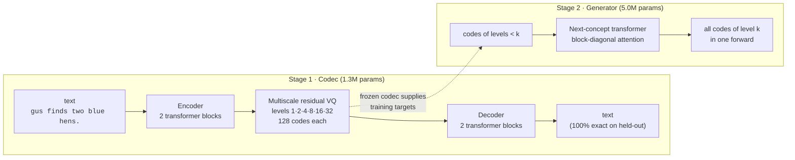
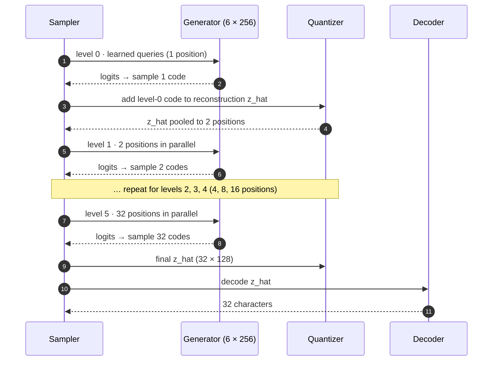

# ncm-mlx

**Coarse-to-fine text generation on Apple Silicon, in MLX.** An independent research implementation of the idea behind [Next-Concept Modeling](https://arxiv.org/abs/2610.14162) (Kumbong et al., HazyResearch, 2026): write a sentence as a rough sketch first, then refine it, filling every position of a level at once.

> [!WARNING]
> **Experimental research code.** Small models trained on a synthetic language and Sudoku, using Apple Silicon and NVIDIA GPUs. It is not a chat model, follows no instructions, and is not compatible with the released NCM checkpoints. It is not affiliated with Stanford or HazyResearch. Results are labelled with hardware, training budget and measurement conditions.

```
after level 0   eue likes one oed egg.      1 code      a rough guess at the whole sentence
after level 1   eve likes one oig egg.      2 codes
after level 2   dee likes one red egg.      4 codes     structure and most words settled
after level 3   dee likes one ret egg.      8 codes     ← a fine level breaks "red"
after level 5   dee likes one ret egg.      32 codes    final: invalid (spelling)
```
<sub>A real sample from the trained model (`mise run demo`), chosen because it shows both the refinement and the typical failure. 90% of samples at temperature 1.0 are valid; see [Results](#results).</sub>

---

## Contents

- [What it does](#what-it-does) · [How generation works](#how-generation-works) · [Quickstart](#quickstart) · [Results](#results)
- [What is faithful to NCM and what is not](#what-is-faithful-to-ncm-and-what-is-not) · [Limitations](#limitations) · [Roadmap](#roadmap)
- [For agents](#for-agents) · [Acknowledgements and citation](#acknowledgements-and-citation)

## What it does

An ordinary language model writes one token per model call: 32 characters means 32 calls in sequence. NCM splits generation into a few **levels**. Each level is one model call that predicts all of its positions in parallel, conditioned on the coarser levels before it. This repo uses 6 levels for 32 characters, so 6 calls instead of 32.

It takes two models, trained one after the other:



1. **Codec.** It learns to compress a sentence into a ladder of discrete codes and rebuild it. Level 0 is a single code for the gist; each finer level corrects what the coarser ones got wrong (a *residual*). This works like a progressive JPEG for text.
2. **Generator.** With the codec frozen, it learns to produce that ladder from the top down: given levels 0..k−1, predict every code of level k at once.

## How generation works

Generation as a call sequence, one arrow per real computation:



The generator makes 6 forward passes, whatever the batch size, plus one decoder pass. The repo's tests prove that running it level by level produces exactly the logits seen in training (`tests/test_mlx_core.py`).

## Quickstart

Requires an Apple Silicon Mac, [mise](https://mise.jdx.dev) and [uv](https://docs.astral.sh/uv/). Python 3.12 and MLX 0.32.3 are pinned.

```bash
git clone https://github.com/janmus1c/ncm-mlx.git && cd ncm-mlx
mise trust && mise install && mise run setup   # Python env, ~1 min
mise run smoke                                 # Metal check + one untrained step
mise run test                                  # core invariants and recovery tests
mise run train                                 # ~5.5 min on M5 Pro: codec 52 s, generator ~4.5 min
mise run demo                                  # level-by-level samples
mise run eval                                  # codec + sample quality (JSON)
mise run bench                                 # synchronized latency, batch 1–256
python -m ncm_mlx baseline --bench             # autoregressive baseline on the same data
```

| Command | Reads | Writes |
|---|---|---|
| `train` | `configs/toy-grammar-12k.json` | `artifacts/toy-grammar-12k/{codec,generator}.safetensors` + `.json` metadata |
| `demo`, `eval`, `bench` | the artifacts above | stdout; `--out file.json` |
| `baseline` | config | `artifacts/.../ar.safetensors` |

### The task: TinyWorld

A synthetic language with 15,360 sentences of the form `<name> <verb> <count> <adjective> <noun>.`, for example `ann sees two red cats.`. One rule spans the sentence: `one` takes a singular noun and any other count a plural, so a model that gets characters right independently will still break agreement. Every output is graded by a parser (`ncm_mlx/text/toygrammar.py`). Training uses 12,000 sentences; 1,000 are for validation and 2,360 are never seen, which measures generalisation, not memorisation.

## Results

Experiment E1 in [`docs/EXPERIMENTS.md`](docs/EXPERIMENTS.md). Hardware: M5 Pro, 64 GB, macOS 26.5, MLX 0.32.3. Other local GPU services were running (16% GPU utilisation before the run).

**Codec** (held-out): 100% of sentences rebuilt exactly; 100% codebook use at every level.

**Generator vs an autoregressive baseline** of the same width and depth, trained on identical data:

| | NCM (this repo) | Character AR + KV cache |
|---|---|---|
| Parameters | 1.3M codec + 5.0M generator | 4.8M |
| Training time | 52 s + 266 s | 134 s |
| Valid sentences, T = 1.0 | 89.8% | **98.6%** |
| Valid sentences, T = 0.7 | 95.8% | **99.8%** |
| Number agreement when well-formed | 99.8% | 100% |
| Valid *and* not in the training set, T = 1.0 | 16.3% | **23.5%** |
| Model calls per sequence | **6** + 1 decode | 32 |

**Latency.** p50 over 30 iterations after 3 warm-ups, timed until the tokens are copied back to the CPU:

| Batch | NCM p50 | AR p50 | NCM sequences/s | AR sequences/s |
|---|---|---|---|---|
| 1 | **4.5 ms** | 30.5 ms* | 222 | 33 |
| 16 | **5.8 ms** | 22.9 ms | 2,779 | 698 |
| 64 | **10.8 ms** | 26.9 ms | 5,907 | 2,383 |
| 256 | **37.8 ms** | 49.8 ms | 6,769 | 5,137 |

<sub>* AR batch-1 p50 was 19.8 ms in the otherwise identical E0 run; small-batch AR timings are sensitive to other GPU load. Peak memory at batch 256: NCM 1.7 GB, AR 0.46 GB.</sub>

**Reading.** On this task at this size, coarse-to-fine is 4–5× faster at small batches and 1.3× at batch 256. It is less accurate: about 9 points lower validity at T = 1.0. Its errors are mostly local spelling slips (`ret fox`, `coxs`), while the sentence-wide agreement rule is almost always kept. [E2](docs/EXPERIMENTS.md) shows these errors come from every level, not only the finest.

The upstream paper's 10–31× speedups compare NCM with **diffusion** language models on GPUs. Nothing here claims a speedup over large LLMs.

### Sudoku against the paper

Puzzle-conditioned models, scored on the paper's own published test boards (2,000 per difficulty) with its "solved" rule: a valid grid that keeps every given. Greedy decoding. E11, E14 and E15 trained on an RTX 3080; full recipes and timings are in [`docs/EXPERIMENTS.md`](docs/EXPERIMENTS.md).

| Model | Params | Training sequences | Easy (40 givens) | Medium (35) | Hard (30) |
|---|---|---|---|---|---|
| NCM, stronger corruption + unique puzzles (E15) | 6.4M | 8.2M | **96.2%** | **76.6%** | **31.9%** |
| NCM, conditioning corruption (E14) | 6.4M | 8.2M | 87.4% | 53.4% | 11.2% |
| AR, same width and depth (E11) | 6.3M | 2.05M | 20.5% | 4.9% | 0.5% |
| AR, original baseline (E4) | 6.3M | 0.64M | 13.8% | 3.0% | 0.4% |
| Qwen3.8 27B 4-bit, no reasoning, 50 boards each | 27B | Pretrained reference | 0% | 0% | 0% |
| AR greedy, paper | 25M | Not stated here | 14.6% | 5.1% | 1.0% |
| **NCM, paper** | 25M | 51M | **99.5%** | **96.5%** | **86.1%** |

The original AR baseline is close to the paper's AR row, which checks the boards, scoring and conditioning path. The best NCM result (E15) remains below the paper, especially on hard boards. At the matched 2.05M-sequence budget, NCM E11 solves 55.2 / 18.1 / 1.6% against AR's 20.5 / 4.9 / 0.5%; the larger-budget E15 comparison is not budget-matched. Training data and conditioning corruption are the strongest levers measured so far.

## What is faithful to NCM and what is not

| | Status |
|---|---|
| Two-stage codec → generator | Same as upstream |
| Multiscale residual VQ: area downsample, linear upsample, per-level blend conv, EMA codebooks, commitment loss, fine-level dropout | Same as upstream |
| Block-diagonal generator, per-level RoPE, level embeddings, QK-norm, learned level-0 queries | Same as upstream |
| Contextual encoder, LayerNorm pre-quant, decoder positions, dead-code restart | **Modified** for small scale |
| Character tokenizer instead of BPE | **Replaced** |
| Token-prefix conditioning (Sudoku puzzle cells) | Same idea as upstream's `raw_token_prefix` |
| Learned level-0 resampling | Same idea (`learned_l0`), single layer, lower codec learning rate |
| Codebook-tied heads, CFG, prefix KV cache | **Not implemented** |

Full source-by-source map: [`docs/research/upstream-map.md`](docs/research/upstream-map.md). No upstream code is copied.

## Limitations

- Synthetic language and Sudoku only; quality on real text is unknown.
- Conditioning is a fixed-length token prefix only (Sudoku). No prompts of free text, so not useful for summarisation, translation or instructions yet.
- Sudoku: 31.9% of hard boards solved in E15, against 86.1% in the paper, with different model size and training budget.
- Weights are incompatible with the released NCM checkpoints.
- Neither sampler uses `mx.compile`; the latency gap may shrink when both are compiled.
- On Metal, fp32 matmuls run at reduced precision (~1e-3 relative error, measured); exactness tests therefore run on the CPU device.
- No energy or power measurements.

## Roadmap


Next steps, in order: [`docs/NEXT.md`](docs/NEXT.md). Current state: [`docs/STATUS.md`](docs/STATUS.md).

Long runs support full-state pause/resume and atomic checkpoints. Start Mac experiments with `scripts/launch_experiment.sh` so terminal closure does not kill them. See [`docs/RECOVERY.md`](docs/RECOVERY.md) for pause signals, restart commands, pod recovery and the limits of legacy weights-only checkpoints.

## For agents

```yaml
repo: ncm-mlx
read_first: [AGENTS.md, docs/STATUS.md, docs/NEXT.md]
platform: Apple Silicon only for MLX code; portable tests run anywhere
setup: "mise trust && mise install && mise run setup"
verify: "mise run smoke && mise run test"
train: "mise run train"            # writes artifacts/toy-grammar-12k/
entrypoint: "python -m ncm_mlx {smoke,train,demo,eval,bench,baseline}"
default_config: configs/toy-grammar-12k.json
invariants:
  - per-level inference equals the teacher-forced forward (exact on mx.cpu)
  - one generator forward per level
  - benchmarks time through a host copy; never enqueue-only
  - codec accuracy and generator quality are reported separately
record_results_in: docs/EXPERIMENTS.md
```

| Path | Contents |
|---|---|
| `ncm_mlx/latent/` | `resample.py` level resampling matrices · `quantizer.py` multiscale residual VQ · `codec.py` encoder/decoder |
| `ncm_mlx/models/` | `blocks.py` transformer block · `generator.py` next-concept generator |
| `ncm_mlx/generation/sampler.py` | level-by-level sampling |
| `ncm_mlx/training/` | two-stage training, checkpoints |
| `ncm_mlx/eval/` | metrics, benchmark |
| `ncm_mlx/baselines/ar.py` | autoregressive baseline |
| `ncm_mlx/text/` | tokenizer, TinyWorld grammar and checker |
| `docs/` | status, decisions, experiments, ADRs, research |

## Acknowledgements and citation

The method is from **Hermann Kumbong, Ishan S. Khare, Iddah Mlauzi, Andrew Woen, Charles Ding, E. Kelly Buchanan, Simran Arora, Azalia Mirhoseini and Christopher Ré**: [paper](https://arxiv.org/abs/2610.14162), [code](https://github.com/HazyResearch/ncm) (MIT). Built with [MLX](https://github.com/ml-explore/mlx). If you use the method, cite the paper:

```bibtex
@misc{kumbong2026nextconcept,
  title         = {Next-Concept Modeling: Fast, Parallel Coarse-to-Fine Text Generation},
  author        = {Hermann Kumbong and Ishan S. Khare and Iddah Mlauzi and Andrew Woen and Charles Ding and E. Kelly Buchanan and Simran Arora and Azalia Mirhoseini and Christopher Ré},
  year          = {2026},
  eprint        = {2610.14162},
  archivePrefix = {arXiv},
  primaryClass  = {cs.CL},
  url           = {https://arxiv.org/abs/2610.14162}
}
```

This repository: MIT licence, see [`LICENSE`](LICENSE) and [`CITATION.cff`](CITATION.cff).
