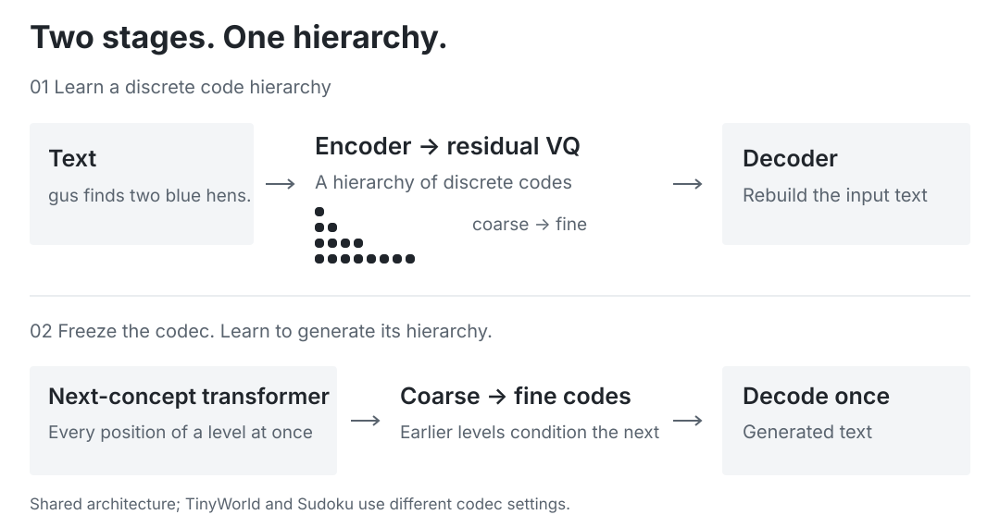
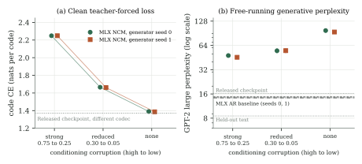
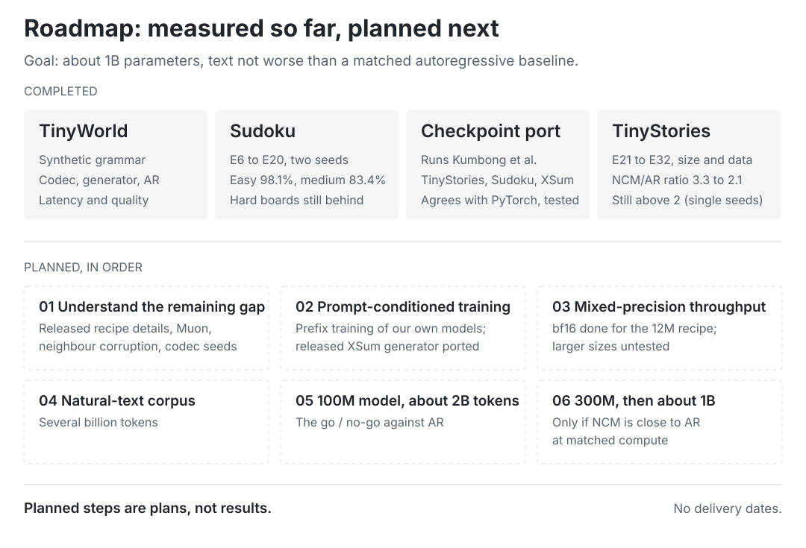

<h1 align="center">
  <picture>
    <source media="(prefers-color-scheme: dark)" srcset="assets/logo-dark.svg">
    
  </picture><br>
  NCM-MLX
</h1>
<p align="center"><strong>Next-Concept Modeling in MLX</strong><br>Parallel within a level. Coarse to fine across levels.</p>
<p align="center">
  <a href="https://janmus1c.github.io/ncm-mlx/">Documentation</a> ·
  <a href="#quickstart">Quickstart</a> ·
  <a href="#results">Results</a> ·
  <a href="paper/dist/ncm-mlx.pdf">Working paper</a> ·
  <a href="https://huggingface.co/spaces/janmusic/NCM-Refinement-Replay">Demo</a>
</p>
<p align="center">
  <a href="https://arxiv.org/abs/2610.14162"></a>
  <a href="https://doi.org/10.5281/zenodo.23781233"></a>
  <a href="https://doi.org/10.5281/zenodo.23620913"></a>
  <a href="https://pypi.org/project/ncm-mlx/"></a>
  <a href="https://huggingface.co/collections/janmusic/next-concept-modeling-in-mlx-6ae3b295f2ed5265df0906bf"></a>
  <a href="https://huggingface.co/spaces/janmusic/NCM-Refinement-Replay"></a>
  <a href="LICENSE"></a>
</p>

An independent [MLX](https://github.com/ml-explore/mlx) implementation of [Next-Concept Modeling](https://arxiv.org/abs/2610.14162), the method of Kumbong et al. (HazyResearch). NCM writes a whole level of the output in one model call, coarse to fine, instead of one token per call. This repository runs the released TinyStories, Sudoku and XSum checkpoints on the Apple Silicon GPU, with the same outputs as upstream PyTorch in the tested cases, and trains small NCM models from scratch on Metal or CUDA. The models trained here still lose clearly to an autoregressive baseline on text. It is research code, not a chat model, and it is not affiliated with Stanford or HazyResearch.

<picture>
  <source media="(prefers-color-scheme: dark) and (max-width: 600px)" srcset="docs/assets/level-vs-token-87m-animated-mobile-dark.svg">
  <source media="(max-width: 600px)" srcset="docs/assets/level-vs-token-87m-animated-mobile-light.svg">
  <source media="(prefers-color-scheme: dark)" srcset="docs/assets/level-vs-token-87m-animated-dark.svg">
  
</picture>

<sub>A real NCM sample from an 87M generator trained here on 4× more data in bf16 (GPT-2 large generative perplexity 24.40 over the whole model, against 11.48 for its AR baseline), not the released checkpoint: sample 0 of seed 0, the first of its seed and well formed by the selection rule, shown in full. The AR panel is our 91M autoregressive baseline replaying the same 128 tokens one call per token (forced decoding) to compare model calls for identical output; it is not an independent AR sample. The counter counts model calls, not time: an NCM call is larger and NCM adds a codec decode. Checkpoint hashes, every level and the AR's log-probability of each token are recorded next to the figure; see [demos](docs/demos.md), which also has the story and a Sudoku board in 12 passes.</sub>

## How it works

<picture>
  <source media="(prefers-color-scheme: dark) and (max-width: 600px)" srcset="docs/assets/architecture-mobile-dark.svg">
  <source media="(max-width: 600px)" srcset="docs/assets/architecture-mobile-light.svg">
  <source media="(prefers-color-scheme: dark)" srcset="docs/assets/architecture-dark.svg">
  
</picture>

Two models are trained one after the other. The codec compresses text into a ladder of discrete codes; each finer level corrects what the coarser ones got wrong, a bit like a progressive JPEG. With the codec frozen, the generator learns to produce the ladder from the top: given levels 0 to k−1, it predicts every code of level k in one forward pass. TinyWorld uses 6 levels for 32 characters, Sudoku 12 levels for 81 cells. The [architecture page](docs/architecture.md) walks through a real refinement trace and lists what matches upstream and what does not.

## Quickstart

```bash
pip install ncm-mlx
python -m ncm_mlx official fetch --task tinystories
python -m ncm_mlx official convert --task tinystories
python -m ncm_mlx official generate --task tinystories --n 2 --levels   # stories refined level by level
```

This runs the released TinyStories checkpoint on an Apple Silicon Mac; Linux with an NVIDIA GPU uses `pip install "ncm-mlx[cuda]"` ([platforms](docs/platforms.md)). The Sudoku checkpoints, benchmarks and parity script are in [released checkpoints](docs/official-checkpoints.md). Converted weights are also on Hugging Face: [NCM-TinyStories-89M-Upstream-MLX](https://huggingface.co/janmusic/NCM-TinyStories-89M-Upstream-MLX), [NCM-Sudoku-25M-Upstream-MLX](https://huggingface.co/janmusic/NCM-Sudoku-25M-Upstream-MLX).

To train from scratch, clone the repository and run `mise trust && mise install && mise run setup && mise run train`; the TinyWorld model takes about 5.5 minutes on an M5 Pro. See [training](docs/training.md) for TinyWorld and Sudoku, and [text training](docs/text-training.md) for TinyStories and [prompt continuation](docs/text-training.md#prompt-continuation-prefix-conditioning) with `official continue-text`.

## Results

| | MLX | Reference |
|---|---|---|
| Released Sudoku checkpoints, solved easy / medium / hard (2,000 boards each) | 99.40 / 96.30 / 86.20% | paper: 99.5 / 96.5 / 86.1% |
| Released XSum generator, greedy without guidance, ROUGE-1 / 2 / L on all 11,334 test articles | 34.93 / 12.71 / 27.94 | paper: 35.0 / 12.8 / 28.0 |
| Released checkpoints, greedy output against upstream PyTorch | identical on 8 TinyStories samples and all 2,000 easy boards | |
| Sudoku trained here, 6.44M generator, training seeds 0 / 1 | 98.10 / 83.40 / 40.30%<br>97.25 / 79.60 / 33.25% | Original NCM, 25.46M generator: 99.5 / 96.5 / 86.1% |
| Sudoku, NCM against AR at the same 2.05M-sequence budget (E11) | 55.2 / 18.1 / 1.6% | MLX AR: 20.5 / 4.9 / 0.5% |
| TinyWorld, valid sentences at temperature 1.0 (E1) | 89.8% | MLX AR: 98.6% |
| TinyStories trained here, 12M generator, three corruption schedules (E21–E24), GPT-2 large generative perplexity, lower is better | 45.6–97.8 | MLX AR: 14.3–14.7 |
| TinyStories trained here, 87M generator, 4× data in bf16 (E32), one training seed | 24.40 | MLX AR (91M): 11.48 |

The Sudoku models trained here saw 16.384M generator presentations against the paper's 51.2M, and the codec comes on top of the generator size, so the comparison with Original NCM is not matched. [Benchmarks](docs/benchmarks.md) has the full tables, latency and methodology; the [checkpoint port article](https://janmus1c.github.io/ncm-mlx/research/checkpoint-parity/), the [two-seed Sudoku assessment](docs/research/e20-seed-report.md) and the [controlled-text assessment](docs/research/e21-e23-assessment.md) give the evidence and its limits. [Capabilities](docs/capabilities.md) lists what is not supported.

The TinyStories result is negative but useful. In both generator seeds, less conditioning corruption lowers the clean teacher-forced loss and makes the generated text worse:



A larger generator and more data narrow the gap without closing it. With the same frozen codec, the ratio of NCM to AR generative perplexity falls from 3.33 for the 12M generator to 2.38 for 87M at the original data, and to 2.13 for 87M with four times the data. Each point is one training seed (the step from 50M to 87M is smaller than the difference between two seeds), compute is not matched, and the 4× runs train in bf16; see [E30 to E32](docs/EXPERIMENTS.md#e32-50m-and-87m-generators-at-four-times-the-data-bf16-2026-11-04).

## Roadmap

<picture>
  <source media="(prefers-color-scheme: dark) and (max-width: 600px)" srcset="docs/assets/roadmap-2026-11-mobile-dark.svg">
  <source media="(max-width: 600px)" srcset="docs/assets/roadmap-2026-11-mobile-light.svg">
  <source media="(prefers-color-scheme: dark)" srcset="docs/assets/roadmap-2026-11-dark.svg">
  
</picture>

The long-term aim is a model of about 1B parameters that writes good text and is no worse than an autoregressive baseline trained with the same compute. Nothing here shows that NCM can get there yet, and the larger steps only happen if the small-scale gap closes. The plans have no dates. Details and completion criteria are in [NEXT](docs/NEXT.md), the current state in [STATUS](docs/STATUS.md), and new versions appear in the [research updates feed](https://janmus1c.github.io/ncm-mlx/feed.xml).

## Citation

If you use the method, cite the paper by Kumbong et al.:

```bibtex
@misc{kumbong2026nextconcept,
  title         = {Next-Concept Modeling: Fast, Parallel Coarse-to-Fine Text Generation},
  author        = {Hermann Kumbong and Ishan S. Khare and Iddah Mlauzi and Andrew Woen and Charles Ding and E. Kelly Buchanan and Simran Arora and Azalia Mirhoseini and Christopher Ré},
  year          = {2026},
  eprint        = {2610.14162},
  archivePrefix = {arXiv},
  primaryClass  = {cs.CL},
  url           = {https://arxiv.org/abs/2610.14162}
}
```

To cite this implementation, use the [archived software](https://doi.org/10.5281/zenodo.23781233) (this DOI covers all versions from 0.2.0 and resolves to the latest; v0.4.0: [10.5281/zenodo.23953482](https://doi.org/10.5281/zenodo.23953482)) and the [working paper v0.13](https://doi.org/10.5281/zenodo.23953213) (all versions: [10.5281/zenodo.23620913](https://doi.org/10.5281/zenodo.23620913)), which reports the experiments and limitations and has not been peer reviewed. [`CITATION.cff`](CITATION.cff) has the metadata.

## License and acknowledgements

MIT licence, see [`LICENSE`](LICENSE), with provenance notes in [`THIRD_PARTY.md`](THIRD_PARTY.md). The source release contains no model weights or downloaded evaluation data; the weights trained here are on Hugging Face: Sudoku [NCM-Sudoku-6.4M-MLX](https://huggingface.co/janmusic/NCM-Sudoku-6.4M-MLX), TinyWorld [NCM-TinyWorld-5M-MLX](https://huggingface.co/janmusic/NCM-TinyWorld-5M-MLX), and the 87M TinyStories NCM and its 91M AR baseline from the scaling study, [NCM-TinyStories-87M-MLX](https://huggingface.co/janmusic/NCM-TinyStories-87M-MLX) and [AR-TinyStories-91M-MLX](https://huggingface.co/janmusic/AR-TinyStories-91M-MLX).

The method, the released checkpoints and the reference [PyTorch code](https://github.com/HazyResearch/ncm) (MIT) are by Hermann Kumbong, Ishan S. Khare, Iddah Mlauzi, Andrew Woen, Charles Ding, E. Kelly Buchanan, Simran Arora, Azalia Mirhoseini and Christopher Ré. No upstream code is copied here. The XSum and WMT14 codec support and prompt-prefix training in 0.3.0 follow work by Red-fuchs in [ncm-modular](https://github.com/Red-fuchs/ncm-modular). Built with [MLX](https://github.com/ml-explore/mlx).

To contribute or reproduce an experiment, start with [`CONTRIBUTING.md`](CONTRIBUTING.md). Automated tools can start from [`AGENTS.md`](AGENTS.md) and [`llms.txt`](llms.txt).
