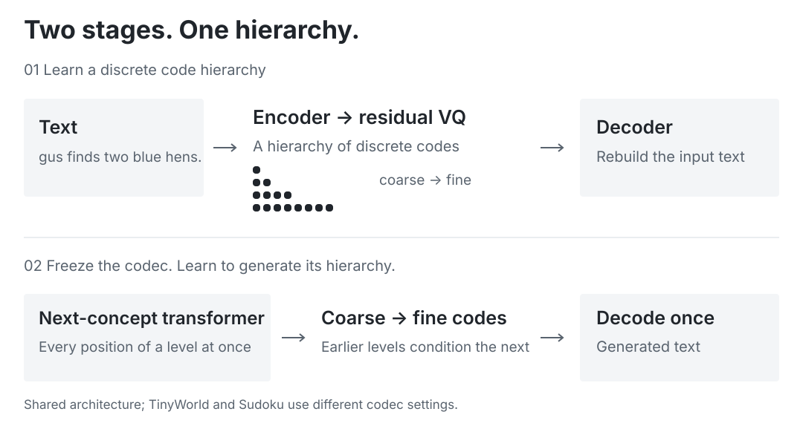
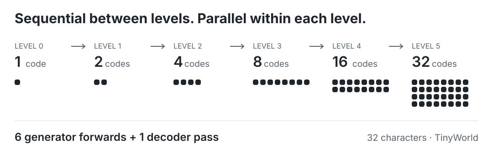
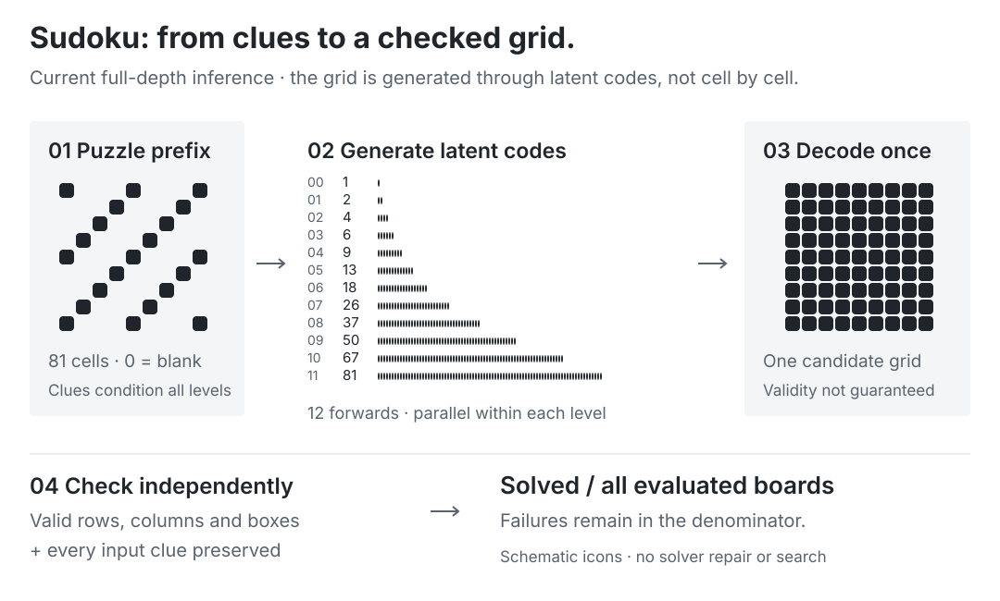
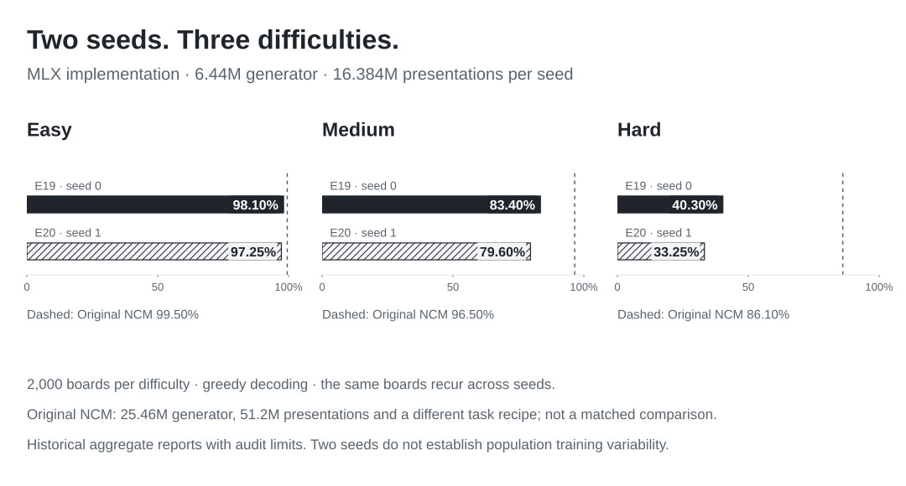
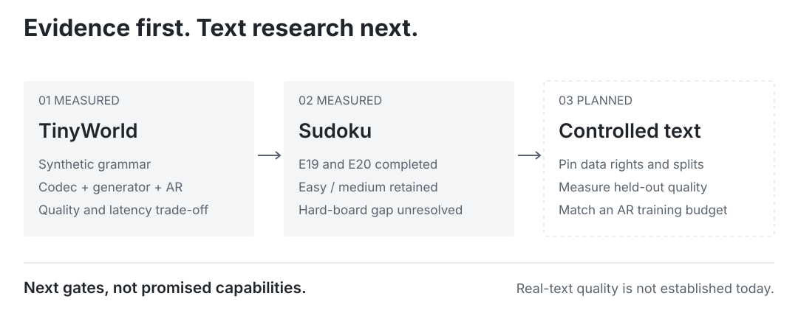

<h1 align="center">
  <picture>
    <source media="(prefers-color-scheme: dark)" srcset="assets/logo-dark.svg">
    
  </picture><br>
  NCM-MLX
</h1>
<p align="center"><strong>Next-Concept Modeling in MLX</strong><br>Parallel within a level. Coarse to fine across levels.</p>
<p align="center">
  <a href="https://janmus1c.github.io/ncm-mlx/">Documentation</a> ·
  <a href="#quickstart">Quickstart</a> ·
  <a href="docs/benchmarks.md">Benchmarks</a> ·
  <a href="paper/dist/ncm-mlx.pdf">Working paper</a>
</p>
<p align="center">
  <a href="https://doi.org/10.5281/zenodo.23620791"></a>
  <a href="https://doi.org/10.5281/zenodo.23620913"></a>
  <a href="https://pypi.org/project/ncm-mlx/"></a>
  <a href="https://huggingface.co/collections/janmusic/next-concept-modeling-in-mlx-6ae3b295f2ed5265df0906bf"></a>
  <a href="https://github.com/janmus1c/ncm-mlx/actions/workflows/ci.yml"></a>
  <a href="LICENSE"></a>
</p>

<picture>
  <source media="(prefers-color-scheme: dark) and (max-width: 600px)" srcset="docs/assets/refinement-mobile-dark.svg">
  <source media="(max-width: 600px)" srcset="docs/assets/refinement-mobile-light.svg">
  <source media="(prefers-color-scheme: dark)" srcset="docs/assets/refinement-dark.svg">
  
</picture>

**Parallel, coarse-to-fine text generation in MLX.** Instead of one token per model call, each level is one call that predicts every position at once, conditioned on the coarser levels before it. An independent implementation of [Next-Concept Modeling](https://arxiv.org/abs/2610.14162) by Kumbong et al., trained from scratch on consumer GPUs.

**Evidence (2026-10-27).** Funded Sudoku recipe, two training seeds (E20): **97.25 / 79.60 / 33.25%** easy/medium/hard, against seed 0's **98.10 / 83.40 / 40.30%**, at equal exposure. This is a partial small-generator success with a substantial hard-board gap; the [two-seed assessment](docs/research/e20-seed-report.md) explains the results and audit limits. Controlled text generation is the next research direction; it is not a supported capability yet.

```bash
git clone https://github.com/janmus1c/ncm-mlx.git && cd ncm-mlx
mise trust && mise install && mise run setup   # Apple Silicon; Linux CUDA: docs/platforms.md
mise run train && mise run demo                # ~5.5 min on M5 Pro, then level-by-level samples
```

**Cite:** [archived software v0.1.1](https://doi.org/10.5281/zenodo.23780571) and the [working paper v0.11](https://doi.org/10.5281/zenodo.23686842) (not peer reviewed). For the method itself, cite [Kumbong et al.](#acknowledgements-and-citation).

> [!WARNING]
> **Experimental research code.** Small models trained on a synthetic language and Sudoku, using Apple Silicon and NVIDIA GPUs. It is not a chat model, follows no instructions, and is not compatible with the released NCM checkpoints. It is not affiliated with Stanford or HazyResearch. Results are labelled with hardware, training budget and measurement conditions.

An independent [MLX](https://github.com/ml-explore/mlx) implementation of [Next-Concept Modeling (NCM)](https://arxiv.org/abs/2610.14162): **parallel, coarse-to-fine text generation** with multiscale residual vector quantization. The non-autoregressive generator predicts a whole level of discrete latent codes per forward pass, rather than one text token at a time. This repository supports training from scratch, sampling, evaluation and synchronized comparisons with a character-level autoregressive baseline.

MLX makes these experiments runnable on consumer Apple Silicon GPUs; Linux NVIDIA CUDA execution is also verified. The current tasks are TinyWorld synthetic text and puzzle-conditioned Sudoku. General-purpose language modeling and instruction following are not demonstrated. The architecture belongs to Kumbong et al. (HazyResearch, 2026); this project independently investigates its implementation and small-model behavior.

[Documentation](https://janmus1c.github.io/ncm-mlx/) · [Architecture](docs/architecture.md) · [Training](docs/training.md) · [Benchmarks](docs/benchmarks.md) · [Platforms](docs/platforms.md) · [Related work](docs/related-work.md)

## Contents

- [What it does](#what-it-does) · [How generation works](#how-generation-works) · [Quickstart](#quickstart) · [Results](#results)
- [What is faithful to NCM and what is not](#what-is-faithful-to-ncm-and-what-is-not) · [Limitations](#limitations) · [Roadmap](#roadmap)
- [For agents](#for-agents) · [Acknowledgements and citation](#acknowledgements-and-citation)

## What it does

An ordinary language model writes one token per model call: 32 characters means 32 calls in sequence. NCM splits generation into a few **levels**. Each level is one model call that predicts all of its positions in parallel, conditioned on the coarser levels before it. The TinyWorld recipe uses 6 levels for 32 characters: 6 generator calls and one final codec decode. Sudoku uses 12 levels for 81 cells.

It takes two models, trained one after the other:

<picture>
  <source media="(prefers-color-scheme: dark) and (max-width: 600px)" srcset="docs/assets/architecture-mobile-dark.svg">
  <source media="(max-width: 600px)" srcset="docs/assets/architecture-mobile-light.svg">
  <source media="(prefers-color-scheme: dark)" srcset="docs/assets/architecture-dark.svg">
  
</picture>

1. **Codec.** It learns to compress a sentence into a ladder of discrete codes and rebuild it. Level 0 is a single coarse code; each finer level corrects what the coarser ones got wrong (a *residual*). This works like a progressive JPEG for text.
2. **Generator.** With the codec frozen, it learns to produce that ladder from the top down: given levels 0..k−1, predict every code of level k at once.

## How generation works

<picture>
  <source media="(prefers-color-scheme: dark) and (max-width: 600px)" srcset="docs/assets/generation-mobile-dark.svg">
  <source media="(max-width: 600px)" srcset="docs/assets/generation-mobile-light.svg">
  <source media="(prefers-color-scheme: dark)" srcset="docs/assets/generation-dark.svg">
  
</picture>

The generator makes 6 forward passes, whatever the batch size, plus one decoder pass. The repo's tests prove that running it level by level produces exactly the logits seen in training (`tests/test_mlx_core.py`).


<details>
<summary>A real refinement trace, including its failure</summary>

```
after level 0   eue likes one oed egg.      1 code      a rough guess at the whole sentence
after level 1   eve likes one oig egg.      2 codes
after level 2   dee likes one red egg.      4 codes     structure and most words settled
after level 3   dee likes one ret egg.      8 codes     ← a fine level breaks "red"
after level 5   dee likes one ret egg.      32 codes    final: invalid (spelling)
```
<sub>A real sample from the trained model (`mise run demo`), chosen because it shows both the refinement and the typical failure. 90% of samples at temperature 1.0 are valid; see [Results](#results).</sub>


</details>

## Quickstart

The commands below target an Apple Silicon Mac with [mise](https://mise.jdx.dev) and [uv](https://docs.astral.sh/uv/). Python 3.12 and MLX 0.32.3 are pinned. For Linux NVIDIA CUDA installation or portable tests without MLX, see [supported platforms](docs/platforms.md).

```bash
git clone https://github.com/janmus1c/ncm-mlx.git && cd ncm-mlx
mise trust && mise install && mise run setup   # Python env, ~1 min
mise run smoke                                 # Metal check + one untrained step
mise run test                                  # core invariants and recovery tests
mise run train                                 # ~5.5 min on M5 Pro: codec 52 s, generator ~4.5 min
mise run demo                                  # level-by-level samples
mise run eval                                  # codec + sample quality (JSON)
mise run bench                                 # synchronized latency, batch 1–256
uv run python -m ncm_mlx baseline --config configs/toy-grammar-12k.json --bench
```

| Command | Reads | Writes |
|---|---|---|
| `train` | `configs/toy-grammar-12k.json` | `artifacts/toy-grammar-12k/{codec,generator}.safetensors` + `.json` metadata |
| `demo`, `eval`, `bench` | the artifacts above | stdout; `--out file.json` |
| `baseline` | config | `artifacts/.../ar.safetensors` |

### The task: TinyWorld

A synthetic language with 15,360 sentences of the form `<name> <verb> <count> <adjective> <noun>.`, for example `ann sees two red cats.`. One rule spans the sentence: `one` takes a singular noun and any other count a plural, so a model that gets characters right independently will still break agreement. Every output is graded by a parser (`ncm_mlx/text/toygrammar.py`). Training uses 12,000 sentences; 1,000 are for validation and 2,360 are never seen, which measures generalisation, not memorisation.

## Results

Experiment E1 in [`docs/EXPERIMENTS.md`](docs/EXPERIMENTS.md). Hardware: M5 Pro, 64 GB, macOS 26.5, MLX 0.32.3. Other local GPU services were running (16% GPU utilisation before the run).

**Codec** (held-out): 100% of sentences rebuilt exactly; 100% codebook use at every level.

**Generator vs an autoregressive baseline** of the same width and depth, trained on identical data:

| | MLX implementation | MLX AR baseline + KV cache |
|---|---|---|
| Parameters | 1.3M codec + 5.0M generator | 4.8M |
| Training time | 52 s + 266 s | 134 s |
| Valid sentences, T = 1.0 | 89.8% | **98.6%** |
| Valid sentences, T = 0.7 | 95.8% | **99.8%** |
| Number agreement when well-formed | 99.8% | 100% |
| Valid *and* not in the training set, T = 1.0 | 16.3% | **23.5%** |
| Model calls per sequence | **6** + 1 decode | 32 |

**Latency.** p50 over 30 iterations after 3 warm-ups, timed until the tokens are copied back to the CPU:

| Batch | MLX implementation p50 | MLX AR baseline p50 | MLX implementation sequences/s | MLX AR baseline sequences/s |
|---|---|---|---|---|
| 1 | **4.5 ms** | 30.5 ms* | 222 | 33 |
| 16 | **5.8 ms** | 22.9 ms | 2,779 | 698 |
| 64 | **10.8 ms** | 26.9 ms | 5,907 | 2,383 |
| 256 | **37.8 ms** | 49.8 ms | 6,769 | 5,137 |

<sub>* AR batch-1 p50 was 19.8 ms in the otherwise identical E0 run; small-batch AR timings are sensitive to other GPU load. Peak memory at batch 256: NCM 1.7 GB, AR 0.46 GB.</sub>

**Reading.** On this task at this size, the recorded small-batch latency advantage varies with GPU contention; batch 16 is about 4× faster and batch 256 about 1.3× faster. It is less accurate: about 9 points lower validity at T = 1.0. Its errors are mostly local spelling slips (`ret fox`, `coxs`), while the sentence-wide agreement rule is almost always kept. [E2](docs/EXPERIMENTS.md) shows these errors come from every level, not only the finest.

The upstream paper's 10–31× speedups compare NCM with **diffusion** language models on GPUs. Nothing here claims a speedup over large LLMs.

### MLX implementation compared with Original NCM

“MLX implementation” means this repository’s independently trained NCM model; “Original NCM” means the model reported by Kumbong et al. These are different implementations and checkpoints. All E-numbered runs are local MLX experiments.

<picture>
  <source media="(prefers-color-scheme: dark) and (max-width: 600px)" srcset="docs/assets/sudoku-generation-mobile-dark.svg">
  <source media="(max-width: 600px)" srcset="docs/assets/sudoku-generation-mobile-light.svg">
  <source media="(prefers-color-scheme: dark)" srcset="docs/assets/sudoku-generation-dark.svg">
  
</picture>

Puzzle-conditioned models, scored on Kumbong et al.’s published test boards (2,000 per difficulty) with its "solved" rule: a valid grid that keeps every given. Greedy decoding. E11, E14 and E15 trained on an RTX 3080; full recipes and timings are in [`docs/EXPERIMENTS.md`](docs/EXPERIMENTS.md).

| Model | Generator params | Generator presentations | Easy (40 givens) | Medium (35) | Hard (30) |
|---|---|---|---|---|---|
| **MLX implementation, larger corpus and schedule (E19-funded)** | 6.44M | 16.384M | **98.10%** | **83.40%** | **40.30%** |
| MLX implementation, same recipe with training seed 1 (E20) | 6.44M | 16.384M | 97.25% | 79.60% | 33.25% |
| MLX implementation, stronger corruption + unique puzzles (E15) | 6.4M | 8.2M | 96.25% | 76.65% | 31.90% |
| MLX implementation, conditioning corruption (E14) | 6.4M | 8.2M | 87.4% | 53.4% | 11.2% |
| MLX AR baseline, same width and depth (E11) | 6.3M | 2.05M | 20.5% | 4.9% | 0.5% |
| MLX AR baseline (E4) | 6.3M | 0.64M | 13.8% | 3.0% | 0.4% |
| Qwen3.8 27B 4-bit, no reasoning, 50 boards each | 27B | Pretrained reference | 0% | 0% | 0% |
| Original AR baseline (Kumbong et al.) | 25M | Not stated here | 14.6% | 5.1% | 1.0% |
| **Original NCM (Kumbong et al.)** | 25.46M | 51.2M | **99.5%** | **96.5%** | **86.1%** |

The MLX AR baseline is close to the Original AR baseline row, a limited sanity check on the boards, scoring and conditioning path. The best local NCM result (E19-funded) remains below the paper, especially on hard boards. At the matched 2.05M-sequence budget, NCM E11 solves 55.2 / 18.1 / 1.6% against AR's 20.5 / 4.9 / 0.5%; the larger-budget E15 and E19-funded comparisons are not budget-matched. Training data and conditioning corruption are the strongest levers measured so far. These parameter columns count generators; the Sudoku codec stores another 13.9M scalar values, including learned resampling layers and EMA state. See [parameter accounting and measurement limits](docs/benchmarks.md).

<picture>
  <source media="(prefers-color-scheme: dark) and (max-width: 600px)" srcset="docs/assets/sudoku-seeds-mobile-dark.svg">
  <source media="(max-width: 600px)" srcset="docs/assets/sudoku-seeds-mobile-light.svg">
  <source media="(prefers-color-scheme: dark)" srcset="docs/assets/sudoku-seeds-dark.svg">
  
</picture>

Both seeds use the same scientific recipe and 16.384M generator presentations. E19-funded remains the best observed seed; E20 is 0.85, 3.80 and 7.05 percentage points lower on easy, medium and hard boards. Two seeds do not establish population training variability or identify the cause. Historical aggregate reports lack per-board predictions and complete remote evaluation/source manifests; see the [two-seed assessment](docs/research/e20-seed-report.md).

**Smaller-generator result.** The MLX implementation reaches **98.10% on easy boards versus Original NCM’s 99.50%**, using a **6.44M versus 25.46M generator** (3.95× smaller) and **16.384M versus 51.2M generator presentations**. Medium and hard remain 13.10 and 45.80 percentage points behind. The size ratio covers generators only: the MLX codec stores another 13.9M values. Different recipes and system costs prevent an overall efficiency or parity claim.

**Interruption study (E17).** The completed weights-only continuation solves **71.25 / 31.75 / 3.70%**, close to E13. Its optimizer and random state reset after interruption, so it does not establish a benefit from its data construction. E18 subsequently completed at **84.25 / 49.10 / 10.55%**, below E15; stronger corruption alone did not improve the base-data comparison at this budget. [Reproduction and uncertainty](docs/reproducibility.md) explain which comparisons can be repeated and what the numbers establish.

## What is faithful to NCM and what is not

| | Status |
|---|---|
| Two-stage codec → generator | Same as upstream |
| Multiscale residual VQ: area downsample, linear upsample, per-level blend conv, EMA codebooks, commitment loss, fine-level dropout | Same as upstream |
| Block-diagonal generator, per-level RoPE, level embeddings, QK-norm, learned level-0 queries | Same as upstream |
| Encoder and pre-quant norm | TinyWorld: contextual encoder / LayerNorm; later Sudoku: lookup encoder / GroupNorm |
| Decoder positions, dead-code restart | **Modified** for small scale |
| Character tokenizer instead of BPE | **Replaced** |
| Token-prefix conditioning (Sudoku puzzle cells) | Same idea as upstream's `raw_token_prefix` |
| Learned level-0 resampling | Same idea (`learned_l0`), single layer, lower codec learning rate |
| Codebook-tied generator heads, CFG, prefix KV cache | **Not implemented** |

Full source-by-source map: [`docs/research/upstream-map.md`](docs/research/upstream-map.md). No upstream code is copied.

## Limitations

- Synthetic language and Sudoku only; quality on real text is unknown.
- Conditioning is a fixed-length token prefix only (Sudoku). No prompts of free text, so not useful for summarisation, translation or instructions yet.
- Sudoku: 33.25–40.30% of hard boards solved across E20 and E19-funded, against 86.1% for Original NCM (Kumbong et al.), with different model size and training budget.
- Weights are incompatible with the released NCM checkpoints.
- Generator training can use `mx.compile`; neither inference sampler is compiled. The latency gap may change when both samplers are compiled.
- On Metal, fp32 matmuls run at reduced precision (~1e-3 relative error, measured); exactness tests therefore run on the CPU device.
- No energy or power measurements.

## Roadmap

<picture>
  <source media="(prefers-color-scheme: dark) and (max-width: 600px)" srcset="docs/assets/research-path-mobile-dark.svg">
  <source media="(max-width: 600px)" srcset="docs/assets/research-path-mobile-light.svg">
  <source media="(prefers-color-scheme: dark)" srcset="docs/assets/research-path-dark.svg">
  
</picture>

The core implementation, toy comparison and full-state recovery are complete. Planned research tracks are:

1. Extend the completed Sudoku evidence with bounded training runs, multiple seeds and matched-budget AR comparisons.
2. Compare against released upstream checkpoints using the same evaluator.
3. Build a real-text workflow: training, visible coarse-to-fine samples, held-out benchmarks and a matched AR baseline, followed by conditional task examples and a local demo.
4. Independently test level budgets, verified Sudoku early exit and prefix caching, preserving full-depth baselines and exactness checks.
5. Compile both samplers and repeat synchronized timing comparisons.

The completed **E19-funded** run is the new local best: **98.10 / 83.40 / 40.30%** solved on easy/medium/hard boards (2,000 each). It uses 16.384M generator presentations, twice E15's budget; it does not establish an equal-budget advantage. The short E19 pilot scores 90.20 / 59.75 / 16.55% at 3.059M presentations. [Full report and machine-readable results](docs/research/e19-funded-report.md) retain timings, checkpoint identity, uncertainty, failures and comparison limits. E20 completed the same recipe with seed 1 at 97.25 / 79.60 / 33.25%; both seeds and their evidence limits are retained in the [assessment](docs/research/e20-seed-report.md). The original million-step recipe remains unstarted.

Compute scenarios and planned level budgets: [roadmap projections](docs/research/planning-projections.md). Priorities, dependencies and completion criteria: [`docs/NEXT.md`](docs/NEXT.md). Current state: [`docs/STATUS.md`](docs/STATUS.md). Follow releases through the [research updates feed](https://janmus1c.github.io/ncm-mlx/feed.xml).

The [prefix-caching and speculative-drafting review](docs/research/prefix-caching-and-speculative-drafting.md) connects primary literature to this implementation, with [proposed experiments](docs/research/inference-experiment-protocol.md). It separates analytic opportunities from measured performance and future text capabilities.

Long runs support full-state pause/resume and atomic checkpoints. Start Mac experiments with `scripts/launch_experiment.sh` so terminal closure does not kill them. See [`docs/RECOVERY.md`](docs/RECOVERY.md) for pause signals, restart commands, pod recovery and the limits of legacy weights-only checkpoints.

## For agents

```yaml
repo: ncm-mlx
read_first: [AGENTS.md, docs/STATUS.md, docs/NEXT.md]
platform: "MLX Metal on Apple Silicon; MLX CUDA on verified Linux NVIDIA systems"
setup: "mise trust && mise install && mise run setup"
verify: "mise run smoke && mise run test"
train: "mise run train"            # writes artifacts/toy-grammar-12k/
entrypoint: "python -m ncm_mlx {smoke,train,demo,eval,bench,baseline}"
default_config: configs/toy-grammar-12k.json
invariants:
  - per-level inference equals the teacher-forced forward (exact on mx.cpu)
  - one generator forward per level
  - benchmarks time through a host copy; never enqueue-only
  - codec accuracy and generator quality are reported separately
record_results_in: docs/EXPERIMENTS.md
```

| Path | Contents |
|---|---|
| `ncm_mlx/latent/` | `resample.py` level resampling matrices · `quantizer.py` multiscale residual VQ · `codec.py` encoder/decoder |
| `ncm_mlx/models/` | `blocks.py` transformer block · `generator.py` next-concept generator |
| `ncm_mlx/generation/sampler.py` | level-by-level sampling |
| `ncm_mlx/training/` | two-stage training, checkpoints |
| `ncm_mlx/eval/` | metrics, benchmark |
| `ncm_mlx/baselines/ar.py` | autoregressive baseline |
| `ncm_mlx/text/` | tokenizer, TinyWorld grammar and checker |
| `docs/` | status, decisions, experiments, ADRs, research |

## Acknowledgements and citation

The method is from **Hermann Kumbong, Ishan S. Khare, Iddah Mlauzi, Andrew Woen, Charles Ding, E. Kelly Buchanan, Simran Arora, Azalia Mirhoseini and Christopher Ré**: [paper](https://arxiv.org/abs/2610.14162), [code](https://github.com/HazyResearch/ncm) (MIT). Built with [MLX](https://github.com/ml-explore/mlx). If you use the method, cite the paper:

```bibtex
@misc{kumbong2026nextconcept,
  title         = {Next-Concept Modeling: Fast, Parallel Coarse-to-Fine Text Generation},
  author        = {Hermann Kumbong and Ishan S. Khare and Iddah Mlauzi and Andrew Woen and Charles Ding and E. Kelly Buchanan and Simran Arora and Azalia Mirhoseini and Christopher Ré},
  year          = {2026},
  eprint        = {2610.14162},
  archivePrefix = {arXiv},
  primaryClass  = {cs.CL},
  url           = {https://arxiv.org/abs/2610.14162}
}
```

Cite this implementation using the [archived software v0.1.1](https://doi.org/10.5281/zenodo.23780571). The companion [working paper v0.11](https://doi.org/10.5281/zenodo.23686842) reports the experiments and limitations; it has not been peer reviewed.

This repository: MIT licence, see [`LICENSE`](LICENSE), [`THIRD_PARTY.md`](THIRD_PARTY.md) and [`CITATION.cff`](CITATION.cff). No model weights or downloaded evaluation data are redistributed in the source release. The trained Sudoku and TinyWorld weights are published separately on Hugging Face: [ncm-mlx-sudoku](https://huggingface.co/janmusic/ncm-mlx-sudoku) and [ncm-mlx-tinyworld](https://huggingface.co/janmusic/ncm-mlx-tinyworld). To contribute or reproduce an experiment, start with [`CONTRIBUTING.md`](CONTRIBUTING.md). The [capability overview](docs/capabilities.md), [`AGENTS.md`](AGENTS.md) and [`llms.txt`](llms.txt) provide concise entry points for automated tools.
