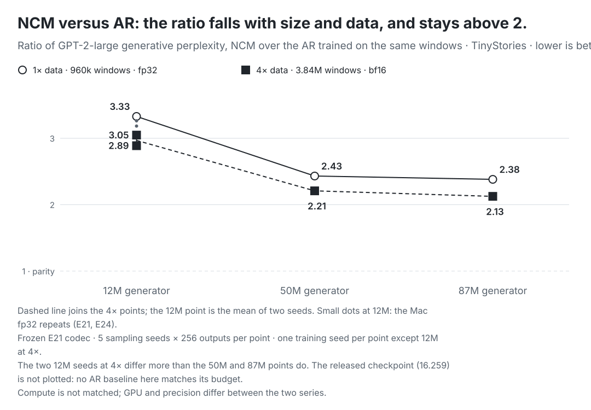

# Experiments

Every measured run, newest first. Unless a run specifies another device, hardware is Apple M5 Pro, 64 GB, macOS 26.5, MLX 0.32.3, Python 3.12.14. Raw JSON is written to `runs/` (gitignored); the numbers below are copied from it.

**Model labels.** All E-numbered NCM experiments below use this repository’s MLX implementation. “Original NCM (Kumbong et al.)” and “Original AR baseline” denote cited results from the original study; these were not measured here. “Published easy/medium/hard” identifies their shared test boards, not the model being scored.

**GPU contention.** Mac experiments generally ran alongside other local GPU services; per-run notes record exceptions and other hardware. `ioreg` reported 15% GPU utilisation from other processes just before the v0 benchmark started. Treat those latency numbers as "typical busy desktop" rather than an idle machine.

## Official checkpoints: XSum summarisation and ROUGE (2026-11-03)

Inference only, no training. The released XSum generator and codec of Kumbong et al. (same pinned upstream code and checkpoint revisions as the TinyStories and Sudoku port) are converted and run by `python -m ncm_mlx official summarize --task xsum`. Commands, the readout (frequency penalty, allowance and adjacency rules), the cache and the limits are in [released checkpoints](official-checkpoints.md); the parity script is `scripts/official_xsum_parity.py`. These are upstream-trained weights, not models trained here.

**Parity (CPU, upstream PyTorch 2.15.0 and upstream code `c702742`).** Eight fixed inputs: test articles 0 to 3 and four raw texts. GPT-2 encoding (11 cases, 500 references) and decoding (201 id rows) are identical. Free-running greedy codes at all nine levels are identical for the eight inputs, and the penalised readout gives identical ids and texts for 8 of 8. Teacher-forced per-level logits differ by at most 6.7e-4 in fp32 (logit scale up to 1,118) and 6.8e-13 in exact fp64; fp32 rounding itself is 7.6e-4 for upstream and 5.4e-4 for MLX against the fp64 reference. Final decoder logits differ by 3.7e-4 at scale 41. Classifier-free guidance at 1.0 gives identical codes with raw logits within 7.9e-4. The prefix cache and the recompute path agree exactly.

**ROUGE (MLX, Metal, batch 16, seed 0, F-measure with stemming, scores × 100).**

| Articles | Setting | R-1 | R-2 | R-L | Mean words |
|---|---|---:|---:|---:|---:|
| 11,334 (full test set) | released defaults, greedy | 34.93 | 12.71 | 27.94 | 20.7 |
| 11,334 | guidance 1.0 | 35.15 | 12.61 | 27.98 | 20.6 |
| 11,334 | guidance 0.5 | 35.20 | 12.83 | 28.11 | 20.6 |
| Quoted from Kumbong et al., Sec. 4.3 and Table 2 | no guidance, "8 NFE" | 35.0 | 12.8 | 28.0 | n/a |
| Quoted from Kumbong et al., Sec. 4.3 and Table 2 | with guidance, "16 NFE" | 35.3 | 13.0 | 28.2 | n/a |
| 200, random sample | released defaults | 34.51 | 12.72 | 27.55 | 20.4 |
| 200, same sample, CPU | released defaults | 34.63 | 12.64 | 27.50 | 20.4 |
| 200, same sample | no penalties | 34.51 | 12.73 | 27.48 | 20.5 |

On the full test set the default run is within 0.1 of the quoted scores on all three measures. The paper reports its guided row at guidance weight 0.5 (its Appendix F.4 and Figure 14, where the ROUGE curves peak); at 0.5 the port is within 0.2 of the quoted guided scores on all three measures, and at 1.0 it is lower on ROUGE-2 and ROUGE-L. The paper counts generator calls per output (8 for XSum, two per guided step), whereas this port makes 9 generator forwards (a level-0 query pass plus eight); presumably the paper does not count the level-0 pass, which is not confirmed. The 200-article rows are samples, with about 0.4 R-1 of noise between sets. On the 200-article sample the CPU run reproduces 181 of the 200 Metal summaries; reduced-precision Metal matrix products flip near-ties. Speed on the M5 Pro (MLX 0.32.4, busy desktop, 200 articles, excluding ROUGE): 20.4 articles/s at batch 1 and 36.1 at batch 16 (10.9 without the prefix cache), 0.9 and 2.8 GB peak MLX memory; the full test set at batch 16 took 317 s.

**Limits.** The summaries are fluent-looking but contain broken words and wrong facts (for example "herptptathlon" and a different team and score than the source), and ROUGE overlap does not measure faithfulness. Only greedy decoding is checked against upstream; minimum-Bayes-risk decoding and sampled outputs are not. There is no Metal parity run. The decode follows `transformers` 5.x defaults without the optional space clean-up; whether 4.x defaults clean up differs, and ROUGE is unchanged at two decimals on the sample. The penalty readout has no visible ROUGE effect at 200 articles although it changes every parity text. Training XSum is out of scope here, and `bench` does not time summarisation.

## E32: 50M and 87M generators at four times the data, bf16 (2026-11-04)

Question: do the size gains hold, and does the NCM/AR ratio keep falling, when 50M and 87M generators see four times the TinyStories windows? Configs: `configs/tinystories-ladder-50m-x4-bf16.json` and `configs/tinystories-ladder-87m-x4-bf16.json` (out_dir under `artifacts/`). They are the 1× size-ladder configs of E30 with generator updates 15,000 to 60,000 (60,000 × 64 = 3,840,000 windows), AR updates 7,500 to 30,000 (30,000 × 128), no time limit, and `train.precision = "bfloat16"` (E29). The frozen E21 codec, corruption 0.75 to 0.25, optimiser and every other setting are unchanged. Training seed 0, one run per size.

Hardware: rented NVIDIA GPUs through MLX's CUDA backend (MLX 0.32.3, Python 3.12.3). The 50M pair ran on an NVIDIA A40 and the 87M pair on an NVIDIA RTX PRO 6000 Blackwell, so wall-clock times are not comparable between rows.

| Run | Generator | Clean code CE | NCM GPT-2-large PPL (SD, 5 sampling seeds) | AR parameters | AR PPL (SD) | AR token CE | NCM / AR | Generator training |
|---|---|---:|---:|---:|---:|---:|---:|---|
| 50M, 4×, bf16 | 49,644,683 (12 × 576, 9 heads) | 1.62073 | 26.148 (0.547) | 52,586,880 | 11.838 (0.436) | 1.04535 | 2.209 | 53,243 s, 75.3 seq/s, 21.15 GB peak MLX memory |
| 87M, 4×, bf16 | 87,426,059 (12 × 768, 12 heads) | 1.51620 | 24.404 (0.848) | 91,348,992 | 11.484 (0.341) | 1.01081 | 2.125 | 22,440 s, 172.1 seq/s, 29.84 GB peak |

Against the 1× fp32 runs of E30 (50M 32.226, 87M 30.688), four times the data lowers NCM perplexity by 18.9% (50M) and 20.5% (87M), and the AR baselines by 10.7% and 10.9%. At 4× data the 50M to 87M step lowers NCM perplexity from 26.148 to 24.404 (-6.7%), against -4.8% at 1×. The NCM/AR ratio is 2.209 at 50M and 2.125 at 87M: lower than every 12M value, still above 2. The 87M run is the best NCM of this study (clean code CE 1.5162, perplexity 24.404, distinct-3 0.4792); the held-out text scores 8.529 and the released checkpoint 16.259 under the same scorer.

**Limitations.**
- One training seed per row. At 12M the two 4× seeds differ by 2.230 perplexity (E31), larger than the 1.74 separating the 50M and 87M rows here, so the size step from 50M to 87M is not distinguishable from training-seed variation.
- **Precision and data change together.** These rows train in bf16 while the 1× rows they are compared with train in fp32. E29 supports parity only for the 12M recipe at 1× data; no fp32 run exists at 50M or 87M, or at 4× data, so a precision effect there cannot be excluded.
- The AR baselines also see four times the windows and use bf16, with logits rounded to bf16 before the fp32 loss.
- Equal window exposure is not equal compute; the NCM stage costs more per window, and more again at larger width. Wall time is not comparable across rows (different GPUs).
- Frozen E21 codec (trained on TinyStories at 12M scale and never adapted); synthetic data; 128-token unconditional samples; one external scorer; no human rating. Evaluation (sampling and GPT-2 scoring) ran in fp32.
- Peak memory is the value printed by the training log, not a controlled measurement.

**Summary figure (E30 to E32).** The ratio of NCM to AR GPT-2-large perplexity by generator size, at one and four times the data. The released checkpoint is not plotted, because no AR baseline here matches its budget. Values are copied from the saved evaluation reports into [`research/tinystories-scaling.json`](research/tinystories-scaling.json), which the figure script reads.

<picture>
  <source media="(max-width: 600px) and (prefers-color-scheme: dark)" srcset="assets/scaling-ladder-mobile-dark.svg">
  <source media="(max-width: 600px)" srcset="assets/scaling-ladder-mobile-light.svg">
  <source media="(prefers-color-scheme: dark)" srcset="assets/scaling-ladder-dark.svg">
  
</picture>

## E31: four times the data at 12M, two seeds, bf16 (2026-11-03 to 2026-11-04)

Question: how much does four times the windows help the 12M recipe of E21 on its own? Configs: `configs/tinystories-ladder-12m-x4-bf16.json` (seed 0) and `configs/tinystories-ladder-12m-x4-bf16-seed1.json` (seed 1). These are `tinystories-e21-bf16.json` (E29) with 60,000 generator updates × 64 (3,840,000 windows), 30,000 AR updates × 128 and no time limit; the frozen E21 codec is reused. One RTX 3080 (12 GB) through MLX's CUDA backend, MLX 0.32.3, Python 3.12.15.

| Run | Clean code CE | NCM GPT-2-large PPL (SD) | AR PPL (SD) | AR token CE | NCM / AR | Generator training |
|---|---:|---:|---:|---:|---:|---|
| 12M, 4×, bf16, seed 0 | 2.01235 | 38.416 (1.316) | 12.601 (0.264) | 1.16798 | 3.049 | 13,855 s, 283.4 seq/s, 7.85 GB |
| 12M, 4×, bf16, seed 1 | 2.01741 | 36.186 (0.467) | 12.525 (0.195) | 1.16871 | 2.889 | 13,700 s, 283.9 seq/s, 7.84 GB |
| 12M, 1×, fp32 (E30) | 2.24708 | 48.964 (1.236) | 14.705 (0.260) | 1.31481 | 3.330 | 5,949 s on a different GPU |

Against the 1× run of E30, four times the data lowers seed-0 NCM perplexity by 21.5% and the AR baseline's by 14.3%, so NCM gains more, but the ratio only moves from 3.33 to 3.05 (seed 0) and 2.89 (seed 1). The two 4× seeds differ by 2.230 perplexity and 0.005 code CE. Clean code CE falls from 2.247 to 2.012 and 2.017.

**Limitations.** Two seeds on one frozen codec do not estimate full-training variability. The seed-1 AR control was trained in the seed-1 run and the seed-0 AR in the seed-0 run (30,000 × 128 each). The 1× comparison row was trained in fp32 on another GPU, and bf16 parity is shown only at 1× (E29). A 12M model is capacity-limited, so these runs do not show what four times the data does at larger sizes (E32). Equal exposure is not equal compute, and the codec is frozen from E21, synthetic prose, 128-token unconditional generation.

## E30: size ladder at 1× data, fp32 (2026-11-03)

Question: does the NCM/AR gap shrink with generator size when the data are held at E21's 960,000 windows? Configs: `configs/tinystories-ladder-12m.json`, `configs/tinystories-ladder-50m.json` and `configs/tinystories-ladder-87m.json` (out_dir under `artifacts/`). They differ from `tinystories-e21.json` only in generator shape (6 × 384 × 6 heads, 12 × 576 × 9 heads, 12 × 768 × 12 heads) and in raising the time limits from E21's 390 minutes (generator) and 90 minutes (AR) to 1,500 and 600; all three runs completed their 15,000 generator updates. The AR baseline is built from the same block stack at each width. All runs reuse the frozen seed-0 E21 codec (non-padding reconstruction 99.816%), corruption 0.75 to 0.25, 15,000 × 64 = 960,000 generator windows and 7,500 × 128 AR windows, fp32, training seed 0. The 12M run reruns E21's recipe on a different GPU and library state, so it is a fresh trained model and not E21.

Hardware: rented NVIDIA GPUs through MLX's CUDA backend (MLX 0.32.3, Python 3.12.3): an RTX A6000 for 12M and 50M, an RTX PRO 6000 Blackwell for 87M. Evaluation is the audited protocol of E21 (4,096 ordered held-out windows; 256 outputs × five sampling seeds; GPT-2 large).

| Run | Generator | Clean code CE | NCM GPT-2-large PPL (SD) | AR parameters | AR PPL (SD) | AR token CE | NCM / AR | Generator training |
|---|---|---:|---:|---:|---:|---:|---:|---|
| 12M | 11,832,587 (6 × 384, 6 heads) | 2.24708 | 48.964 (1.236) | 13,794,048 | 14.705 (0.260) | 1.31481 | 3.330 | 5,949 s, 150.5 seq/s, 12.31 GB peak |
| 50M | 49,644,683 (12 × 576, 9 heads) | 1.90405 | 32.226 (0.609) | 52,586,880 | 13.254 (0.232) | 1.18791 | 2.431 | 16,896 s, 58.0 seq/s, 34.27 GB peak |
| 87M | 87,426,059 (12 × 768, 12 heads) | 1.80314 | 30.688 (0.985) | 91,348,992 | 12.888 (0.446) | 1.15069 | 2.381 | 8,970 s, 110.1 seq/s, 46.74 GB peak |

Going from 12M to 50M lowers NCM perplexity by 34.2% and the AR's by 9.9%, and the ratio from 3.33 to 2.43. From 50M to 87M the changes are 4.8% and 2.8% (ratio 2.43 to 2.38): the gain nearly stops at fixed data. Clean code CE keeps falling (2.247, 1.904, 1.803). The 12M row is consistent with E21 (3.26) and E24 (3.18), which scored 47.897 and 45.568 against ARs of 14.676 and 14.311.

**Limitations.** One training seed per row; the 12M repeats (E21, E24 and this run) show that seed and hardware changes move the ratio by about 0.1 to 0.15 at 12M, so the 50M to 87M difference of 0.05 is not resolved. Sampling-seed SDs (0.6 to 1.2) are not training-seed variability. The 12M and 50M runs use a different GPU than the 87M run, so training time is not comparable. Total compute is not matched between NCM and AR or between sizes, the codec is frozen from E21 (it was trained at the 12M scale and never rescaled), the corpus is synthetic, and the AR parameters grow with the NCM generator (13.8M to 91.3M) rather than being held fixed. Peak memory is the value printed by the training log.

## E29: bf16 mixed-precision quality parity at the E21 recipe (2026-11-03)

Question: does bf16 mixed-precision training change the quality of the E21 recipe? Config: `configs/tinystories-e21-bf16.json`, identical to `tinystories-e21.json` except `train.precision = "bfloat16"` (code: [text training](text-training.md#optional-bfloat16-mixed-precision)). It reuses the frozen E21 codec; the codec stage is never trained in bf16. fp32 master weights and fp32 optimiser state are kept; norms, tied level heads, rotary application and the loss stay fp32. Evaluation runs in fp32 on the exported master weights. One NVIDIA GeForce RTX 3080 (12 GB) through MLX's CUDA backend, MLX 0.32.3, Python 3.12.15, generator batch 64, seed 0.

| Run | Precision | Clean code CE | NCM GPT-2-large PPL (SD, 5 sampling seeds) |
|---|---|---:|---:|
| E21 (Apple M5 Pro) | fp32 | 2.24875 | 47.897 (0.797) |
| E24 (seed 1, Apple M5 Pro) | fp32 | 2.24909 | 45.568 (0.909) |
| 12M run of E30 (RTX A6000) | fp32 | 2.24708 | 48.964 (1.236) |
| E29 (RTX 3080) | bf16 | 2.24705 | 49.091 (1.766) |

The bf16 perplexity is 0.13 above the highest of the three fp32 runs (45.568 to 48.964), well inside its own sampling-seed SD of 1.77, and its clean code CE differs from every fp32 value by at most 0.0021. Distinct-3 is 0.5006 and repeated 4-grams 0.57%. Training took 3,456 s for 15,000 updates (about 283 sequences/s) with about 7.8 GB peak MLX memory; fp32 at batch 64 did not fit the 12 GB card.

**Step timing** (`scripts/text_step_timing.py`, RTX 3080, compiled, batch 32, 5 warmups and 30 timed steps): the generator step takes 0.15689 s in fp32 and 0.10438 s in bf16 (1.50x faster), with peak MLX memory 7.464 and 4.766 GB (-36%); the AR step 0.03016 and 0.01977 s (1.53x), 2.142 and 1.793 GB (-16%). One measurement session.

**Limitations.** One training seed; parity is judged against only three fp32 perplexities across different hardware, so a small systematic difference cannot be excluded. It is shown at 12M and 1× data only; the larger and 4× runs of E31 and E32 rely on it by extension. The bf16 run had no AR baseline of its own (E31 and E32 do). Frozen E21 codec, synthetic data, unconditional 128-token generation, one external scorer. The bf16 AR path rounds logits to bf16 before an fp32 loss.

## E28: stronger corruption and equal level loss, two seeds each (2026-11-02)

Question: after the E21 to E24 ablation, can either of two further training-side changes close part of the AR gap? Configs: `configs/tinystories-stronger-corruption.json` and `configs/tinystories-stronger-corruption-seed1.json` (conditioning corruption 0.90 to 0.50, loss alpha 0), and `configs/tinystories-equal-level-loss.json` and `configs/tinystories-equal-level-loss-seed1.json` (E21's corruption 0.75 to 0.25 with loss alpha 1, so each level carries equal weight; with alpha 0 the first predicted level carries 1.25% of the loss weight and with alpha 1 it carries one eleventh). Everything else is E21's recipe, with the frozen E21 codec and the AR baselines of the matching seed. Each run is 15,000 × 64 windows in fp32. One RTX 3080 (12 GB) through MLX's CUDA backend, using gradient accumulation of 2 × 32 to reach batch 64 on that card (a training option in the private frozen source that ran these jobs, not a key of the public config); about 4,900 s per generator. The AR controls are those of E21 and E24, evaluated again in these reports.

| Run | Seed | Clean code CE | NCM GPT-2-large PPL (SD) | AR PPL (SD) | NCM / AR | Distinct-3 |
|---|---:|---:|---:|---:|---:|---:|
| Stronger corruption 0.90 to 0.50 | 0 | 2.84962 | 55.329 (2.039) | 14.675 (0.466) | 3.770 | 0.4606 |
| | 1 | 2.83754 | 53.297 (1.735) | 14.278 (0.216) | 3.733 | 0.4470 |
| Equal level loss (alpha 1) | 0 | 2.27875 | 47.543 (1.338) | 14.675 (0.466) | 3.240 | 0.4819 |
| | 1 | 2.27559 | 45.740 (1.138) | 14.278 (0.216) | 3.204 | 0.4732 |
| E21 / E24 reference | 0 / 1 | 2.24875 / 2.24909 | 47.897 (0.797) / 45.568 (0.909) | 14.676 / 14.311 | 3.264 / 3.184 | 0.4951 / 0.4787 |

Both are negative or null results. Stronger corruption is worse than E21/E24 by 7.43 (seed 0) and 7.73 (seed 1) perplexity and its clean code CE rises to about 2.84, so the corruption setting of E21 is not below a useful level in the sense of this test. Equal level weighting differs from E21/E24 by -0.354 (seed 0) and +0.172 (seed 1), below the sampling-seed SDs of 0.8 to 1.3 and below the 2.3 spread between the E21 and E24 seeds: indistinguishable. Neither closes the AR gap (ratios 3.2 to 3.8). The stronger-corruption change alters both the amount and the per-level placement of noise, so it is read separately from E25.

**Limitations.** Two generator seeds on one frozen codec; the seed pairs have wide spreads at this size. Single hyperparameter points (one stronger schedule, alpha 1 only). Gradient accumulation with 2 × 32 need not be bitwise equal to one batch of 64. The FineWeb version of the stronger-corruption test (E26) was interrupted and has no result.

## E27: sampling-policy studies of E21 and E24 (2026-11-01 to 2026-11-02)

Question: how much of the AR gap is sampling? Evaluation only; no training. Two studies reuse the E21 and E24 checkpoints and their matched AR baselines, with the audited protocol (GPT-2 large; seeds [42, 0, 1, 2, 3] × 256 for the gate, a disjoint seed set [10 to 14] × 256 for confirmation). The driver is `scripts/sampling_study.py` with the 98-run list `scripts/sampling_study_runs.json` ([how to run it](text-training.md#sampling-study)); its self-test checks that the per-level sampler is token-identical to `sample.generate` at default settings. The tables below were produced by the private script it was cleaned up from, and the published version has not been re-run on a clean checkout. Per-run results and every generated sample are in the evidence archive of the paper release.

**Reproduction.** E21 NCM scores 48.1 +- 1.0 (E21's own report: 47.897), the AR 14.7 +- 0.5, ratio 3.3; held-out data 8.6.

**Matched-diversity comparison.** Because lowering temperature lowers perplexity for both models, NCM settings are compared with the AR at the same distinct-3 (read off an AR temperature curve). Confirmation seeds [10 to 14], E21:

| NCM setting | NCM PPL | Distinct-3 | AR PPL at the same distinct-3 | NCM / AR |
|---|---:|---:|---:|---:|
| temperature 1 (default) | 47.9 | 0.496 | 14.5 (lower bound; the AR at T=1 is the nearest point) | 3.29 |
| global temperature 0.85 | 37.1 | 0.448 | 11.9 | 3.11 |
| global temperature 0.7 | 32.8 | 0.408 | 9.9 | 3.30 |
| levels 4 to 11 at temperature 0.7 | 34.6 | 0.439 | 11.4 | 3.03 |
| levels 4 to 11 at temperature 0.5 | 31.2 | 0.415 | 10.2 | 3.06 |
| levels 4 to 11 at temperature 0.3 | 30.0 | 0.402 | 9.7 | 3.09 |
| top-p 0.9 | 40.8 | 0.470 | 13.4 | 3.05 |
| top-k 50 | 30.6 | 0.351 | 8.3 | 3.68 |

The AR scores 14.5 at temperature 1 (distinct-3 0.486) and 7.6 at 0.7 (0.314). On E24 (seed 1), confirmation ratios are 3.25 (T=1), 3.30 (global 0.7) and 2.99 (levels 4 to 11 at 0.5). Across every sampler, the ratio at matched diversity stays between about 3.0 and 3.7. Sharpening the stored level-0 unigram (temperature 0.8 to 0.2) changes nothing beyond noise (48.1 to 49.0 against 47.9). The best sampler, cooling only the fine levels, shrinks the gap by about 6% in log terms (ln 3.29 = 1.19 against ln 3.06 = 1.12); we attribute roughly 5 to 10% of the gap to sampling, with an uncertainty of a few points, and the remainder to the learned model.

**Earlier Mac study** (128 development and 384 confirmation samples per policy, disjoint sampling seeds, Apple M5 Pro): temperature 0.85 lowers E21 from 44.193 to 35.610 (development) and from 47.796 to 37.155 (confirmation), and E24 from 45.086 to 34.443 and from 44.663 to 35.147, while the AR falls from 14.308 to 9.671 (E21's AR, temperature 0.85) and nucleus 0.9 takes it to 9.449. Diversity falls with perplexity in every case. These studies agree: lowering temperature looks like a large NCM gain but the AR gains as much.

**Conditioning diagnostics** (64 held-out windows, original target-code cross-entropy; a sensitivity measure, not language perplexity): clean, training-corruption and generated-prefix code CE are 2.1779, 3.3897 and 11.2566 for E21, 1.6127, 2.1508 and 13.1064 for E22, and 1.3355, 1.3355 and 17.7663 for E23. The less a generator is corrupted in training, the worse it predicts target codes once its own sampled prefix diverges from the data, which fits the opposite orderings of clean loss and free-running quality in E21 to E24. It is a consistent description, not a causal proof.

**Limitations.** Matching on distinct-3 is one choice among several; at low temperature the NCM's unigram entropy (3.86 to 3.88) falls below the AR's (3.92 to 3.95) and the AR copies 5 to 19% of its 32-token openings against about 0% for the NCM, so low-temperature AR scores are partly memorised openings and slightly flatter the AR. Perplexity under GPT-2 large rewards fluent and repetitive text. Two checkpoints, one training seed each; the 2-seed sweeps carry sampling-seed SDs of 1 to 2 perplexity, so differences under about 3 are unresolved there. Iterated refinement or reranking with the AR would change the algorithm and was not tried.

## E26: FineWeb-Edu pilot, 100M and 250M generators at matched exposure (2026-11-01 to 2026-11-02)

Question: does the NCM/AR gap and the size result carry over from synthetic stories to naturally occurring web text, and does a larger generator help at fixed exposure? This is a pilot on a bounded sample, not a trained language model, and the paper reports it only as a pipeline check. The curated data cache and preparation code are not in this repository, so no config is published for this entry; the settings follow.

**Data.** `HuggingFaceFW/fineweb-edu` (ODC-By), revision `87f0914`, first shard of `sample-10BT`. Documents are assigned to train, validation or test before windowing; the first 16 non-overlapping 128-token windows of each retained document are used, with the unchanged TinyStories 8,192-entry BPE (not learned on this text). Train: 92,759 documents, 800,000 windows, 102.4M positions (98.6M non-padding tokens); validation and test: 4,096 windows each. 94,720 documents scanned; repeated documents and windows were removed. This is a bounded sample, not representative of FineWeb-Edu. A near-duplicate screen on 667 candidate pairs found none at the 0.8 threshold; it cannot exclude all overlap.

**Models.** A new 15.5M-value codec trained on this data (same 12-level hierarchy); its provisional gate was 99% non-padding reconstruction and the held-out value is 99.061% on 256 test windows (exact-window 42.969%, against 99.816% on TinyStories). NCM generators with 101,602,059 parameters (14 blocks, width 768, 12 heads) and 255,087,115 parameters (20 blocks, width 1024, 16 heads); an AR baseline of about 105.5M parameters on the 100M budget. Batch 16 (100M) and batch 8 (250M), peak learning rate 3e-4, planned schedules of 500,000 and 1,000,000 updates; the compared checkpoints are early points of those schedules (50,000 and 100,000 updates at batch 16, and 76,900 and 100,000 at batch 8), so they are not converged. fp32, one training seed each, corruption 0.75 to 0.25. One rented NVIDIA RTX 5090 through MLX's CUDA backend, about 15 hours.

**Evaluation.** Unconditional samples, 192 per model (sampling seeds 42, 0 and 1 × 64), temperature 1, scored by GPT-2 large with no BOS token and up to 1,024 tokens; held-out real text windows score 31.0. This is a smaller and different protocol from E21's, so values are not comparable with TinyStories scores.

| Model | Text positions seen | GPT-2-large PPL | Teacher-forced loss |
|---|---:|---:|---:|
| Held-out real text | n/a | 31.0 | n/a |
| MLX AR baseline, 100M | 102.4M | 412.1 | 3.338 (token CE) |
| MLX AR baseline, 100M | 204.8M | 384.1 | 3.259 (token CE) |
| MLX NCM, 101.6M generator | 102.4M | 1,167.0 | 2.747 (code CE) |
| MLX NCM, 101.6M generator | 204.8M | 1,113.2 | 2.601 (code CE) |
| MLX NCM, 255.1M generator | 78.7M | 1,206.1 | 2.806 (code CE) |
| MLX NCM, 255.1M generator | 102.4M | 1,279.3 | 2.752 (code CE) |

At matched exposure the NCM's perplexity is 2.8 to 2.9 times the AR's (1,167.0 against 412.1 at 102.4M; 1,113.2 against 384.1 at 204.8M), and 3.1 times for the 255M generator, a gap of the same order as on TinyStories. The learning rate had barely decayed at these checkpoints. A second pass over the same windows modestly improves both. The 255M generator is no better than the 101.6M one at 102.4M positions (equal code CE, 1,279.3 against 1,167.0 perplexity), although batch size differs (8 against 16). Every model is far from real text (31.0), and nothing here is coherent prose; the exposure is about a twentieth of a compute-optimal token budget. Code CE and AR token CE are different targets and are not compared.

**Interrupted run.** A FineWeb stronger-corruption test (corruption 0.90 to 0.50 on the 100M configuration) was started on a rented GPU on 2026-11-02 and interrupted. It has no evaluation and no result, and nothing is reported for it.

**Limitations.** One seed per row; the 100M-to-250M and batch 8-to-16 comparison is confounded; early checkpoints of long schedules; compute and parameters are not matched between NCM and AR; the codec was trained for this pilot and its own quality gap (99.061%) differs from TinyStories; the scorer sample is small (192) and its sampling seeds are not training seeds; the data are a classifier-selected web sample with navigation text, and no factual audit was done. Not reproducible from this repository alone.

## E25: matched-constant corruption control (2026-11-01)

Question: is the *taper* of E21's conditioning corruption (0.75 falling to 0.25 across levels) responsible for its behaviour, or only the overall amount? E21's expected replacement count is 198.95 of the 513 conditioning positions per window (11 conditioning levels of 1, 8, 16, 24, 32, 40, 52, 64, 76, 92 and 108 codes). A constant probability of 198.95 / 513 = 0.38781676 reproduces that expectation. Config: `configs/tinystories-matched-constant.json` (corruption 0.3878 to 0.3878, everything else E21's). Frozen E21 codec, fresh generator, training seed 0, 15,000 × 64 windows, fp32; the AR control is E21's own (not retrained). Apple M5 Pro, MLX 0.32.3, Metal.

| Run | Corruption | Clean code CE | NCM GPT-2-large PPL (SD) | AR PPL |
|---|---|---:|---:|---:|
| Matched constant | 0.3878 constant | 2.05726 | 47.052 (1.245) | 14.676 |
| E21 | 0.75 to 0.25 | 2.24875 | 47.897 (0.797) | 14.676 |
| E24 (seed 1) | 0.75 to 0.25 | 2.24909 | 45.568 (0.909) | 14.311 |

The matched-constant control scores within 0.85 perplexity of E21 and inside the 2.33 spread between E21 and E24, while its clean code CE is lower (2.057 against 2.249). We read this as no evidence that the per-level taper matters at this expected amount; equal expected replacement does not mean equal semantic perturbation at coarse and fine levels. Distinct-3 is 0.510, repeated 4-grams 0.54%.

**Limitations.** One training seed; the seed-1 repeat was queued and never run. Generator training was paused and resumed from full-state snapshots by a resource guard about 25 times while other work used the machine (one clean stop at update 2, then at 1,444 and 1,978, and later pauses), and the allocator cache limit was lowered from 2 GiB to 256 MiB for later segments. Resumption is exact within a backend in CPU tests, but GPU bitwise equivalence across allocation profiles is not asserted. The generator training loop took 21,582 s in total and is not a speed measurement. The result is one of several: the AR control, the frozen codec, the synthetic corpus and the single seed limits apply as in E21 to E24.

## E21–E24: TinyStories corruption ablation and generator-seed repeats (2026-10-30)

The [assessment](research/e21-e23-assessment.md) audits retained local experiments run with the text-training workflow (see [text training](text-training.md)). No model run was repeated for this audit. The [sanitized evidence extract](research/e21-e23-evidence.json) preserves configurations, source and checkpoint hashes, ordered evaluation identities, individual sample excerpts and reaggregated scorer values. Public clean-checkout reproduction remains pending.

E21 trains a 15.51M-value codec on pinned TinyStories V2 GPT-4 windows, then an 11.83M-value generator with conditioning corruption 0.75→0.25. E22 reduces corruption to 0.30→0.05; E23 removes it. The three fresh seed-0 generators share the frozen E21 codec, BPE, level-0 unigram and common AR control. Each completes 15,000 × 64 = 960,000 window presentations; the common AR completes 7,500 × 128. This matches exposure, not total compute or system size. The corpus is synthetic prose, with 128-token windows and an EOS-only unconditional prefix.

| Run/stage | Training-loop seconds | Clean code CE | Free-running GPT-2-large PPL |
|---|---:|---:|---:|
| Shared codec, 14,000 × 256 | 5,517.25 | n/a | — |
| E21 generator | 13,898.17 | 2.24875 | 47.897 |
| E22 generator | 14,435.59 | 1.66515 | 54.923 |
| E23 generator | 20,734.07 | 1.38995 | 97.776 |
| Common AR | 2,062.03 | n/a | 14.676 |

No stage is time-limited. M5 Pro, 64 GB, macOS 26.5, Python 3.12.14, MLX 0.32.3 Metal; other desktop GPU services remained active. Runtime differences are not attributed to corruption.

Evaluation uses 4,096 ordered held-out windows and 256 outputs × five sampling seeds at temperature 1, top-k 0, top-p 1. Shared codec non-pad reconstruction is 99.816%, separately from generation. The released TinyStories reference scores 16.259 and held-out data 8.529 under the same external scorer. Clean teacher-forced code CE improves as free-running scorer quality worsens; these are different measurements. All per-output NLL/counts remain retained and were independently reaggregated. Synchronized benchmark timings, GPU-output differences in some optimized modes, failures, sample text and novelty limits are in the assessment.

**CPU sensitivity audit, 2026-10-30:** reaggregation of 7,680 saved scored outputs reproduces the reported three-decimal means. Pooled-token PPL for E21/E22/E23 is 47.891 / 54.906 / 97.757, versus 14.671 for the common AR. Equal-output weighting, median sample PPL and both populated scorer-token length groups retain that ordering. This is a post-hoc analysis of the same samples and scorer, with no new training, inference, timing or GPU contention measurement. Methods, counts and input hashes are in the assessment and evidence extract; it does not replace the generator-seed repeats below.

**Generator-seed repeats (E24, E22-seed1, E23-seed1).** Each repeats a seed-0 recipe with training seed 1 for the generator and the AR control, keeping the frozen seed-0 codec, BPE and level-0 unigram. E24 repeats E21's recipe (corruption 0.75→0.25); E22-seed1 and E23-seed1 repeat E22 (0.30→0.05) and E23 (0). E22-seed1 and E23-seed1 reuse E24's seed-1 AR as their common control, as E22 and E23 reuse the seed-0 AR. Configs are `configs/tinystories-e24-seed1.json`, `configs/tinystories-e22-seed1.json` and `configs/tinystories-e23-seed1.json`; the seed-0 follow-ups are `configs/tinystories-e22.json` and `configs/tinystories-e23.json`. All six generators complete 15,000 of 15,000 updates at batch 64 with no time limit triggered. Final exported weights are evaluated; none is a best-validation checkpoint. The repeats measure generator variability conditional on one codec, not full two-stage training variability, and equal window exposure is not equal total NCM/AR compute.

| Run | Corruption | Training seed | Generator training-loop seconds | Clean code CE | Free-running GPT-2-large PPL, mean (SD over 5 sampling seeds) | Eval GPU load before / after |
|---|---|---:|---:|---:|---:|---|
| E21 | 0.75→0.25 | 0 | 13,898.17 | 2.24875 | 47.897 (0.797) | 0 / 99% |
| E24 | 0.75→0.25 | 1 | 18,842.73 | 2.24909 | 45.568 (0.909) | 99 / 99% |
| E22 | 0.30→0.05 | 0 | 14,435.59 | 1.66515 | 54.923 (1.548) | 21 / 99% |
| E22-seed1 | 0.30→0.05 | 1 | 22,419.19 | 1.66106 | 55.114 (1.568) | 99 / 99% |
| E23 | 0→0 | 0 | 20,734.07 | 1.38995 | 97.776 (2.107) | 0 / 94% |
| E23-seed1 | 0→0 | 1 | 18,706.68 | 1.38638 | 93.833 (1.424) | 0 / 0% |
| AR control, seed 0 | n/a | 0 | 2,062.03 | AR token CE 1.31454 | 14.676 (0.450) | n/a |
| AR control, seed 1 | n/a | 1 | — | AR token CE 1.31806 | 14.311 (0.237) | n/a |

The ordering E21 < E22 < E23 in free-running scorer PPL, and the opposite ordering in clean code CE, holds in both generator seeds; every NCM generator remains well behind the AR control of its seed. Between seeds the means differ by 2.329 (E21/E24), 0.191 (E22) and 3.943 (E23). Two generator seeds on one codec are not a variance estimate. Codec non-pad reconstruction is the shared 99.816% in every run. The released TinyStories reference and held-out data score 16.259 and 8.529 under the same scorer, as above. Per-sampling-seed values, audit identities and report hashes are in the assessment and the `seed1_repeats` block of its evidence extract. The scores come from the aligned reports (the protocol above), whose recorded result audits pass. Evaluation GPU load readings are discrete before/after samples, not contention measurements: the after-run value includes the experiment itself, and the desktop remained in normal use.

**Synchronized benchmarks.** Per-batch completion latency, p50 / p95 in ms, for the runs' own checkpoints, with three warmups and twenty iterations timed through a decoded-token host copy. Each run re-times its AR control, and E21 also times the released checkpoint. Eager NCM versus KV-cached AR is the reference comparison; prefix caching and compilation are separately labelled NCM modes and carry no quality claim of their own. First-call cost, raw latencies, peak MLX memory and GPU-load readings are retained in the benchmark JSON files. Results were measured on a busy desktop and are not uncontended hardware limits. Medians for the same architecture differ by up to about four times between runs (NCM eager at batch 1 ranges from 12.7 to 52.4 ms), so differences between runs should not be attributed to training changes.

| Runner / mode | Batch | E21 | E22 | E23 | E24 | E22-seed1 | E23-seed1 |
|---|---:|---:|---:|---:|---:|---:|---:|
| NCM eager | 1 | 12.8 / 13.0 | 13.3 / 14.1 | 12.9 / 13.1 | 52.4 / 57.1 | 44.0 / 45.9 | 12.7 / 12.8 |
| NCM eager | 16 | 45.4 / 45.9 | 51.6 / 59.4 | 50.9 / 96.6 | 188.4 / 204.2 | 145.2 / 149.7 | 45.1 / 45.9 |
| NCM eager | 64 | 223.9 / 227.1 | 275.5 / 331.9 | 332.0 / 445.9 | 527.3 / 674.1 | 478.8 / 538.0 | 219.0 / 224.6 |
| NCM prefix-cached | 1 | 13.2 / 13.4 | 14.8 / 15.1 | 14.0 / 14.3 | 55.6 / 65.4 | 43.3 / 45.5 | 12.8 / 13.0 |
| NCM prefix-cached | 16 | 47.4 / 52.8 | 72.5 / 126.8 | 58.6 / 324.1 | 186.3 / 217.1 | 150.3 / 156.3 | 47.4 / 50.0 |
| NCM prefix-cached | 64 | 231.8 / 237.4 | 334.6 / 366.8 | 300.1 / 367.1 | 571.6 / 649.7 | 486.5 / 504.8 | 224.1 / 227.5 |
| NCM cached + compiled | 1 | 11.7 / 11.9 | 12.4 / 13.0 | 12.5 / 13.4 | 48.1 / 51.5 | 41.6 / 42.6 | 11.6 / 11.8 |
| NCM cached + compiled | 16 | 42.9 / 44.0 | 45.7 / 50.0 | 44.2 / 47.2 | 165.9 / 190.0 | 137.8 / 141.9 | 42.8 / 43.6 |
| NCM cached + compiled | 64 | 201.3 / 205.6 | 321.4 / 446.8 | 263.6 / 962.4 | 505.6 / 563.7 | 446.0 / 453.6 | 192.8 / 201.5 |
| AR, KV cache | 1 | 81.8 / 83.4 | 89.0 / 107.9 | 111.4 / 186.7 | 273.0 / 316.1 | 232.3 / 265.0 | 81.9 / 85.1 |
| AR, KV cache | 16 | 142.7 / 144.6 | 149.0 / 151.7 | 161.0 / 312.0 | 551.2 / 600.4 | 489.7 / 496.9 | 141.9 / 142.8 |
| AR, KV cache | 64 | 357.4 / 365.6 | 433.7 / 652.8 | 521.1 / 2140.1 | 906.6 / 1302.1 | 805.7 / 815.5 | 351.5 / 360.6 |
| Released NCM eager | 1 | 38.3 / 39.7 | — | — | — | — | — |
| Released NCM eager | 16 | 205.8 / 212.2 | — | — | — | — | — |
| Released NCM eager | 64 | 951.3 / 987.8 | — | — | — | — | — |
| Released NCM cached | 1 | 42.2 / 44.3 | — | — | — | — | — |
| Released NCM cached | 16 | 232.6 / 238.1 | — | — | — | — | — |
| Released NCM cached | 64 | 1069.7 / 1116.4 | — | — | — | — | — |
| Released NCM cached + compiled | 1 | 37.7 / 38.6 | — | — | — | — | — |
| Released NCM cached + compiled | 16 | 198.6 / 233.6 | — | — | — | — | — |
| Released NCM cached + compiled | 64 | 940.0 / 953.5 | — | — | — | — | — |

## Official checkpoints — released HazyResearch weights in MLX (2026-10-29)

Inference only; no training. These are the released upstream checkpoints (revision `d342ce8`, code `c702742`), converted by `python -m ncm_mlx official convert`; they are not models trained by this repository. Details and commands are in [released checkpoints](official-checkpoints.md); the parity reports and solve-rate records are in [`research/official-checkpoint-parity.json`](research/official-checkpoint-parity.json).

**Parity (CPU, `scripts/official_parity.py`, PyTorch 2.15.0).**

- TinyStories (4 texts, 8 greedy samples):
  - BPE ids are identical.
  - Per-level logits differ by at most 0.10 in fp32 (scale up to 853) and 3.2e-10 in exact fp64. Upstream fp32 itself differs by 0.071 from fp64.
  - Greedy codes and text are identical for 8/8 samples.
  - Codec codes agree 97.4–100% per level; each item's first divergence is a near-tie.
- Sudoku-easy (64 boards):
  - Per-level logits differ by at most 7.2e-5 in fp32 and 1.2e-13 in fp64.
  - Codes are 100% identical, and greedy outputs are identical for 64/64 boards.

**Sudoku solve rates**, greedy, published test sets, n = 2,000 each, MLX on Metal: **easy 99.40% (1,988), medium 96.30% (1,926), hard 86.20% (1,724)**. A first-200 easy sample gives 99.0% (198/200) on both Metal and CPU. On the full easy set, upstream PyTorch on this machine's CPU also solves 1,988/2,000 (188.75 s), and MLX's outputs equal upstream's on all 2,000 boards on both Metal and CPU. Original NCM (Kumbong et al.) reports 99.5 / 96.5 / 86.1%. Medium and hard were not run with upstream PyTorch here. Metal evaluation wall time is 21–24 s per 2,000 boards at batch 250, with ~19% GPU use by other applications before the medium/hard runs.

**Latency** (`official bench` / `scripts/official_torch_reference.py bench`). Timings are synchronized through a host copy, uncompiled, with no prefix cache. MLX uses 3 warmups and 20 iterations; PyTorch uses 2 warmups and 10 iterations on 6 threads. TinyStories samples at T=1 with the level-0 unigram; Sudoku is greedy.

| p50 / p95 ms | MLX Metal | Upstream PyTorch CPU |
|---|---:|---:|
| TinyStories b=1 | 39.8 / 40.8 | 280.0 / 289.9 |
| TinyStories b=16 | 519.3 / 742.3 | 3,883 / 4,076 |
| Sudoku-easy b=1 | 20.5 / 22.7 | 164.6 / 201.8 |
| Sudoku-easy b=16 | 228.6 / 277.0 | 1,663 / 1,746 |

- First-call MLX latency is 160 / 278 ms for TinyStories and 102 / 261 ms for Sudoku (batch 1 / 16).
- MLX peak memory is 635 / 2,269 MB for TinyStories and 269 / 2,012 MB for Sudoku.
- Upstream fails on MPS: PyTorch 2.15 does not implement non-divisible `adaptive_avg_pool1d` there, so there is no MPS row.
- **Contention:** `ioreg` sampled 0–33% GPU utilisation from desktop applications (window server, browser) before and between runs, with single readings of 69–98% at run boundaries. These are busy-desktop numbers, not idle-machine numbers.

At b=16 the Sudoku level forward is compute-bound: about 15 ms for the 89-position level, because the 91-token prefix is recomputed at every level.

**Prefix cache and compilation (2026-10-29, branch `fast-official-sampler`).** `official bench` now times eager (`--no-prefix-cache`), generation-local prefix K/V cache and cache plus `mx.compile`. Same machine, 3 warmups, 20 iterations, host-copy synchronized. Sudoku-easy p50 ms, eager / cached / cached+compiled: b=16 208 / 65 / 52 (rerun 200 / 64 / 57), b=64 1,238 / 648 / 458 (rerun 1,179 / 393 / 435). TinyStories (one-token prefix): b=16 335 / 389 / 317, no useful cache gain. **Contention:** Metal `Device Utilization %` median 65%, 96% of 2 s samples at or above 50%, peak 100%; no training run active. Treat absolute numbers as busy-machine timings and the within-run ratios as the result. Full tables, exactness evidence and the first-call (trace) costs are in [released checkpoints](official-checkpoints.md#prefix-kv-cache-and-compiled-step).

## E20 — completed seed replication

`configs/sudoku-e20-seed1.json` repeats E19-funded’s scientific recipe with configured training seed 1, unchanged data split and frozen E6 codec, 200k base plus 8M cached unique puzzles, corruption 0.50→0.10 and batch 128. Both complete 128,000 updates (16,384,000 presentations). This is a fresh initialization, not a continuation. Its 960-minute cap is shorter than E19-funded’s 1,440-minute cap but did not trigger; there is no recorded optimizer reset or truncation.

**Completed, audited 2026-10-27.** Reported greedy solve rates are **97.25 / 79.60 / 33.25%**, n = 2,000 per published difficulty; validation is 71.00%, n = 1,000. E19-funded scores 98.10 / 83.40 / 40.30%, so E20 is lower by 0.85 / 3.80 / 7.05 percentage points. Both use twice E15/E18’s exposure. Best-validation and final full-state steps are 128,000; best weighted code CE 0.142558. Training-loop time 54,122.43 s; recorded pipeline time 55,543.62 s, excluding rental startup and final cleanup. Source declared by the controller: `4ad3646189197fe1ca76e45308848793fefe9a3f`; executed config SHA-256 `664a8295fb98ac9cbdb6aa5eab7e7a5f6a1f199a573bc12d481f927bea558e4b`. A40, MLX 0.32.3 CUDA, Python 3.12.3. All 15 retained completion files rehash correctly; inference weights equal the saved best-model tensors. Generator SHA-256: `b6ddadb7278e7f1c5542eecef676840f39cb829e802d189b65f2dadd645c2b3d`.

**Contention and audit limits.** Preflight records an idle allocation (0% GPU, 0 MiB) and 78 passing tests in 103.41 s; these are not benchmark-time observations. The benchmark GPU-load log is empty because a Metal-only probe ran on CUDA; contemporaneous contention is unknown. Synchronized temperature-1 p50 at batch 1/16/64/256 is 29.453 / 48.506 / 174.326 / 581.791 ms, with three warmups and 20 timed iterations, completion through a host copy and an uncompiled sampler. These timings do not time greedy quality or establish a cross-host speed ratio. No per-board predictions, ordered checkpoint-bound scoring-input manifest or remote source digest inventory was retained. Local board hashes match published files, but actual remote evaluation identity and duplicate-free coverage cannot be independently audited. Scores are recorded aggregates, not independently rescored results.

The [two-seed assessment](research/e20-seed-report.md) gives full metrics, failure accounting, uncertainty, interpretation and next tests; the [sanitized extract](research/completed-sudoku-results.json) and [derived statistics](research/e20-seed-assessment.json) preserve the public evidence. This phase is a partial small-model success, with hard-Sudoku reproduction and natural-text validation unresolved.

## E19-funded — completed larger-corpus experiment

Completed 128,000 updates, 16,384,000 presentations, seed 0, best-validation step 127,000 and weighted CE 0.133244. Training 54,419.81 s; whole remote pipeline 55,700.91 s. A40/CUDA, MLX 0.32.3, Python 3.12.3; no optimizer reset or time-limit truncation. All 17 downloaded files match their completion hashes; full-state checkpoint and provider deletion verified.

Greedy generation solves **98.10 / 83.40 / 40.30%**, n = 2,000 per upstream difficulty. E15's corresponding scores are 96.25 / 76.65 / 31.90 at half the generator exposure. Full-depth codec validation is 100%, separately. The initial preflight failure and corrected fresh attempt remain recorded in the [full report](research/e19-funded-report.md), with sample counts, uncertainty, recipe, timing boundaries, synchronized benchmarks and checkpoint hash. The [sanitized result extract](research/completed-sudoku-results.json) includes E18, the short pilot and this run. The original million-step E19 recipe remains unstarted.

## E19-budget — completed larger-corpus pilot

**Completion, 2026-10-24.** The A40 run completed all 23,895 updates without interruption; its best-validation checkpoint is also step 23,895, weighted CE 0.2000. Training-loop time was **10,225.84 s**. From controller readiness to final artifact copy and pod deletion was **11,445.52 s**, including setup, preprocessing, training, evaluation, benchmarking and transfers; it excludes the initial rental/readiness wait. All 16 downloaded artifact/log hashes match the completion manifest. Full training state records step 23,895 of 23,895 with no time-limit truncation, and provider deletion was independently verified.

**Recipe and actual target.** `configs/sudoku-e19-budget.json`: frozen E6 codec, width-256 eight-layer generator, corruption 0.50 → 0.10, 200,000 base puzzles plus 8M cached unique puzzles (seeds 201–208), batch 128, seed 0, warmup 1,000, full-state checkpoints every 1,000 updates. The executed CLI overrides the config's 1,000,000-step ceiling with **23,895 updates**, at most **3,058,560 sequence exposures**. Generator time cap is 600 minutes in the config; the outer pipeline cap is six hours including corpus processing, training, evaluation and benchmarking. Neither ceiling is a measured duration. This pilot has less exposure than E15 and cannot establish a longer-budget improvement or an equal-budget comparison.

**Preflight evidence.** MLX 0.32.3, Python 3.12.3, CUDA; 0% GPU utilisation, 0 MiB allocated and no compute applications observed before the checks. All 75 tests passed in 112.60 s, including exact CPU invariants and recovery tests on this host. A synthetic width-256/batch-128 training-step probe measured 542 ms/step and 236 sequences/s, with a 15.6 GB MLX-reported peak. The probe uses 3 warmups and 10 timed steps; it sizes the schedule to 90% of a four-hour allowance. It excludes dataset encoding and is not a measured end-to-end training or generation throughput.

**Recovery and reporting.** The source snapshot is commit `0c9ce98a63f029105b7ec85f044f8885e143960b`. Inputs have recorded SHA-256 hashes, remote files were copied back every ten minutes and at exit, and the pipeline ran independently of a terminal. No optimizer-reset continuation or cross-device exact recovery is claimed. Raw outputs use `runs/sudoku-e19-budget-*` and `artifacts/sudoku-e19-budget/`.

Best-generator SHA-256: `34ce3edeec7383fc8984af50ed2bb3ea2c45889215608cf509a195639021b638`.

**Held-out generation.** Temperature 0, one pass over 1,000 validation boards and 2,000 upstream boards per difficulty. Full-depth codec reconstruction remains 100% on validation; it is separate from these generator scores.

| Metric | Validation | Upstream easy | Upstream medium | Upstream hard |
|---|---:|---:|---:|---:|
| Solved | 62.40% | 90.20% | 59.75% | 16.55% |
| Blank-cell accuracy | 82.10% | 98.47% | 92.78% | 78.59% |
| Givens preserved | 98.70% | 99.90% | 99.05% | 96.40% |

This pilot exceeds E18's solve rates with fewer sequence exposures and trails E15. Corpus, batch size, schedule and accelerator differ across those comparisons; one seed does not isolate a causal effect or establish an equal-budget advantage.

**Synchronized timing.** MLX 0.32.3, Python 3.12.3, CUDA/A40, temperature 1.0, uncompiled sampler, 3 warmups and 20 timed iterations through a NumPy host copy. Batch 1 / 16 / 64 / 256 p50 was **37.415 / 51.420 / 174.178 / 582.918 ms**, with 12 generator forwards per batch. These timings use a different temperature from greedy quality evaluation. The rented device was idle before preflight; health checks observed the owned training workload at 100% utilisation, but no exact immediate pre-benchmark contention sample was retained. Do not treat these as certified idle-machine limits or infer a hardware speed ratio against earlier devices.

## E18 — stronger corruption on the base dataset

**Recipe.** `configs/sudoku-e18.json`: E14's 200,000 base training puzzles and 128,000 updates × batch 64 = 8.192M sequence exposures, with corruption changed from 0.30 → 0.05 to 0.50 → 0.10. The 6,440,128-value generator uses the frozen E6 codec (13,915,200 saved values including EMA state). No extra unique-puzzle corpus is added. NVIDIA RTX 3080 12 GB, MLX 0.32.3, Python 3.12.15, compiled generator training and uncompiled sampling.

**Completion and recovery.** The uninterrupted generator completed step 128,000; its best-validation checkpoint is also step 128,000, weighted CE 0.1750. Training-loop time was 23,366.69 s. The launcher recorded 11:38:47 CEST on 2026-10-24; the completed artifacts were copied and hash-verified at 18:12:07 CEST, 23,600 s later including watcher polling and transfer. This run used the older weights-only checkpoint implementation; no optimizer reset occurred during the run, but its saved inference weights are not full resumable training state. The remote job survived the earlier local terminal closure.

**Evaluation.** Greedy generation, temperature 0, one pass over 1,000 local validation boards and all 2,000 upstream boards per difficulty. These are single-run point estimates. Full-depth codec reconstruction on validation remains 100%; it is a separate measurement from solving generated boards.

| | Val | Upstream easy | Upstream medium | Upstream hard |
|---|---|---|---|---|
| Solved, E18 | 55.80% | 84.25% | 49.10% | 10.55% |
| Blank-cell accuracy, E18 | 81.22% | 97.50% | 90.62% | 76.70% |
| Givens preserved, E18 | 99.20% | 99.80% | 99.65% | 98.55% |
| Solved, E14 | 55.40% | 87.40% | 53.40% | 11.20% |
| Solved, E15 | 69.50% | 96.25% | 76.65% | 31.90% |

**Reading.** Stronger corruption alone did not improve transfer over E14 at this budget. E15, using the same stronger corruption and sequence budget plus 4M unique training puzzles, remains ahead by 12.00 / 27.55 / 21.35 percentage points on easy/medium/hard. This supports further dataset-coverage experiments; a single seed and these comparisons do not establish a general causal effect or a matched-budget advantage over the original paper.

**Timing and contention.** Synchronized generation p50 at batches 1 / 16 / 64 / 256 was 15.952 / 44.537 / 153.800 / 524.874 ms, with 20 timed iterations, 3 warmups and 12 generator forwards per sample batch. The executed CLI used the benchmark function's default temperature 1.0, verified from its original code; the older result JSON does not record that setting. Timing ends with a host copy. The coding-model service stayed stopped until training, evaluation and benchmarking were inactive; 100% GPU utilisation was observed while the benchmark was active; this does not reconstruct a pre-run idle reading. An exact pre-run contention measurement was not retained, so these are not certified idle-machine measurements. Raw artifacts: `runs/sudoku-e18-{train.log,eval.json,bench.json}` and `artifacts/sudoku-e18/`.

## E17 — interrupted Mac run and weights-only recovery

**Recipe.** E13 budget and corruption (32,000 × 64 = 2.048M intended sequences), with the unique subset of random-removal puzzles added to the base set. Original config: `configs/sudoku-e17.json`; recovery: `configs/sudoku-e17-recovery.json`, separate output directory, validation/checkpoint interval 100 instead of 2,000 steps. Apple M5 Pro, MLX 0.32.3, 20 GiB allocation cap and 24,000 MB watchdog.

**Interruption, 2026-10-24.** The original run started at 10:19:23 CEST. Closing its terminal killed the parent session and training tree at 15:05:17 (17,154 s elapsed wall time, including preprocessing). Its last durable checkpoint was step 30,000 at 14:49:25: loss 0.3265, weighted validation CE 0.2217. Uncheckpointed progress after that is unknown. The watchdog logged no limit breach; the final sampled process-tree footprint was 9,456 MB at 15:03:40, below 24,000 MB. All 143 tensors / 6,440,128 parameters in the saved weights are finite. Source SHA-256 and incident details are recorded in `docs/RECOVERY.md` and `runs/sudoku-e17-recovery-incident.json`.

**Recovery.** Started at 15:22:48 CEST under launchd. It loads the preserved step-30,000 weights and performs global steps 30,001–32,000, retaining learning-rate and shuffled-batch positions. AdamW moments and MLX random state reset because the legacy run did not save them. This is a weights-only continuation, not an uninterrupted matched-budget run. Original artifacts and logs were backed up before launch. The recovery performed 2,000 additional steps in 1,247.53 s of training-loop time; preprocessing, training, evaluation and benchmarking together took 1,956 s, finishing at 15:55:24. The best-validation model is step 31,900 (weighted CE 0.2204).

**GPU contention.** Device utilisation was 0% immediately before recovery launch; other local services stayed running. The original run's prelaunch contention was not recorded and cannot be reconstructed. Device utilisation was 80% immediately before the synchronized benchmark, so latency is a shared-desktop measurement.

**Recovery checks.** Before launch, 49 tests passed in 2.17 s, including exact CPU equality between uninterrupted and paused/resumed codec and generator training (compiled and uncompiled generator paths). Two additional cloud-runner tests passed using mocked SSH/rsync, including transfer after failure; no pod was rented or crashed for testing. The operational procedure is in `docs/RECOVERY.md`.

| | Val | Upstream easy | Upstream medium | Upstream hard |
|---|---|---|---|---|
| Solved, recovered E17 | 42.9% | 71.25% | 31.75% | 3.70% |
| Solved, E13 | 43.8% | 70.9% | 31.2% | 4.0% |
| Solved, E16 | 37.2% | 57.6% | 21.8% | 2.2% |
| Blank-cell accuracy, recovered E17 | 79.07% | 95.53% | 86.60% | 70.73% |

**Reading.** Recovered E17 is close to E13 and above the greedy-unique E16. This is consistent with puzzle construction affecting transfer, but the optimizer/random-state reset prevents a controlled causal conclusion. Codec reconstruction remains 100%; solved-board quality is the separate measurement above. Synchronized latency p50 at batches 1 / 16 / 64 / 256 is 14.059 / 78.835 / 648.257 / 1,952.542 ms (20 timed iterations). Raw results: `runs/sudoku-e17-recovery-{eval,bench}.json`.

## E15 — Sudoku, all levers combined (`configs/sudoku-e15.json`)

**Change from E14.** Corruption 0.50 → 0.10 (E14: 0.30 → 0.05) and 4M greedy-unique puzzles added to the 200k base set (seeds 201–204). Same budget (8.2M sequences, batch 64 × 128,000), RTX 3080, 23,374 s.

| | Val | Published easy | Published medium | Published hard |
|---|---|---|---|---|
| **Solved, E15** | **69.5%** | **96.2%** | **76.6%** | **31.9%** |
| Solved, E14 | 55.4% | 87.4% | 53.4% | 11.2% |

**Reading.** Within 3.3 points of Original NCM (Kumbong et al.) on easy (99.5%) with a generator about a quarter of its size and one sixth of its generator presentations; medium and hard still trail (Original NCM: 96.5 / 86.1%). It contradicts the reading of E16: at this scale, mixing greedy-unique puzzles with the base set does not hurt. E18 (E14 budget, stronger corruption, base data only) finished below E14; stronger corruption alone did not reproduce E15's improvement at this budget. See the E18 comparison above.

## E16 — Sudoku, fresh unique-solution puzzles instead of repetition (`configs/sudoku-e16.json`)

**Change from E13.** Training data: the 200k base puzzles plus 2M unique-solution puzzles generated by greedy removal (cells removed in random order, skipping any removal that breaks uniqueness), each seen about once, instead of ten passes over the 200k base puzzles. Same budget (2.05M sequences), recipe and corruption (0.50 → 0.10). Apple M5 Pro, 16,217 s.

| | Val | Published easy | Published medium | Published hard |
|---|---|---|---|---|
| Solved, E16 | 37.2% | 57.6% | 21.8% | 2.2% |
| Solved, E13 | 43.8% | 70.9% | 31.2% | 4.0% |

**Reading.** Worse than E13 by 13 points on easy. Not because of uniqueness: the published test boards are 100% unique (500 checked per difficulty), while only 24.8% of our base training puzzles are. The likely cause is construction: greedy unique removal changes which clues remain, while the test boards look like random removal that happens to be unique. E17 tests this by keeping the unique subset of random-removal puzzles.

## E12 — Sudoku, upstream's width with stronger corruption on a rented A40 (`configs/sudoku-e12.json`)

**Change from E13.** Generator 8 × 512 (25M), dropout 0.2, lr 3e-4, batch 64 × 50,776 steps = 3.25M sequences (steps sized from the measured 118 sequences/s for an 8.5 h budget). Corruption 0.50 → 0.10. NVIDIA A40 48 GB, 21,491 s of training. Spare CPU produced 11M unique-solution and 4M regular puzzles.

| | Val | Published easy | Published medium | Published hard |
|---|---|---|---|---|
| Solved, E12 | 48.5% | 74.6% | 35.2% | 6.0% |
| Blank-cell accuracy, E12 | 79.1% | 95.8% | 86.6% | 71.4% |

**Reading.** A few points above E13 (256 wide, 2.05M sequences: 70.9 / 31.2 / 4.0%) with 1.6× the data and twice the width; far below E14 (8.2M sequences). Consistent with E10: data dominates at these budgets. Latency on the A40 (p50, batch 1 / 16 / 64 / 256): 29.1 / 90.5 / 306 / 1,079 ms.

## E10 — Sudoku, upstream's generator width on the Mac (`configs/sudoku-e10.json`)

**Change from E8.** Generator 8 × 512 (25M parameters, upstream's width), dropout 0.2, lr 3e-4, batch 64 × 24,000 steps = 1.5M sequences; corruption 0.30 → 0.05. Apple M5 Pro, 36,906 s (10.3 h), MLX memory capped at 20 GB.

| | Val | Published easy | Published medium | Published hard |
|---|---|---|---|---|
| Solved, E10 | 36.6% | 55.9% | 18.4% | 2.0% |
| Blank-cell accuracy, E10 | 76.4% | 92.7% | 81.6% | 66.0% |

**Reading.** Twice the width (4× the parameters) on 1.5M sequences matches the 256-wide E11 on 2.05M (55.2 / 18.1 / 1.6%). At these budgets width is not the binding constraint; data and corruption are. Latency on the Mac (p50, batch 1 / 16 / 64 / 256): 19.5 / 143 / 785 / 2,363 ms.

## E14 — Sudoku, E11 with four times the data again (`configs/sudoku-e14.json`)

**Change from E11.** 128,000 steps × batch 64 = 8.2M training sequences (E11: 2.05M), over the same 200,000 puzzles (about 41 passes). Same codec, generator and corruption (0.30 → 0.05). RTX 3080, 23,341 s.

| | Val | Published easy | Published medium | Published hard |
|---|---|---|---|---|
| **Solved, E14** | 55.4% | 87.4% | 53.4% | 11.2% |
| Blank-cell accuracy, E14 | 80.6% | 98.0% | 91.7% | 77.1% |
| Givens kept, E14 | 99.3% | 100.0% | 99.9% | 99.1% |

**Reading.** Quadrupling the data again took easy from 55.2% to 87.4%, medium from 18.1% to 53.4% and hard from 1.6% to 11.2%. Validation CE 0.131 at the last step and still falling. Data remains the dominant lever.

## E13 — Sudoku, E11 with stronger corruption (`configs/sudoku-e13.json`)

**Change from E11.** Corruption 0.50 → 0.10 (E11: 0.30 → 0.05). Same data budget (2.05M), RTX 3080, 5,868 s.

| | Val | Published easy | Published medium | Published hard |
|---|---|---|---|---|
| **Solved, E13** | 43.8% | 70.9% | 31.2% | 4.0% |
| Blank-cell accuracy, E13 | 78.8% | 95.5% | 86.4% | 71.2% |

**Reading.** At equal data, stronger corruption gives +15.7 points on easy, +13.1 on medium, +2.4 on hard. Both levers (data, corruption strength) helped independently; E15 combines them.

## E11 — Sudoku, E8 recipe with four times the training data, on an RTX 3080 (`configs/sudoku-e11.json`)

**Change from E8.** Training length only: batch 64 × 32,000 steps = 2.05M training sequences (E8: 128 × 4,000 = 0.51M), warmup 200. Same frozen E6 codec, generator shape (8 × 256, 6.4M) and corruption schedule (0.30 → 0.05). First run on NVIDIA: RTX 3080 12 GB, MLX 0.32.3 CUDA backend, 5,849 s, peak 9.2 GB.

| | Val | Published easy | Published medium | Published hard |
|---|---|---|---|---|
| **Solved, E11** | **31.4%** | **55.2%** | **18.1%** | **1.6%** |
| Solved, E8 | 5.9% | 6.2% | 0.35% | 0.0% |
| Solved, AR (E4, 0.64M sequences) | 10.4% | 13.8% | 3.0% | 0.4% |
| Blank-cell accuracy, E11 | 76.8% | 93.1% | 82.5% | 66.8% |
| Givens kept, E11 | 99.8% | 100.0% | 99.7% | 99.3% |

**Reading.** Four times more data turned NCM from far behind to far ahead of the same-size AR model at every difficulty.

**Matched-budget AR baseline** (same config, batch 64 × 32,000 steps = 2.05M sequences, RTX 3080, 2,535 s): solved 17.9% val, 20.5% easy, 4.9% medium, 0.5% hard; blank cells 76.0% on easy. More data helps AR too (13.8% → 20.5% on easy), but at equal budget NCM solves 2.7× more easy boards, 3.7× more medium and 3× more hard. Teacher-forced accuracy rose at every level, most at level 0 (53% vs 23%). Validation CE was still falling at the last step. The gap to Original NCM (Kumbong et al.: 99.5 / 96.5 / 86.1%) remains large on medium and hard; its generator is 4× larger and uses 25× more generator presentations.

**Latency** on the RTX 3080 (p50, batch 1 / 16 / 64 / 256): 16.0 / 44.5 / 154 / 523 ms.

## E9 — Sudoku, corruption from the generator's own samples (`configs/sudoku-e9.json`)

**Change from E8.** Replacement codes come from the generator's own predictions (one extra forward without gradients per step; each level sampled given the true coarser levels) instead of uniformly from the codebook. Same probabilities, codec, shape and steps. 7,565 s (1.56× E8).

| | Val | Published easy | Published medium | Published hard |
|---|---|---|---|---|
| Solved, E9 | 4.5% | 3.0% | 0.3% | 0.0% |
| Solved, E8 | 5.9% | 6.2% | 0.35% | 0.0% |
| Blank-cell accuracy, E9 | 63.1% | 74.7% | 61.5% | 48.5% |
| Givens kept, E9 | 93.8% | 95.7% | 90.6% | 85.4% |

**Reading.** Model-sampled corruption matches uniform corruption on blank cells and solves fewer easy boards (3.0% vs 6.2%; with 2,000 boards the standard error is about 0.5 points). Its validation CE is lower (0.242 vs 0.297), as its corrupted inputs are closer to the truth. At this scale it does not beat uniform corruption and costs 1.56× the training time, so uniform corruption stays the default. The paper's suggestion is not supported here; a one-step sample of each level given true coarser levels may be too close to the truth to teach recovery.

## E8 — Sudoku, conditioning corruption (`configs/sudoku-e8.json`)

**Change from E6.** Generator only: conditioning corruption (upstream Section 3.4), replacement probability falling linearly from 0.30 at level 0 to 0.05 at level 10, replacements uniform from the level's codebook, labels unchanged. Same frozen E6 codec, same generator shape and steps; training step compiled and attention segmented (identical results, faster). 4,847 s.

| | Val | Published easy | Published medium | Published hard |
|---|---|---|---|---|
| **Solved, E8** | **5.9%** | **6.2%** | **0.35%** | 0.0% |
| Solved, E6 | 0.0% | 0.0% | 0.0% | 0.0% |
| Blank-cell accuracy, E8 | 63.2% | 74.7% | 61.1% | 48.2% |
| Blank-cell accuracy, E6 | 47.0% | 53.9% | 44.8% | 36.8% |
| Blank-cell accuracy, AR (E4) | 59.5% | 71.0% | 58.4% | 47.4% |
| Givens kept, E8 | 92.9% | 94.1% | 90.3% | 84.3% |

**Reading.** The first NCM configuration here to solve boards. Teacher-forced validation CE is *worse* than E6 (0.297 vs 0.238), because the model now spends capacity on recovering from wrong coarse codes, while greedy generation is much better: blank-cell accuracy rises by about 20 points on every set and exceeds the same-size AR baseline on all three. Solved boards remain below AR on easy (6.2% vs 13.8%) and medium (0.35% vs 3.0%). Train–test mismatch, not codec quality, was the largest single gap.

**Latency** (p50, batch 1 / 16 / 64 / 256): 15.1 / 58 / 618 / 2,154 ms, as E6 within noise.

## E6 — Sudoku, learned level-0 sampler (`configs/sudoku-e6.json`)

**Change from E5.** Codec only: upstream's learned level-0 down/upsampling (`learned_l0`: one strided convolution from 81 positions to 1 and one transposed convolution back, initialised to area pooling and repetition), pre-quantisation GroupNorm(8), codec dropout 0.3. The generator is E5's, unchanged (8 × 256, 4,000 steps), so the difference isolates the codec.

**Stability.** At E5's codec learning rate (1e-3) the learned sampler diverged within 100 steps, both as a four-layer cascade (81 = 3⁴, upstream's `learned_l1_cascade` plan) and as a single layer: the VQ loss reached 1e12. The likely mechanism is the straight-through gradient moving the level-0 input while the EMA codebook trails it. At 2e-4 it trained stably. Upstream has not released its training configuration, so its learning rate is unknown.

**Codec** (3,000 steps, 531 s): exact reconstruction kept (100% cells with all levels). Level 0 is now used: code perplexity 15.9 (E5: 1.0). Cell accuracy decoding from the first k levels: 16, 16, 16, 16, 16, 20, 26, 34, 45, 57, 72, 100% (E5: 11, 11, 13, 14, 15, 18, 23, 32, 45, 56, 72, 100%).

**Generator** (5,241 s, GPU not shared, peak 16.6 GB): validation CE 0.238 at step 4,000 (E5: 0.250), 0.481 at step 1,000 (E5: 0.548). The level-0 code is close to unpredictable from the puzzle (CE 2.29 nats of a possible 2.77); level 1 became deterministic instead.

| | Val | Published easy | Published medium | Published hard |
|---|---|---|---|---|
| Solved | 0.0% | 0.0% | 0.0% | 0.0% |
| Blank-cell accuracy, E6 | 47.0% | 53.9% | 44.8% | 36.8% |
| Blank-cell accuracy, E5 | 45.2% | 51.8% | 43.4% | 36.0% |
| Givens kept, E6 | 91.6% | 92.7% | 89.6% | 87.1% |

**Latency** (12 levels, T = 1.0, p50, 20 iterations, GPU not shared): 13.6 / 54 / 531 / 2,012 ms at batch 1 / 16 / 64 / 256, peak 3.5 GB at 256. Against E4's AR baseline (57 / 90 / 365 / 1,425 ms, measured in a different run), the 12-level NCM is faster at batch ≤16 and slower from batch 64. With 314 codes plus an 81-token prefix per sequence, the per-level forwards stop being cheap at large batch.

**Reading.** Each upstream component added so far moves every secondary metric the right way, by small amounts. None moves solved boards off zero. The two remaining large gaps are the generator width (upstream 8 × 512) and the training budget.

## E5 — Sudoku, upstream-style 12-level hierarchy (`configs/sudoku-ref12.json`)

**Change from E4.** Codec only follows upstream's released Sudoku configuration more closely: 12 levels `1,2,4,6,9,13,18,26,37,50,67,81` × 16 codes, lookup-only encoder (`enc_layers: 0`), one decoder block, width 256, EMA decay 0.99, fine-level dropout 0.5. Generator unchanged in shape (8 × 256, 6.44M params), 4,000 steps. Codec 3.30M params, 345 s; generator 7,784 s, peak 16.6 GB. The Qwen baseline below shared the GPU for most of the generator run. Greedy decoding.

**Solved boards: 0.0% on val and on all three upstream sets** (2,000 boards each).

| | Val | Published easy | Published medium | Published hard |
|---|---|---|---|---|
| Blank-cell accuracy, E5 | 45.2% | 51.8% | 43.4% | 36.0% |
| Blank-cell accuracy, E4 | — | 29% | — | — |
| Blank-cell accuracy, AR (E4) | — | 71% | — | — |
| Givens kept | 89.8% | 89.5% | 86.9% | 84.7% |

**What changed.** The hierarchy is now gradual, as intended: decoding from the first k levels gives cell accuracy 11, 11, 13, 14, 15, 18, 23, 32, 45, 56, 72, 100% for k = 1…12. Level 0 is still dead (perplexity 1.0, one code used) and level 4 is underused (perplexity 4.6). Teacher-forced, the generator gets 59–95% of the codes right at levels 1–10 (CE about 1.0 nats per code at levels 1, 2 and 5), and validation loss was still falling at step 4,000 (0.254 → 0.250 over the last 500 steps). With about 300 codes per board, an exact solve needs nearly every one of them right, so per-code accuracy in this range gives no solved boards even though cell accuracy almost doubled over E4.

**Still different from upstream** (`config/eval/sudoku-*.yaml` and `models/quant.py` in HazyResearch/ncm):

1. Level 0 uses a learned, cascaded strided-conv down/upsampler (`learned_l1_sampling`, `learned_l1_cascade`) instead of area pooling. A mean over all 81 cells is nearly constant, which is the likely reason level 0 is dead here.
2. Pre-quantisation GroupNorm(8) on the encoder output.
3. Generator 8 × 512 (about 4× the parameters; paper: 25M) vs 8 × 256 here.
4. Dropout 0.2 (generator) and 0.3 (codec) vs 0.1.
5. Codec sequence of 89 tokens (grid plus separators) vs 81.
6. One model per difficulty upstream vs one model for every difficulty here; upstream's training budget is not stated in the released configs.

This is a configuration replication with known gaps, not a tuned attempt. Closing gaps 1–3 is the next experiment (`docs/NEXT.md`).

## Reference — Qwen3.8 27B (4-bit, local oMLX) on the upstream boards

`python -m ncm_mlx.baselines.openai_llm`, 50 boards per difficulty, temperature 0, thinking disabled, 400 completion tokens. A reference point, not a matched comparison: the model is about 4,000× larger and was not trained on the task.

| | Easy | Medium | Hard |
|---|---|---|---|
| Solved | 0 / 50 | 0 / 50 | 0 / 50 |
| Blank-cell accuracy | 15.3% | 11.4% | 11.0% |
| Givens kept | 10% | 6% | 4% |
| No parseable grid | 24 | 22 | 25 |
| Latency p50 | 14.2 s | 17.2 s | 55.6 s |

With reasoning enabled (up to 6,000 completion tokens, 10 easy boards) the run had not finished after about 95 minutes on the shared GPU and was stopped, so there is no result for it. Without reasoning, its blank-cell accuracy is at chance (about 11%), and about half the replies are not a 9 × 9 grid. Latency was measured while E5 trained on the same GPU.

## E4 — Sudoku, conditional, 6-level hierarchy (`configs/sudoku.json`)

**Setup.** 200,000 synthetic training puzzles (randomized-backtracking grids, 28–45 givens, solution uniqueness not enforced), 1,000 val. One model for every difficulty. Codec 1.16M params: contextual encoder (2 blocks), levels `1,3,9,27,54,81` × 32 codes; 3,000 steps, 130 s. Generator 6.41M params (8 × 256, 8 heads), conditioned on the 81 puzzle cells as a token prefix; 5,000 steps, 3,444 s, peak 10 GB. AR baseline 6.33M params, same width and depth, same prefix (bidirectional), 5,000 steps, 1,657 s. Greedy decoding (T=0) for both, as in the paper's greedy rows. Test sets: own val and the published NCM boards (2,000 each; 40/35/30 givens).

**Solved boards.**

| Model | Val (28–45 givens) | Published easy (40) | Published medium (35) | Published hard (30) |
|---|---|---|---|---|
| MLX implementation (6 levels) | 0.0% | 0.0% | 0.0% | 0.0% |
| MLX AR baseline, greedy (6.3M) | 10.4% | **13.8%** | 3.0% | 0.4% |
| Original AR baseline, greedy (Kumbong et al., 25M) | — | 14.6% | 5.1% | 1.0% |
| Original NCM (Kumbong et al., 25M, 12 levels) | — | 99.5% | 96.5% | 86.1% |

The MLX AR baseline is numerically close to the Original AR baseline (13.8 vs 14.6 / 13.9% on easy). This is a limited sanity check on boards, scoring and conditioning, not a reproduction of its model or training recipe. Blank-cell accuracy: NCM 29% on easy (chance is ~11%), AR 71%.

**Diagnosis.** The codec puts no information in the coarse levels: decoding from levels 0–2 gives 11% cell accuracy (chance), and utilisation at those levels is 19–28% of the codebook. Nearly all the information sits in level 4 (54 codes, whose pooling windows straddle cell boundaries). The generator predicts level 4 with only 36% accuracy (teacher-forced), and level 5 is then almost deterministic (99.8%). So this hierarchy turns Sudoku into one big, hard parallel guess, which is the opposite of coarse-to-fine. Upstream's released Sudoku configuration differs exactly here: 12 gradual levels (`1,2,4,6,9,13,18,26,37,50,67,89`), 16 codes per level and a lookup-only encoder.

**Latency** (T=1.0, batch 1/16/64/256, p50): NCM 6.6 / 27 / 152 / 722 ms; AR 57 / 90 / 365 / 1,425 ms. NCM is 2–8× faster but solves nothing, so the speed is meaningless for this configuration.

## E3 — block-causal attention (`configs/toy-grammar-12k-causal.json`)

**Change from E1.** Generator only, `attn_pattern: block_causal`: level k also attends to the inputs of levels < k. Same frozen E1 codec, same data and steps. Train 328 s (E1: 266 s).

| | E1 block-diagonal | E3 block-causal |
|---|---|---|
| Valid, T=1.0 | 0.898 | **0.922** |
| Valid, T=0.7 | **0.958** | 0.953 |
| Valid & novel, T=1.0 | 0.163 | 0.173 |
| Forced levels 0–3, valid | 0.984 | 0.978 |
| p50 batch 1 / 16 / 256 | **4.5 / 5.8 / 37.8 ms** | 6.9 / 9.5 / 70.6 ms |
| Peak memory batch 256 | **1.7 GB** | 2.0 GB |

Teacher-forced val CE per level is unchanged to two decimals. The T=1.0 gain (+2.4 points, n=1,024, standard error ≈ 0.9) is small and vanishes at T=0.7. Level k now runs over every coarser level as well, so latency grows with the total code count instead of the level length. **Kept as an option; the default stays block-diagonal.**

## E2 — where NCM loses validity (`examples/level_ablation.py`, E1 checkpoint)

**Forced prefix.** For 1,000 val sentences, use the codec's true codes for levels 0..k and sample the remaining levels at T=1.0 (2 seeds).

| True levels given | none | 0 | 0–1 | 0–2 | 0–3 | 0–4 | all |
|---|---|---|---|---|---|---|---|
| Valid | 0.907 | 0.897 | 0.920 | 0.946 | 0.984 | 0.991 | 1.000 |
| Reproduces the val sentence | 0.041 | 0.052 | 0.232 | 0.666 | 0.951 | 0.991 | 1.000 |

The ~10% of invalid samples is spread across the hierarchy: about 4.5 points come from sampling levels 0–2 (1–4 codes per level), about 5.5 from levels 3–5 (8–32 codes). Sampling the last level alone, with everything coarser correct, still breaks 1% of sentences. Parallel sampling of neighbouring fine codes is a real error source, but not the only one.

**Per-level temperature** (unconditional, 2 × 512):

| Schedule | valid | valid & novel | unique |
|---|---|---|---|
| T=1.0 everywhere | 0.898 | 0.163 | 0.967 |
| T=0.7 everywhere | **0.958** | 0.148 | 0.926 |
| T=1.0 levels 0–1, 0.5 levels ≥2 | 0.938 | 0.148 | 0.944 |
| T=1.0 levels 0–1, greedy levels ≥2 | 0.946 | 0.126 | 0.811 |
| T=1.0 levels 0–2, greedy levels ≥3 | 0.937 | 0.153 | 0.932 |

Cooling only the fine levels does not beat uniform T=0.7, and greedy fine levels cut diversity (unique 0.81): fine levels carry some of the sentence's identity, not only spelling. The hypothesis "diversity from coarse levels, accuracy from fine levels" is **not supported** at this size.

## E1 — toy-grammar v1, 12k train (`configs/toy-grammar-12k.json`, current default)

**Change from E0.** 12,000 train / 1,000 val / 2,360 unseen sentences; generator 3,000 steps with best-validation checkpoint selection (best at step 1,500). AR baseline retrained on the same split for 3,000 steps. GPU: 16% from other processes before the run.

**Codec.** Val sentence-exact reconstruction from all levels **1.000** (char 1.000); from levels 0–2 0.366, 0–3 0.760. Utilisation 100% at every level. Train time 52 s.

**Generator (teacher-forced, val, best step).** CE per level `4.81, 2.04, 0.58, 0.23, 0.15, 0.20`, accuracy `0.02, 0.30, 0.73, 0.90, 0.95, 0.94`. More data roughly halved CE at levels 2–5 compared with E0. Train time 266 s.

**Samples (2 × 512 per temperature).**

| | valid | agreement ∣ well-formed | valid & not in train | unique |
|---|---|---|---|---|
| MLX implementation T=1.0 | 0.898 | 0.998 | 0.163 | 0.967 |
| MLX implementation T=0.7 | 0.958 | 0.999 | 0.148 | 0.926 |
| AR T=1.0 | **0.986** | 1.000 | **0.235** | 0.964 |
| AR T=0.7 | 0.998 | 1.000 | 0.224 | 0.954 |

Unseen sentences are 16.4% of the language, so a model sampling uniformly from the whole language would score `valid & not in train` ≈ 0.164 at validity 1.0. Both models are near that rate; AR is slightly above it (its argmax sentence is unseen).

AR val CE is 0.303 nats/char ≈ ln(15,360)/32 = 0.301, the entropy of a uniform distribution over the language at 32 positions: **the AR baseline has essentially learned this language exactly.** NCM has not. Its validity drops compared with E0 because it memorises less (E0 samples were mostly training copies, which are valid by construction).

**Failure modes (NCM, T=1.0, 22 invalid of 256).** Mostly local spelling slips with correct structure: `cy has one ret fog.`, `cy has two big coxs.`, `eve sees five wed cups.`. A few are positional breakdowns: `fin   s threeeedd   has__daassn`. Number agreement, the long-range constraint, is almost never violated (99.8% given well-formed). Reading: the coarse levels capture the global plan; errors come from sampling neighbouring fine-level codes independently.

**Latency.** Unchanged from E0 within noise (same architecture): NCM p50 4.51 ms at batch 1, 5.76 ms at 16, 37.8 ms at 256; AR 30.5 ms (first iterations noisy, p95 37.7), 22.9 ms, 49.8 ms.

**Conclusion.** On this task, at this size, coarse-to-fine gives **~4–5× lower latency at batch ≤ 16 and ~1.3× at 256**, for **~9 points lower validity at T=1.0 (~4 at T=0.7)** than an equal-size AR model.

## E0 — toy-grammar v0 (`configs/toy-grammar.json`)

**Setup.** TinyWorld split seed 0: 4,000 train / 500 val / 10,860 unseen sentences. Codec 1.30M params (dim 128, 2+2 blocks, 6 levels `1,2,4,8,16,32` × 128 codes), 3,000 steps, 52 s. Generator 4.97M params (6 × 256, 4 heads), 4,000 steps, 369 s. Batch 128, AdamW, cosine schedule.

**Codec (held-out val, decode from levels 0..k).**

| Levels used | 0 | 0–1 | 0–2 | 0–3 | 0–4 | 0–5 |
|---|---|---|---|---|---|---|
| Char accuracy | 0.752 | 0.874 | 0.957 | 0.984 | 0.995 | **1.000** |
| Sentence exact | 0.000 | 0.050 | 0.392 | 0.704 | 0.882 | **0.994** |

Codebook utilisation 97% at level 0, 100% at every other level; no collapse.

**Generator (teacher-forced, val).** CE per level `4.83, 2.10, 1.26, 0.52, 0.48, 0.62`; accuracy `0.01, 0.30, 0.68, 0.90, 0.92, 0.91`. Level 0 CE ≈ ln(code perplexity 108) is expected: level 0 is unconditional, so its best prediction is the code marginal. **Overfitting:** val CE was lowest at step 1,000 (levels 2–5: `0.85, 0.35, 0.35, 0.40`) and rose afterwards while train loss kept falling. The checkpoint used is the final (step 4,000) one; best-val selection was added after this run.

**Samples (2 × 512 per temperature).**

| | valid | well-formed | agreement ∣ well-formed | valid & not in train | unique |
|---|---|---|---|---|---|
| MLX implementation T=1.0 | 0.946 | 0.952 | 0.994 | **0.252** | 0.915 |
| MLX implementation T=0.7 | 0.952 | 0.961 | 0.991 | 0.179 | 0.871 |
| MLX implementation T=0 | 1.000 | 1.000 | 1.000 | 0.000 | 0.001 (one sentence) |
| AR baseline T=1.0 | **0.990** | 0.990 | 1.000 | 0.076 | 0.905 |
| AR baseline T=0.7 | 0.999 | 0.999 | 1.000 | 0.029 | 0.868 |

AR baseline: 4.75M params, same width/depth, 4,000 steps, 159 s, val CE 0.42 nats/char. It is more often valid, and NCM produces about 3× more valid sentences outside its training set. Neither result is tuned; both models overfit.

**Generation latency (T=1.0, 30 timed iterations after 3 warm-ups, timed through a host copy of the tokens).**

| Batch | MLX implementation p50 / p95 ms | MLX AR baseline p50 / p95 ms | MLX implementation seq/s | MLX AR baseline seq/s | MLX implementation / MLX AR peak MB |
|---|---|---|---|---|---|
| 1 | 4.56 / 5.07 | 19.75 / 24.73 | 219 | 51 | 35 / 19 |
| 4 | 4.75 / 4.89 | 20.41 / 21.20 | 842 | 196 | 59 / 25 |
| 8 | 5.10 / 5.19 | 21.01 / 24.22 | 1,570 | 381 | 89 / 33 |
| 16 | 5.66 / 5.83 | 22.26 / 24.59 | 2,825 | 719 | 144 / 46 |
| 64 | 10.65 / 10.79 | 26.66 / 31.83 | 6,011 | 2,401 | 491 / 129 |
| 256 | 35.55 / 36.12 | 49.79 / 52.57 | 7,200 | 5,142 | 1,704 / 460 |

NCM: 6 generator forwards + 1 decoder forward per batch. AR: 32 single-token forwards with a KV cache. First-call latency (graph setup, kernel compilation) at batch 1: NCM 580 ms, AR 36 ms. Neither uses `mx.compile`. At small batches NCM is about 4× faster, mostly because it makes 6 dispatch round trips instead of 32. The gap closes as batch size grows and both become compute bound. NCM peak memory is 3–4× higher because every level attends over its whole length and the codec decoder runs at full length.

## E-precision — Metal fp32 matmul precision (2026-10-22)

`a @ b` for `(4,4,S,16) @ (4,4,16,S)` standard-normal inputs, compared with float64 NumPy: GPU max abs error 1.4e-2 (S=17), 1.6e-2 (S=64), 2.4e-2 (S=256); CPU 2–4e-6. The generator's per-level forward vs. the full teacher-forced forward differs by up to 5.7e-4 on GPU and 0 on CPU (2-layer test model). Tests check exact equivalence on CPU and allow 5e-3 on GPU.
