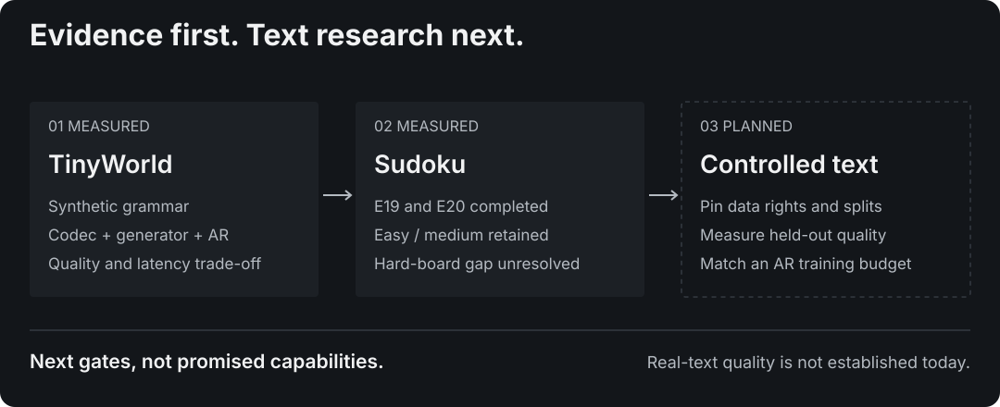

# Research roadmap

This is the canonical roadmap for NCM-MLX. [STATUS](STATUS.md) describes implemented behavior; [EXPERIMENTS](EXPERIMENTS.md) records measured outcomes. A planned milestone is not a supported feature or a performance claim. There are no committed delivery dates: training and benchmark milestones depend on an explicit compute allocation. Planning charts for compute, fixed levels and evidence gates are in [roadmap scenarios](research/planning-projections.md); they do not predict future quality.

## Decision after E20

The current phase is a partial success, with retained easy/medium performance across two seeds and an unresolved hard-board gap. The [two-seed assessment](research/e20-seed-report.md) records the evidence and its audit limits. The next main milestone is a reproducible controlled-text experiment, while Sudoku remains a bounded diagnostic track. Matching Original NCM’s hard score is not a prerequisite for text research. Keep the 6.44M generator as a baseline; larger models and longer runs need a specific hypothesis and compute allocation. No text feature, future score or delivery date is promised.

Before new runs, retain per-board predictions and ordered source/data/checkpoint-bound evaluation manifests, and use a backend-appropriate GPU-load probe. These missing E20 records cannot be reconstructed retrospectively.

**Controlled-text update, 2026-10-30:** the [E21–E23 assessment](research/e21-e23-assessment.md) records completed seed-0 TinyStories pilots and their remaining AR quality gap. The already running E24 and queued seed repeats test the corruption ranking conditional on one codec. Complete those checks and integrate the public evaluation recipe before choosing a larger training run. The roadmap's natural-document and conditional-task gates remain unmet.

<picture>
  <source media="(max-width: 600px)" srcset="assets/research-path-mobile-dark.svg">
  
</picture>

## Priorities and dependencies

| Priority | Milestone | Current state | Dependency |
|---|---|---|---|
| P0 | Evaluation integrity | Batch coverage guard implemented; broader audit planned | Required for every new comparison |
| P1 | Close current Sudoku evidence | E18, both E19 runs and E20 completed; two-seed assessment recorded | Retain provenance limits; new paired evaluation is a separate measurement |
| P1 | Establish an upstream-checkpoint reference | TinyStories and Sudoku easy/medium/hard converted with CPU parity; see [released checkpoints](official-checkpoints.md) | Text checkpoints needing CFG or other tokenizers remain |
| P1 | Establish a real-text baseline | Planned; no real-text quality validation today | Dataset rights, tokenizer/padding contract and matched budgets |
| P2 | Measure fixed level budgets and Sudoku early exit | Planned; full hierarchy remains the only sampling policy | Evaluation integrity and full-depth per-board baseline |
| P2 | Implement prefix KV caching | Implemented in the released-checkpoint sampler; pending for the independent training sampler | Preserve separate attention contracts and correctness gates |
| P2 | Compile inference and measure dispatch costs | Opt-in compiled level steps in the released-checkpoint sampler; pending for the independent training sampler | Stable inference policies and recorded contention |
| P3 | Strengthen generality and release evidence | Planned | Successful earlier milestones and reproducible artifacts |

The text, checkpoint-reference and inference tracks can progress independently once their prerequisites are met. New training or timed experiments must not compete with an active experiment. Implementation and portable tests can proceed before compute is available.

## P0 — evaluation integrity

The batch Sudoku report now rejects empty evaluation sets, unequal board counts and malformed shapes. Regression coverage checks that every failed board remains in the denominator. This guard does not rerun or revise historical experiments.

Before new experiments:

- Validate sample identity, counts, input clues and split provenance; reject missing, repeated or stale records when aggregating saved results.
- Save the exact configuration, checkpoint identity, dataset revision, seed, sampling policy and metric settings with each result. A different policy is a separate experiment.
- Keep codec reconstruction, teacher-forced code prediction and free-running generation quality separate. Record failed and interrupted runs, not only the best checkpoint.

**Completion gate:** deliberately incomplete or mismatched evaluation inputs fail visibly; a small independently checked fixture produces the expected aggregate. Every headline comparison links to a recoverable result artifact and its limitations.

## P1 — Sudoku evidence and checkpoint reference

### Finish the current training evidence

1. E18 is complete and recorded: 84.25 / 49.10 / 10.55% on easy/medium/hard. Preserve its negative comparison with E14 and E17's optimizer/random-state reset qualification. Read [RECOVERY](RECOVERY.md) before any future interruption or continuation.
2. Evaluate completed checkpoints on all 2,000 boards per upstream difficulty using fixed sampling settings. Record steps, effective sequence exposure, wall time, hardware and contention.
3. E19-budget and E19-funded are complete. Preserve all snapshots and held-out results: the pilot scores 90.20 / 59.75 / 16.55%; the funded run scores 98.10 / 83.40 / 40.30% at twice E15's exposure. The [combined E18/E19 working paper v0.10](https://doi.org/10.5281/zenodo.23640777) is published, retaining setup failures and budget differences. E20 completes the same scientific recipe with seed 1 at equal exposure, scoring 97.25 / 79.60 / 33.25%. Report both seeds, not only the best. The hard difference is 7.05 points; two seeds do not establish population variability or its cause. The [v0.11 assessment](research/e20-seed-report.md) retains missing per-board/source/evaluation provenance and benchmark-contention limitations. The original million-step E19 recipe remains unstarted.
4. Add paired per-board comparisons and multiple training seeds. Run an AR comparison matched to E15's budget before describing E15 as an equal-budget advantage.

**Completion gate:** final checkpoint identities and held-out outcomes are recorded, uncertainty and training-budget differences remain visible, and a separate reproduction can recover the scoring inputs. Width-512 and model-sampled corruption are already tested in E10/E12 and E9; do not repeat them as untested ideas.

### Establish a released-checkpoint reference

Map the released Sudoku vocabulary, prefix/target formatting, normalization, resampling, parameter names and shapes. Build an independent conversion path without copying implementation code. Check intermediate codec reconstructions and per-level logits on fixed fixtures before comparing full task scores.

**Completion gate:** the same released weights and boards produce a documented, tolerance-qualified reference result. Distinguish conversion parity from reproducing the original training recipe.

**Status (2026-10-29): gate met for TinyStories and Sudoku.** `ncm_mlx/official/` converts the released checkpoints without PyTorch. Per-level logits match upstream PyTorch to 3e-10 / 1e-13 in exact float64, and greedy outputs are identical on all 2,000 easy boards. Released Sudoku solves 99.40 / 96.30 / 86.20% on Metal; see [released checkpoints](official-checkpoints.md). This is conversion parity, not a reproduction of the training recipe. Next: LM1B/OWT (same text path, larger weights), then WMT14/XSum, which need classifier-free guidance and a pretrained source tokenizer. The released checkpoints also give a fixed reference for prefix KV caching and level-budget experiments.

## P1 — real-text validation

### Data and representation

Start with a bounded TinyStories experiment or another explicitly licensed text corpus. Pin its revision, document rights and filtering, preserve document-level train/validation/test separation and record sequence counts and token exposure. Decide whether the first study uses characters or a new tokenizer before changing the model; keep vocabulary, special tokens, truncation, padding, prefix positions and output masks explicit. Split Unicode text at valid character/token boundaries.

[TinyStories](https://huggingface.co/datasets/roneneldan/TinyStories) is a controlled starting point built from synthetic stories, not sufficient evidence of performance on naturally occurring documents.

**Completion gate:** deterministic preprocessing and round-trip fixtures pass, held-out documents do not overlap training data, and the command works from a clean environment without private files.

### Quality and budget comparison

Train the codec, then the next-concept generator and an AR baseline with the same data and documented budgets. Report codec size and training separately from generator size and training; matching generator width alone does not match total system cost. Record reconstruction error, code usage and free-running sample quality separately. Include readable fixed-seed examples and failure cases.

Do not label generator code cross-entropy as text perplexity. If an independent text scorer is used, fix its model/tokenizer revision and padding, length and unscorable-example rules. Quantify repetition, novelty and length alongside the chosen quality metric; these are diagnostics, not proof of coherent long-form writing.

**Completion gate:** a held-out text report and matched AR result exist with clear budgets and sampling settings. Synthetic grammar or Sudoku success cannot satisfy this gate. Open-domain quality, instruction following and chat serving remain separate, unplanned capabilities.

### Coarse-to-fine examples and useful text tasks

Make text a supported workflow through staged deliverables:

| Stage | Implementation and example | Evidence required |
|---|---|---|
| Text smoke path | A documented text-data recipe, tiny config, tokenizer save/load, codec training, generator training and sampling command | Fresh-environment end-to-end check; padding, Unicode, conditioning and checkpoint tests; explicit short-run quality limits |
| Visible refinement | CLI output showing the same sample after each completed concept level, plus final text and machine-readable codes/settings | Full-length intermediate decodes; final preview equals normal generation; fixed-seed examples include failures |
| Text continuation | Prefix-conditioned generation from held-out story or document fragments | Prompt/target boundaries, no held-out leakage, matched AR baseline and longer-context checks |
| Natural text benchmark | A pinned, rights-reviewed corpus of naturally occurring text, with preprocessing and held-out scoring commands | Document separation, reconstruction and free-running quality, length/repetition diagnostics and synchronized latency at several batch sizes |
| Conditional task | A bounded translation or summarization study with input/output examples | Task-specific metrics, output-length policy, equal-budget baseline and failure analysis |
| Local interactive demo | A small local interface for entering an input, viewing level refinements and exporting the result/settings | Uses an actually evaluated checkpoint; reports supported lengths, platform requirements and limitations; no silent model training or remote publishing |

[WMT14](https://www.statmt.org/wmt14/translation-task.html) translation and [XSum](https://huggingface.co/datasets/EdinburghNLP/xsum) summarization are candidate comparison tasks, not implemented features. Choose one after checking its exact data provenance, permitted use, preprocessing and compute needs; the XSum card currently lists its license as unknown. For translation, record the exact BLEU/chrF evaluation configuration; for summarization, record ROUGE settings and inspect factual errors rather than treating overlap as factual accuracy.

**Completion gate:** a reader can reproduce a real-text example and its benchmark from public instructions, distinguish intermediate reconstruction from final generated text, and inspect the recorded failures. Add a README text showcase only when the corresponding workflow and evidence exist. Public hosted inference, an API and general chat behavior require separate designs and are not implied by a local demo.

## P2 — level budgets and verified early exit

### Fixed level budgets first

Add an opt-in cap on completed concept levels, decoding the accumulated latent at the full output length. Preserve the current full-hierarchy default and one generator forward per executed level. Test valid and invalid caps, deterministic seeds, batch ordering, learned level-0 resampling and equality between the full cap and existing generation.

Sweep budgets against the same full-depth checkpoint and board identities. Report task quality, levels used, codec decodes, memory and synchronized latency. Small budgets may be faster and worse; retain that result.

### Sudoku verification

Add a separate opt-in policy that decodes after eligible levels and accepts a board only when all rows, columns and boxes are valid and every input clue is preserved. The stopping decision must never read reference solutions. Support minimum/maximum levels, record each board's stop reason and original identity, and remove accepted samples from later computation only after verifying ordering and state handling.

Specify how random keys follow sample identities when batches shrink. Test mixed stopping times, unresolved boards, no accepted boards and all boards accepted. Repeated decoding, device/host synchronization and compaction can outweigh saved generator work; include them in end-to-end timing. Early exit is a different sampling policy, not an output-equivalence claim.

**Completion gate:** paired full-depth/fixed-budget/adaptive results report solve rate, the distribution of levels used and measured latency on the same board set. No unconditional speedup claim without those measurements. Text has no exact Sudoku-style verifier; confidence or stability stopping for text needs a separately validated criterion and remains exploratory.

## P2 — prefix caching and compiled inference

The [literature review](research/prefix-caching-and-speculative-drafting.md) and [proposed protocol](research/inference-experiment-protocol.md) describe the independent training sampler's attention contract, correctness gates and future drafting options. The separate [released-checkpoint sampler](official-checkpoints.md#prefix-kv-cache-and-compiled-step) now implements prefix caching and opt-in compiled level steps, with correctness and contention-qualified timing evidence. That implementation does not establish the optimization for the independent training sampler.

### Prefix KV caching

Implement generation-local prefix caches, with explicit support for block-diagonal and block-causal attention or an explicit rejection of unsupported configurations. Preserve position resets, prefix visibility, conditioning and training/inference equivalence. A blank Sudoku cell is meaningful input, not padding. Future variable-length text prefixes need their own padding contract.

**Completion gate:** existing exact CPU teacher-forced/per-level tests pass without relaxed tolerances; cached and uncached paths agree under the supported contract; repeated calls cannot leak cache state across inputs. Test deterministic and sampled generation, multiple batch sizes and one generator forward per level. Record synchronized timing and memory before claiming a benefit.

### Compilation

Compile the NCM and AR samplers after their inference contracts are stable. Keep eager reference paths, distinguish compilation/warmup cost from steady-state latency and test changing batch shapes. Adaptive compaction may require an eager fallback or separate compiled shapes; report that explicitly.

**Completion gate:** output/quality comparisons and synchronized benchmarks use identical settings, host-copy completion, recorded GPU load and p50/p95 latency. Compare compilation and caching separately before combining them. Lower precision and quantization are separate experiments with explicit quality checks.

## P3 — stronger evidence and future releases

After the earlier gates, prioritize multiple seeds, matched total training costs, cross-backend replication and longer text sequences. New quantizers, resampling rules, correction passes or decoder architectures require isolated ablations and retraining; changing several at once cannot identify the cause of an improvement. Energy claims need actual instrumentation.

For each public milestone, update capabilities, platforms and benchmark summaries only where evidence changed. Release weights only after model-card, data-rights and reproduction review. Preserve old tags and DOI records; publish a new version for new artifacts. Keep publication/indexing status separate from peer review and scientific validation.
