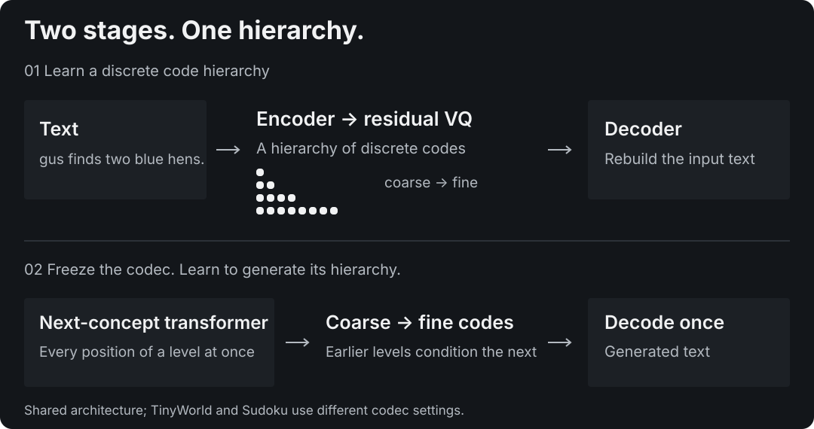
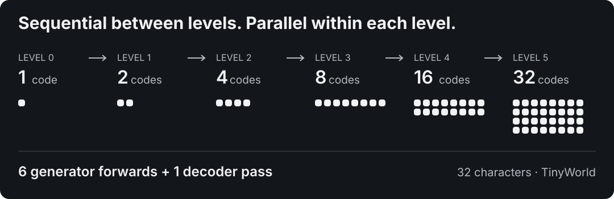
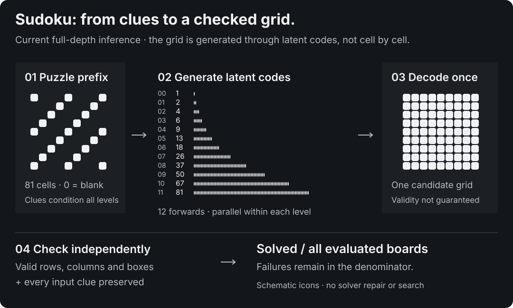

# Next-Concept Modeling architecture in MLX

NCM-MLX independently implements the two-stage architecture of [Next-Concept Modeling](https://arxiv.org/abs/2610.14162). A codec learns a hierarchy of discrete latent codes; a generator learns to produce that hierarchy. Generation is sequential between levels and parallel within each level. It is non-autoregressive over output characters, while retaining a causal order over latent levels.

<picture>
  <source media="(max-width: 600px)" srcset="assets/architecture-mobile-dark.svg">
  
</picture>

## In plain terms

An ordinary language model writes one token per model call: 32 characters means 32 calls in sequence. NCM splits generation into a few **levels**. Each level is one model call that predicts all of its positions in parallel, conditioned on the coarser levels before it. The TinyWorld recipe uses 6 levels for 32 characters: 6 generator calls and one final codec decode. Sudoku uses 12 levels for 81 cells.

It takes two models, trained one after the other:

1. **Codec.** It learns to compress a sentence into a ladder of discrete codes and rebuild it. Level 0 is a single coarse code; each finer level corrects what the coarser ones got wrong (a *residual*). This works like a progressive JPEG for text.
2. **Generator.** With the codec frozen, it learns to produce that ladder from the top down: given levels 0..k−1, predict every code of level k at once.

## How generation works

<picture>
  <source media="(max-width: 600px)" srcset="assets/generation-mobile-dark.svg">
  
</picture>

The generator makes 6 forward passes, whatever the batch size, plus one decoder pass. The repo's tests prove that running it level by level produces exactly the logits seen in training (`tests/test_mlx_core.py`).

A real refinement trace, including its failure:

```
after level 0   eue likes one oed egg.      1 code      a rough guess at the whole sentence
after level 1   eve likes one oig egg.      2 codes
after level 2   dee likes one red egg.      4 codes     structure and most words settled
after level 3   dee likes one ret egg.      8 codes     ← a fine level breaks "red"
after level 5   dee likes one ret egg.      32 codes    final: invalid (spelling)
```

A real sample from the trained model (`mise run demo`), chosen because it shows both the refinement and the typical failure. 90% of samples at temperature 1.0 are valid; see [benchmarks](benchmarks.md#tinyworld-e1-in-detail).

## The codec

An encoder maps a fixed-length token sequence to continuous vectors. At each level, the residual vector quantizer pools the remaining residual to that level's length, assigns its nearest codebook entries, upsamples the selected vectors, and refines them with a blended convolution. It adds this contribution to the reconstruction and removes it from the residual before processing the next level. The decoder turns the cumulative reconstruction back into token logits.

Codebooks learn through exponential moving averages (EMA), separately from gradient updates. Codec training combines token reconstruction, encoder commitment and residual-fit losses. Dropping finer levels during some training examples asks partial reconstructions to remain useful. Perfect full-hierarchy reconstruction does not establish that a generator can predict the hierarchy or that coarse levels alone carry useful semantics.

| Setting | TinyWorld quickstart | Sudoku E6 and later shared codec |
|---|---|---|
| Tokens | 32 characters, including padding | 81 cells; blank puzzle cells are prefix token `0` |
| Codec width | 128 | 256 |
| Encoder / decoder blocks | 2 / 2 | 0 / 1 |
| Quantizer levels | 1, 2, 4, 8, 16, 32 | 1, 2, 4, 6, 9, 13, 18, 26, 37, 50, 67, 81 |
| Entries per codebook | 128 | 16 |
| Pre-quantization normalization | LayerNorm without affine parameters | GroupNorm with 8 groups, without affine parameters |
| First-level resampling | Fixed area / linear | Learned strided convolution / transposed convolution |

The Sudoku first-level kernels span all 81 positions. They account for 10,617,344 trainable values, so omitting them substantially understates codec size. See [parameter accounting](benchmarks.md#parameter-accounting).

## The generator

For level zero, learned queries supply the input. For every later level, the input is the cumulative reconstruction from coarser codes, pooled to the new level's length. A shared transformer uses rotary position embeddings that restart within each level, learned level embeddings, and query/key normalization. Separate output heads predict code indices for each level.

The default block-diagonal attention lets each level read the prefix and its own positions. Coarser information arrives through the pooled reconstruction, rather than through attention to earlier levels. Training concatenates all teacher-forced levels; segmented attention avoids materializing the masked full attention matrix. A CPU invariant test requires level-by-level inference logits to equal the corresponding teacher-forced logits exactly in evaluation mode.

Sampling performs exactly one generator forward per level and one final codec-decoder forward. The benchmark's `model_forwards` counts generator forwards only. The finest output has the configured fixed length; this implementation has no variable-length chat decoding or instruction-following interface.

The experimental `block_causal` configuration also lets a level attend to earlier levels. It processes more positions at inference and should be reported separately from the default architecture.

## Conditioning and train–test mismatch

TinyWorld uses a learned unconditional prefix. Sudoku embeds the 81 puzzle cells as a conditioning prefix and generates a complete solution. This supports fixed-shape token-prefix conditioning, rather than arbitrary natural-language prompting.

Teacher forcing supplies true coarse codes during training; inference supplies the model's own predictions. Optional conditioning corruption replaces some conditioning codes while retaining true labels. Configurations choose a linear per-level replacement schedule and uniform or model-sampled replacements. These are training choices, not denoising iterations at sampling time.

<picture>
  <source media="(max-width: 600px)" srcset="assets/sudoku-generation-mobile-dark.svg">
  
</picture>

## Implementation boundaries

The implementation uses MLX and NumPy. It does not import the upstream PyTorch modules. Released upstream checkpoints load only through the separate inference port in `ncm_mlx/official/` ([official checkpoints](official-checkpoints.md)), not through the training models described here. Differences include tokenization, sequence lengths, decoder positions, codebook-update timing and training recipes; Sudoku and TinyWorld also use different codec designs. See the [upstream map](research/upstream-map.md) for the detailed comparison.

Generator training can use `mx.compile` when `train.compile` is true. Codec training, autoregressive training, and both generation samplers are currently uncompiled. Compilation status and number of forwards describe different costs; neither alone establishes wall-clock speed. See [benchmark methodology](benchmarks.md).

## What is faithful to NCM and what is not

| | Status |
|---|---|
| Two-stage codec → generator | Same as upstream |
| Multiscale residual VQ: area downsample, linear upsample, per-level blend conv, EMA codebooks, commitment loss, fine-level dropout | Same as upstream |
| Block-diagonal generator, per-level RoPE, level embeddings, QK-norm, learned level-0 queries | Same as upstream |
| Encoder and pre-quant norm | TinyWorld: contextual encoder / LayerNorm; later Sudoku: lookup encoder / GroupNorm |
| Decoder positions, dead-code restart | **Modified** for small scale |
| Character tokenizer instead of BPE | **Replaced** |
| Token-prefix conditioning (Sudoku puzzle cells) | Same idea as upstream's `raw_token_prefix` |
| Learned level-0 resampling | Same idea (`learned_l0`), single layer, lower codec learning rate |
| Codebook-tied generator heads, CFG, prefix KV cache | **Not implemented in the independent training implementation.** The [official-checkpoint port](official-checkpoints.md) has tied heads, a prefix cache and, for XSum, CFG |

Full source-by-source map: [upstream map](research/upstream-map.md). No upstream code is copied.

## Source map

| Component | Source |
|---|---|
| Codec and encoder/decoder | [`latent/codec.py`](../ncm_mlx/latent/codec.py) |
| Residual quantizer and EMA | [`latent/quantizer.py`](../ncm_mlx/latent/quantizer.py) |
| Fixed resampling matrices | [`latent/resample.py`](../ncm_mlx/latent/resample.py) |
| Transformer and attention | [`models/blocks.py`](../ncm_mlx/models/blocks.py) |
| Teacher-forced / per-level generator | [`models/generator.py`](../ncm_mlx/models/generator.py) |
| Coarse-to-fine sampling | [`generation/sampler.py`](../ncm_mlx/generation/sampler.py) |
| Training and full-state recovery | [`training/`](../ncm_mlx/training/), [recovery guide](RECOVERY.md) |
