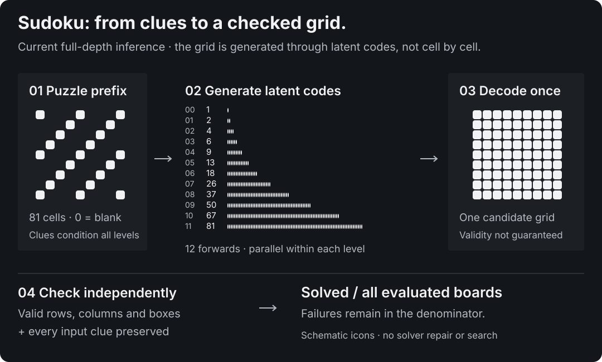
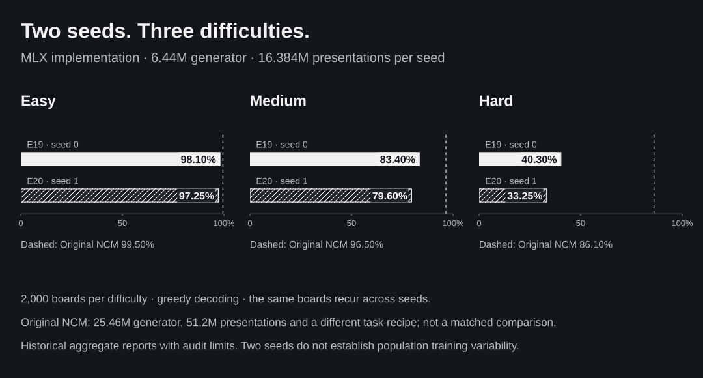

# NCM quality and inference benchmarks

Quality, latency and training cost answer different questions. This page defines the measurements; [EXPERIMENTS.md](EXPERIMENTS.md) preserves the experiment history, and [`paper/data/results.json`](../paper/data/results.json) contains a public extract of measured results. Raw run logs and weights are not committed. Results describe experimental small models, not a general-purpose language model or a reproduction of upstream's full text benchmarks.

**Model labels.** “MLX implementation” is this repository’s independently trained NCM model; all E-numbered rows refer to it. “Original NCM (Kumbong et al.)” is a cited result from the original study, not a model evaluated or trained here. The MLX AR baseline is separate from the Original AR baseline reported in that study.

## Quality: TinyWorld and Sudoku

TinyWorld is a finite synthetic grammar. Its generated-sentence metrics check grammatical shape, number agreement, novelty relative to the training set, and diversity. These checks do not measure open-domain text quality. The historical 89.8% NCM versus 98.6% AR validity result uses temperature 1.0 and models of similar generator size.

Sudoku generation is conditioned on the puzzle cells. Greedy decoding (`temperature=0.0`) gives one candidate per board, with no search, reranking or solver repair. Each external difficulty set has 2,000 boards; the generated validation split has 1,000. A solved board is a valid Sudoku grid that preserves the givens. Cell accuracy against the supplied solution, blank-cell accuracy and the fraction preserving all givens are separate metrics. A valid alternative completion can matter on non-unique validation puzzles; the external boards are intended to have unique solutions.

| MLX implementation run | Easy solved | Medium solved | Hard solved | Generator presentations |
|---|---:|---:|---:|---:|
| E13 | 70.85% | 31.25% | 4.05% | 2,048,000 |
| E15, previous best | 96.25% | 76.65% | 31.90% | 8,192,000 |
| E17, recovered | 71.25% | 31.75% | 3.70% | 2,048,000 intended; weights-only recovery |
| E18 | 84.25% | 49.10% | 10.55% | 8,192,000 |
| E19-budget pilot | 90.20% | 59.75% | 16.55% | 3,058,560 |
| E19-funded, best observed seed | 98.10% | 83.40% | 40.30% | 16,384,000 |
| E20, second training seed | 97.25% | 79.60% | 33.25% | 16,384,000 |

The [E19 report](research/e19-funded-report.md) records the full completion, confidence intervals and synchronized A40 timings. Its doubled E15 exposure is not an equal-budget comparison. E20 repeats that scientific recipe at equal exposure and falls by 0.85 / 3.80 / 7.05 percentage points. See the [two-seed assessment](research/e20-seed-report.md): scores are retained aggregates, per-board outcomes and complete remote provenance manifests are missing, and E20 benchmark contention is unknown.

These percentages retain the precision of the evaluation artifacts; historical summaries sometimes use one decimal place. E17 restored step-30,000 weights and performed 2,000 further steps with fresh optimizer moments and random state. Its uncheckpointed work before interruption is unknown. It does not establish an improvement over E13 or a controlled effect of puzzle construction. See [recovery qualifications](RECOVERY.md#legacy-weights-only-recovery-e17).

For an indication of finite-board uncertainty, 95% Wilson intervals for E17 are 69.23–73.19%, 29.75–33.82% and 2.96–4.62%. They assume boards are independent samples from a population and do not account for training-seed variation, related puzzle structure, hyperparameter selection or distribution shift. The benchmark sets are fixed, so the observed scores themselves are exact for those boards. Comparing models on the same boards requires paired outcomes, not an independent-binomial significance claim. Most runs use one training seed; repeated sampling seeds are not independent training repetitions.

Codec reconstruction reads true held-out solutions through the encoder and decoder. E13/E15/E17 reconstruct all 1,000 validation solutions exactly using the full hierarchy. Generated solved-board rates above measure the separate generator task. Teacher-forced code accuracy and validation cross entropy also use true coarser codes and must not substitute for free-running quality.

## What is matched

The E11 NCM/AR comparison matches generator width/depth, dataset and 32,000 × 64 generator presentations. It reports NCM 55.2 / 18.1 / 1.6% versus AR 20.5 / 4.9 / 0.5% in the historical rounded summary. The AR baseline has a KV cache and puzzle-prefix prefill. It is a practical reference model, not an extensively tuned baseline.

Matching generator presentations does not match FLOPs, training time, optimizer path, or total system size: NCM also trains and retains a codec. E15 has no equal-budget AR quality result. Comparing E15 with the older AR run or with the original paper is an unmatched comparison. Original NCM (Kumbong et al.) reports 99.5 / 96.5 / 86.1% with a 25.46M generator and 51.2M generator presentations, separate difficulty-specific checkpoints, and a different board tokenization. Those published numbers are reference results, not measurements made by this project. [Original paper, Tables 3, 5 and 6](https://arxiv.org/html/2610.14162v1).

The strongest small-generator result is easy-board accuracy of 98.10% versus Original NCM’s 99.50%, with 6.44M versus 25.46M generator parameters (3.95× smaller) and 16.384M versus 51.2M generator presentations. Medium/hard gaps are 13.10/45.80 percentage points. This does not establish general quality parity or matched-cost efficiency; the codec is additional.

## TinyWorld E1 in detail

Experiment E1 in [EXPERIMENTS](EXPERIMENTS.md). Hardware: M5 Pro, 64 GB, macOS 26.5, MLX 0.32.3. Other local GPU services were running (16% GPU utilisation before the run).

**Codec** (held-out): 100% of sentences rebuilt exactly; 100% codebook use at every level.

**Generator vs an autoregressive baseline** of the same width and depth, trained on identical data:

| | MLX implementation | MLX AR baseline + KV cache |
|---|---|---|
| Parameters | 1.3M codec + 5.0M generator | 4.8M |
| Training time | 52 s + 266 s | 134 s |
| Valid sentences, T = 1.0 | 89.8% | **98.6%** |
| Valid sentences, T = 0.7 | 95.8% | **99.8%** |
| Number agreement when well-formed | 99.8% | 100% |
| Valid *and* not in the training set, T = 1.0 | 16.3% | **23.5%** |
| Model calls per sequence | **6** + 1 decode | 32 |

**Latency.** p50 over 30 iterations after 3 warm-ups, timed until the tokens are copied back to the CPU:

| Batch | MLX implementation p50 | MLX AR baseline p50 | MLX implementation sequences/s | MLX AR baseline sequences/s |
|---|---|---|---|---|
| 1 | **4.5 ms** | 30.5 ms* | 222 | 33 |
| 16 | **5.8 ms** | 22.9 ms | 2,779 | 698 |
| 64 | **10.8 ms** | 26.9 ms | 5,907 | 2,383 |
| 256 | **37.8 ms** | 49.8 ms | 6,769 | 5,137 |

\* AR batch-1 p50 was 19.8 ms in the otherwise identical E0 run; small-batch AR timings are sensitive to other GPU load. Peak memory at batch 256: NCM 1.7 GB, AR 0.46 GB.

**Reading.** On this task at this size, the recorded small-batch latency advantage varies with GPU contention; batch 16 is about 4× faster and batch 256 about 1.3× faster. It is less accurate: about 9 points lower validity at T = 1.0. Its errors are mostly local spelling slips (`ret fox`, `coxs`), while the sentence-wide agreement rule is almost always kept. [E2](EXPERIMENTS.md) shows these errors come from every level, not only the finest.

The upstream paper's 10–31× speedups compare NCM with **diffusion** language models on GPUs. Nothing here claims a speedup over large LLMs.

## Sudoku: MLX implementation compared with Original NCM

“MLX implementation” means this repository’s independently trained NCM model; “Original NCM” means the model reported by Kumbong et al. These are different implementations and checkpoints. All E-numbered runs are local MLX experiments.

<picture>
  <source media="(max-width: 600px)" srcset="assets/sudoku-generation-mobile-dark.svg">
  
</picture>

Puzzle-conditioned models, scored on Kumbong et al.’s published test boards (2,000 per difficulty) with its "solved" rule: a valid grid that keeps every given. Greedy decoding. E11, E14 and E15 trained on an RTX 3080; full recipes and timings are in [EXPERIMENTS](EXPERIMENTS.md).

| Model | Generator params | Generator presentations | Easy (40 givens) | Medium (35) | Hard (30) |
|---|---|---|---|---|---|
| **MLX implementation, larger corpus and schedule (E19-funded)** | 6.44M | 16.384M | **98.10%** | **83.40%** | **40.30%** |
| MLX implementation, same recipe with training seed 1 (E20) | 6.44M | 16.384M | 97.25% | 79.60% | 33.25% |
| MLX implementation, stronger corruption + unique puzzles (E15) | 6.4M | 8.2M | 96.25% | 76.65% | 31.90% |
| MLX implementation, conditioning corruption (E14) | 6.4M | 8.2M | 87.4% | 53.4% | 11.2% |
| MLX AR baseline, same width and depth (E11) | 6.3M | 2.05M | 20.5% | 4.9% | 0.5% |
| MLX AR baseline (E4) | 6.3M | 0.64M | 13.8% | 3.0% | 0.4% |
| Qwen3.8 27B 4-bit, no reasoning, 50 boards each | 27B | Pretrained reference | 0% | 0% | 0% |
| Original AR baseline (Kumbong et al.) | 25M | Not stated here | 14.6% | 5.1% | 1.0% |
| **Original NCM (Kumbong et al.)** | 25.46M | 51.2M | **99.5%** | **96.5%** | **86.1%** |

The MLX AR baseline is close to the Original AR baseline row, a limited sanity check on the boards, scoring and conditioning path. The best local NCM result (E19-funded) remains below the paper, especially on hard boards. At the matched 2.05M-sequence budget, NCM E11 solves 55.2 / 18.1 / 1.6% against AR's 20.5 / 4.9 / 0.5%; the larger-budget E15 and E19-funded comparisons are not budget-matched. Training data and conditioning corruption are the strongest levers measured so far. These parameter columns count generators; the Sudoku codec stores another 13.9M scalar values, including learned resampling layers and EMA state. See [parameter accounting](#parameter-accounting).

<picture>
  <source media="(max-width: 600px)" srcset="assets/sudoku-seeds-mobile-dark.svg">
  
</picture>

Both seeds use the same scientific recipe and 16.384M generator presentations. E19-funded remains the best observed seed; E20 is 0.85, 3.80 and 7.05 percentage points lower on easy, medium and hard boards. Two seeds do not establish population training variability or identify the cause. Historical aggregate reports lack per-board predictions and complete remote evaluation/source manifests; see the [two-seed assessment](research/e20-seed-report.md).

**Smaller-generator result.** The MLX implementation reaches **98.10% on easy boards versus Original NCM’s 99.50%**, using a **6.44M versus 25.46M generator** (3.95× smaller) and **16.384M versus 51.2M generator presentations**. Medium and hard remain 13.10 and 45.80 percentage points behind. The size ratio covers generators only: the MLX codec stores another 13.9M values. Different recipes and system costs prevent an overall efficiency or parity claim.

**Interruption study (E17).** The completed weights-only continuation solves **71.25 / 31.75 / 3.70%**, close to E13. Its optimizer and random state reset after interruption, so it does not establish a benefit from its data construction. E18 subsequently completed at **84.25 / 49.10 / 10.55%**, below E15; stronger corruption alone did not improve the base-data comparison at this budget. [Reproduction and uncertainty](reproducibility.md) explain which comparisons can be repeated and what the numbers establish.

## Parameter accounting

`eval` currently reports `params` by summing every public array in each MLX module's parameter tree. For the E6 codec reused by E13/E15/E17, that includes EMA accumulators, so it is not a count of gradient-trained weights alone.

| Quantity | Scalar values |
|---|---:|
| Generator, gradient-trained | 6,440,128 |
| Codec, gradient-trained | 13,816,704 |
| Codec codebooks, learned by EMA | 49,152 |
| Codec EMA sums and counts, training accumulators | 49,344 |
| Codec total reported by `params.codec` | 13,915,200 |
| Codec plus generator reported total | 20,355,328 |

The learned first-level down/up convolutions contribute 10,617,344 gradient-trained codec values. Earlier descriptions of this codec as about 3.3M omitted these layers. A claim that the local model is about one quarter of upstream's size refers only to the 6.44M versus 25.46M generators. Sampling needs the quantizer's codebooks/refinement/upsampling and decoder, but does not execute the codec encoder; the current loader retains the full codec. Saved-array counts, active inference components and measured memory are different quantities.

## Synchronized latency methodology

[`bench_sampler`](../ncm_mlx/eval/benchmark.py) times a complete generation call through conversion of its output to a NumPy host array. This waits for device work and includes output transfer; it never reports only MLX lazy graph construction. Generation also explicitly evaluates its output. Model loading, corpus preparation and training are outside the timed region. Prefix-array construction and prefix computation are inside it for conditional runs.

For each batch size the benchmark clears MLX's allocator cache, records a first call, performs three warmups, resets peak-memory accounting and times the requested iterations. It reports p50, p95, mean, sample standard deviation, and sequences/second derived from `batch / p50_seconds`. Peak memory is MLX's allocator peak, not total process memory or whole-device usage. First-call latency is not a fresh-process startup measurement. Three warmups and a small iteration count do not guarantee a stable steady state under changing GPU load.

Batch-one p50 is latency for one fixed-length output. Batch-256 p50 is latency for the whole batch; dividing it by 256 does not describe interactive request latency. Throughput at one batch size can be worse than at another because memory pressure and kernels change. The NCM forward count excludes the final decoder call and quantizer work; fewer forwards do not guarantee faster wall time.

Historical benchmark calls use temperature 1.0, including the E17 latency measurements below. Sudoku quality uses greedy temperature 0.0. Thus those timings do not directly time the decoding setting of the solved-board table. New runs can select and record temperature explicitly.

```bash
mkdir -p runs
python -m ncm_mlx bench --config configs/YOUR-RUN.json \
  --temperature 0.0 --batch-sizes 1 16 64 256 --iters 30 \
  --out runs/YOUR-RUN-bench.json
```

## Compilation and hardware

`train.compile: true` wraps the generator training step with `mx.compile`, including optimizer and MLX random state. It does not compile the sampling loop. Codec training, AR training and both samplers are currently uncompiled. Backend kernel optimizations still apply; “uncompiled” here refers specifically to the absence of an explicit `mx.compile` wrapper. Compiled-training speed measurements cannot be presented as compiled-inference speedups.

Verified execution includes Apple M5 Pro/Metal and NVIDIA RTX 3080, A40, RTX A6000, RTX PRO 6000 Blackwell and RTX 5090/CUDA using MLX 0.32.3. CPU runs support exactness and recovery tests; they are not published GPU latency measurements. The recorded Sudoku, TinyWorld and E21–E24 configurations use fp32; the four-times-data TinyStories runs of [E31 and E32](EXPERIMENTS.md#e32-50m-and-87m-generators-at-four-times-the-data-bf16-2026-11-04) use optional bf16 mixed precision, whose quality parity was checked only for the 12M recipe at one times the data ([E29](EXPERIMENTS.md#e29-bf16-mixed-precision-quality-parity-at-the-e21-recipe-2026-11-03)). Metal fp32 matrix products have reduced numerical precision, so exact algorithmic equivalence tests use CPU and device tests use tolerances. Cross-backend bitwise equivalence has not been established.

| E17 recovery, Apple M5 Pro | Batch 1 | Batch 16 | Batch 64 | Batch 256 |
|---|---:|---:|---:|---:|
| p50, ms | 14.059 | 78.835 | 648.257 | 1,952.542 |
| p95, ms | 14.499 | 93.883 | 754.231 | 2,346.734 |

This run used 20 timed iterations. GPU utilization was 80% immediately before benchmarking while other services remained running. A pre-run sample does not measure the load throughout the benchmark. Treat these as shared-desktop observations, not isolated hardware limits. Do not compare them directly with an uncontended CUDA run or infer a hardware speed ratio. Before any new benchmark, record device/software versions, configuration, checkpoint, sampling settings, compilation, batch sizes, iteration count, and contention without interrupting unrelated workloads.

## Training cost and future comparisons

Generator metadata times its training loop after code encoding. Periodic validation and checkpoint saving occur inside that loop; data generation, encoding and the final evaluation pipeline are separate costs. E17's 2,000 recovery steps took 1,247.53 seconds; the full recovery pipeline took 1,956 seconds. Neither is the full original E17 training cost. Always name the timing boundary, including repeated work after recovery.

Higher-value future comparisons are multiple training seeds, paired per-board outcomes, a budget-matched E15 AR baseline, matched compiled samplers and uncontended repeated timing sessions. No expensive new training is required to interpret the existing release accurately.

The released-checkpoint sampler is the exception: `official generate|sudoku --compile` wraps its per-level step in `mx.compile`, and it has an opt-out generation-local prefix K/V cache. Its eager, cached and compiled timings are in [released checkpoints](official-checkpoints.md#prefix-kv-cache-and-compiled-step). They do not apply to the repository's own samplers.
