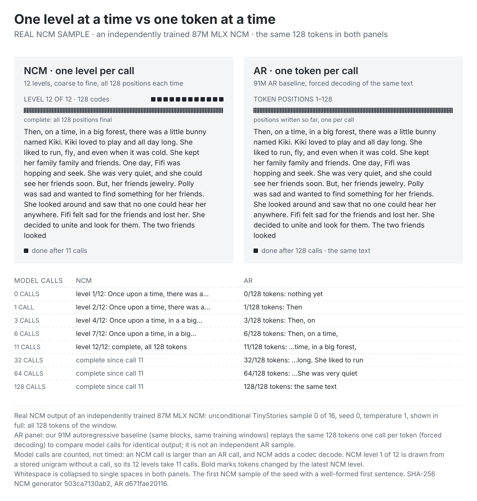
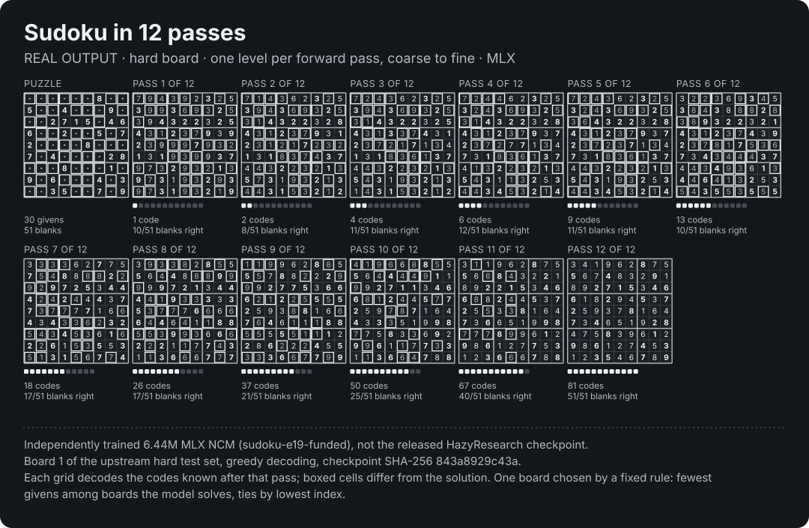
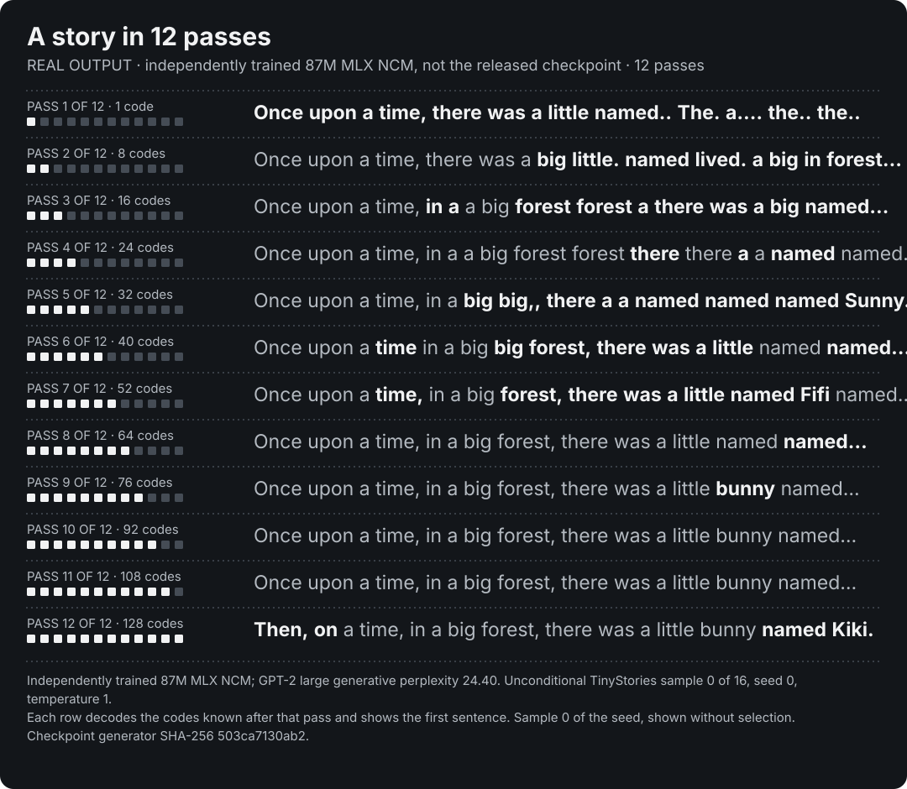

# Level by level: recorded demos

NCM generates one level of its code hierarchy per forward pass. After any pass the codes known so far can be decoded, so the output sharpens from coarse to fine. Each figure below decodes the partial hierarchy after every one of the 12 passes. Both use models trained in this repository, not the released HazyResearch checkpoints, and show real outputs only; each figure has a JSON record next to it with the checkpoint hashes, the seed and the decoded output of every pass.

## One level at a time vs one token at a time

<picture>
  <source media="(prefers-color-scheme: dark) and (max-width: 600px)" srcset="assets/level-vs-token-87m-animated-mobile-dark.svg">
  <source media="(max-width: 600px)" srcset="assets/level-vs-token-87m-animated-mobile-light.svg">
  <source media="(prefers-color-scheme: dark)" srcset="assets/level-vs-token-87m-animated-dark.svg">
  
</picture>

<details>
<summary>Static version with the text after selected numbers of calls</summary>

<picture>
  <source media="(prefers-color-scheme: dark) and (max-width: 600px)" srcset="assets/level-vs-token-87m-mobile-dark.svg">
  <source media="(max-width: 600px)" srcset="assets/level-vs-token-87m-mobile-light.svg">
  <source media="(prefers-color-scheme: dark)" srcset="assets/level-vs-token-87m-dark.svg">
  
</picture>

</details>

| Item | Value |
|---|---|
| Models | the 87.4M MLX NCM generator trained on 4× more data in bf16 ([E32](EXPERIMENTS.md#e32-50m-and-87m-generators-at-four-times-the-data-bf16-2026-11-04); 12 layers, width 768, frozen E21 codec), and the 91.3M autoregressive baseline of the same run, built from the same blocks and trained on the same windows |
| NCM generator SHA-256 | `503ca7130ab235d12b878634b996de5b443957a6cd5665c9069baabd4409ddac` |
| NCM codec SHA-256 | `e8e96b13fcef2d16ac7f8b71b0ddf481e0b09226d3e847fc18ba939baa0be145` |
| NCM inference SHA-256 | `1bff87883dbc240a3e48b5fbaf617218cfefc3764d8eaf09d86be62844fb90f9` |
| AR SHA-256 | `d671fae201165e773b6db18001ba8ca94548062cd25135bf39241ff37281ba7c` |
| Text | NCM sample 0 of 16, unconditional TinyStories, seed 0, temperature 1; opens ' Then, on a time, in a big forest, there was a little bunny named Kiki.'; all 128 tokens of the window (no end-of-story token in it) |
| Selection rule | the first NCM sample of the seed whose first sentence starts with a capital, has 5 to 30 words, ends in . ! or ? and has no repeated word, doubled punctuation or stray characters |
| AR panel | forced decoding: the AR's key/value-cached step is fed the NCM's tokens one per call, so call n writes token n of the same text |
| AR score of this text | log-probability −407.1 nats over 128 tokens (mean 3.18 nats per token, perplexity 24.1); per-token values in the JSON |
| Software | MLX 0.32.4, Apple M5 Pro |

Both panels show the same text: the NCM's sample, decoded as the repository decodes (cut at the first end-of-story token, padding dropped), with whitespace collapsed to single spaces and wrapped by the same rule, so the final frames match. The NCM panel shows all 128 positions from level 1 on; bold marks the tokens the latest level changed. Level 1 is drawn from the stored level-0 unigram without a call, so the 12 levels take 11 calls. The AR panel is our 91M autoregressive baseline replaying the same 128 tokens one call per token (forced decoding) to compare model calls for identical output; it is not an independent AR sample. The JSON records the log-probability the AR gives each token, which shows how the AR scores this text; the figure does not show it.

The counter counts forward passes of the transformer that writes the output, not time. An NCM call processes all 128 positions plus the codes so far and is larger than an AR call with its key/value cache, and NCM adds one codec decode at the end, so the figure says nothing about speed. The animation runs calls 1 to 11 slowly and the rest quickly. The record is [`level-vs-token-87m.json`](assets/level-vs-token-87m.json), with every level of the NCM sample and all 16 NCM final texts of the seed.

## Sudoku in 12 passes

<picture>
  <source media="(max-width: 600px)" srcset="assets/sudoku-12-passes-mobile-dark.svg">
  
</picture>

| Item | Value |
|---|---|
| Model | E19-funded, 6.44M-parameter generator on the frozen E6 codec; 98.10 / 83.40 / 40.30% on easy / medium / hard |
| Generator SHA-256 | `843a8929c43ae8a976e7a71402d18d9a5ce7172ebfc3b3870cfe74fc3c8293b9` |
| Codec SHA-256 | `6cc349babd5e75377b1fbbf2523aaded1cdbcf61b0bc1ad5191dda98c66b7052` |
| Board | index 1 of the upstream hard test set (30 givens), greedy decoding |
| Selection rule | fewest givens among boards the model solves, ties by lowest index |
| Hard-set solve rate in this run | 40.4% of 2,000 (the recorded 40.30% used batches of 500; GPU rounding moves one board) |
| Software | MLX 0.32.4, Apple M5 Pro |

Boxed cells differ from the solution. The early passes are wrong in most blank cells (10 of 51 right after pass 1) and the count rises as the levels get finer, to 51 of 51 after pass 12. The record is [`sudoku-12-passes.json`](assets/sudoku-12-passes.json).

## A story in 12 passes

<picture>
  <source media="(max-width: 600px)" srcset="assets/story-12-passes-87m-mobile-dark.svg">
  
</picture>

| Item | Value |
|---|---|
| Model | 87.4M MLX NCM generator trained on 4× more data (bf16), independently trained (12 layers, width 768) on the frozen E21 codec, run E32; GPT-2 large generative perplexity 24.40 (its AR baseline: 11.48) |
| Generator SHA-256 | `503ca7130ab235d12b878634b996de5b443957a6cd5665c9069baabd4409ddac` |
| Codec SHA-256 | `e8e96b13fcef2d16ac7f8b71b0ddf481e0b09226d3e847fc18ba939baa0be145` |
| Sampling | unconditional TinyStories, seed 0, temperature 1, 16 samples, sample 0 shown |
| Selection rule | none: sample 0 of the seed, shown without selection |
| Software | MLX 0.32.4, Apple M5 Pro |

The figure shows the first sentence only. The 16 final texts (sample 0 is the one shown) are in [`story-12-passes-87m.json`](assets/story-12-passes-87m.json) and vary in quality; many contain repeated or dropped words. The perplexity above comes from the evaluation of the whole model, not from this sample.

## Reading the Sudoku and story figures

The Sudoku board is one the 6.44M model solves; it solves 40.3% of the hard set. The story sample is sample 0 of 16, shown without selection, and the rest of that sample is rougher than its first sentence. The animated versions reveal one pass after another.

## Redraw with another checkpoint

`scripts/render_pass_demos.py` runs a checkpoint once, writes the JSON record and draws every SVG from it (light and dark, desktop and phone, static strips and animated versions). GitHub caches images for five minutes, so give a changed figure a new `--name`. The animated versions reveal one pass after another and show everything at once under reduced motion.

```bash
export NCM_MLX_MEMORY_LIMIT_GB=8
python scripts/render_pass_demos.py sudoku --config configs/sudoku-e19-funded.json --name sudoku-12-passes
python scripts/render_pass_demos.py story --weights artifacts/tinystories-run/export --name story-12-passes-87m \
    --label "independently trained 87M MLX NCM" --eval-note "GPT-2 large generative perplexity 24.40"
python scripts/render_pass_demos.py split --ncm artifacts/tinystories-run/export \
    --ar artifacts/tinystories-run/export/ar.safetensors --name level-vs-token-87m
python scripts/render_pass_demos.py story --name story-12-passes-87m --render-only   # redraw from the JSON
```

The Sudoku boards come from `artifacts/upstream-sudoku` (`scripts/fetch_upstream_sudoku.sh`). The `split` command takes the NCM export directory and the AR weights (`ar.json` next to them supplies the config); it samples the NCM, replays the chosen sample through the AR by forced decoding and records the AR's per-token log-probabilities. The story command needs a text checkpoint exported by `official train-generator` or converted by `official convert`. The `ncm_mlx_commit` field in each JSON record names the local development commit the figure was recorded from; that commit is not in the public history, and the code that draws the figures is the version released with them.
