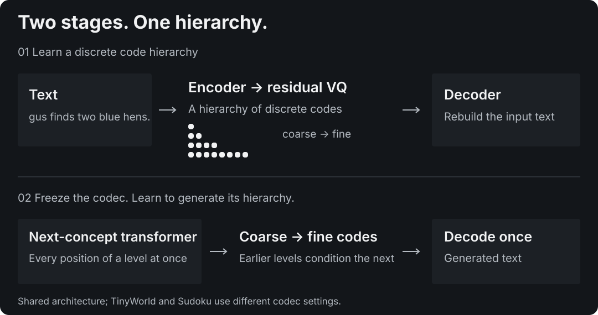

# Next-Concept Modeling in MLX

NCM-MLX independently implements **Next-Concept Modeling (NCM)**, the coarse-to-fine generative architecture introduced by [Kumbong et al.](https://arxiv.org/abs/2610.14162). A multiscale residual vector quantizer turns text into a hierarchy of discrete latent codes. The generator predicts each level in parallel, conditioning on the coarser levels. It generates a fixed-length text sequence in one forward pass per level, followed by a codec decode.

This is experimental research software for **TinyWorld synthetic text and Sudoku**, with training from scratch, autoregressive comparisons and synchronized evaluation. MLX execution has been verified on Apple Silicon with Metal and on Linux NVIDIA GPUs with CUDA. It is not an instruction-following or general-purpose chat model. Released upstream checkpoints are not compatible.

[Install and check your platform](platforms.md){ .primary-link }

<picture>
  <source media="(max-width: 600px)" srcset="assets/architecture-mobile-dark.svg">
  
</picture>

## Choose a starting point

| Your question | Reference |
|---|---|
| How does parallel coarse-to-fine generation work? | [Architecture](architecture.md) |
| How do I train, sample and evaluate? | [Training](training.md) |
| Which results are comparable? | [Benchmark methodology](benchmarks.md) |
| What can I reproduce, and with which data? | [Reproducibility](reproducibility.md) |
| What happens if a training job stops? | [Pause and recovery](RECOVERY.md) |
| How does this differ from other NCM implementations? | [Related work](related-work.md) and [upstream map](research/upstream-map.md) |
| What can an automated tool safely assume? | [Capabilities](capabilities.md) |

## Measured results, with limits

The best completed Sudoku experiment, E19-funded, solves **98.10% easy, 83.40% medium and 40.30% hard** on 2,000 published test boards per difficulty. Its 6.4M-parameter generator uses a separate codec. Original NCM (Kumbong et al.) reports 99.50 / 96.50 / 86.10% with a 25.46M generator and 51.2M presentations. The MLX implementation uses a 6.44M generator (3.95× smaller) and 16.384M presentations. Its easy score is within 1.40 points, while medium and hard remain substantially behind. The codec is additional to both generators. E20 repeats the same scientific recipe with another training seed and reports **97.25 / 79.60 / 33.25%** at equal exposure. Both outcomes must be retained; neither establishes equal-budget parity with the original paper. The [two-seed assessment](research/e20-seed-report.md) explains the 7.05-point hard-set spread, missing historical audit records and why the phase is a partial success.

E17's interrupted run was recovered for its remaining 2,000 updates and solves **71.25 / 31.75 / 3.70%**. The old checkpoint contained weights only; optimizer and random state reset. E18 later completed without a recovery reset and solves **84.25 / 49.10 / 10.55%**, below E15. The E19 pilot and funded run are also complete; the funded result uses twice E15's exposure. Full measurements and qualifications live in the [completed report](research/e19-funded-report.md) and [experiment record](EXPERIMENTS.md).

## Next research phase

Controlled text generation is the next main direction. The plan starts with a reproducible data/tokenizer contract, separate reconstruction and generation metrics, an autoregressive baseline and measurements on Apple Silicon. Sudoku remains a diagnostic track. These are research plans; natural-text quality and application usefulness are unvalidated. See the [roadmap](NEXT.md) for dependencies and acceptance criteria.

## Source, paper and citation

The [GitHub repository](https://github.com/janmus1c/ncm-mlx) contains the implementation, configs, tests and [working paper and downloadable editions](paper.md). The implementation is MIT licensed; [third-party provenance](https://github.com/janmus1c/ncm-mlx/blob/main/THIRD_PARTY.md) covers upstream references and downloaded evaluation data. Cite the original paper for the method and [CITATION.cff](https://github.com/janmus1c/ncm-mlx/blob/main/CITATION.cff) for this software.

[Release notes](releases.md) · [Subscribe to research updates](feed.xml) · [Current status](STATUS.md) · [Contributing](https://github.com/janmus1c/ncm-mlx/blob/main/CONTRIBUTING.md)
