# Released NCM checkpoints in MLX

`ncm_mlx/official/` runs the released checkpoints of the original Next-Concept Modeling work in MLX on Apple Silicon. It covers TinyStories (unconditional BPE text), the three Sudoku checkpoints (easy, medium, hard) and XSum summarization ([XSum summarization](#xsum-summarization)). The WMT14 release is supported at the codec level only, see [XSum and WMT14 codecs](#xsum-and-wmt14-codecs). It is an inference-only reimplementation, written from the upstream architecture and released configurations. It is separate from this repository's own training models and contains no upstream source code.

**Credit and license.** The checkpoints, configurations and reference PyTorch implementation are by HazyResearch: [checkpoints](https://huggingface.co/hazyresearch/ncm-checkpoints), [code](https://github.com/HazyResearch/ncm) and the paper [Kumbong et al., arXiv:2610.14162](https://arxiv.org/abs/2610.14162). They are MIT licensed, Copyright (c) 2025 Hermann Kumbong. Weights are downloaded from Hugging Face on demand and never redistributed here.

## At a glance

<picture>
  <source media="(max-width: 600px)" srcset="assets/tinystories-refinement-mobile-dark.svg">
  
</picture>

- **Same outputs as upstream PyTorch in the tested cases.** Greedy generation is identical on 8 TinyStories samples and all 2,000 easy Sudoku boards; per-level logits agree to floating-point rounding ([parity evidence](#parity-with-upstream-pytorch)).
- **Sudoku solve rates within 0.2 points of the paper:** 99.40 / 96.30 / 86.20% easy/medium/hard on all 2,000 published boards per difficulty, against 99.5 / 96.5 / 86.1% reported.
- **About 7× lower latency than upstream on the same Mac:** 39.8 ms on the GPU against 280 ms for upstream PyTorch on the CPU, for one 128-token TinyStories sample on an M5 Pro (p50, desktop load present). PyTorch's MPS backend rejects an interpolation these models need, so upstream was timed on the CPU.

NCM writes a whole level of the output in one model call, coarse to fine, instead of one token per call. The method is by Kumbong et al.; this is an independent implementation.

No install needed to look: the [refinement replay](https://huggingface.co/spaces/janmusic/NCM-Refinement-Replay) replays recorded outputs in the browser. Converted weights: [NCM-TinyStories-89M-Upstream-MLX](https://huggingface.co/janmusic/NCM-TinyStories-89M-Upstream-MLX), [NCM-Sudoku-25M-Upstream-MLX](https://huggingface.co/janmusic/NCM-Sudoku-25M-Upstream-MLX). [How the MLX port was verified](research/checkpoint-parity.md): conversion rules, tokenizer checks, numerical parity and measured performance.

## Commands

```bash
python -m ncm_mlx official fetch --task tinystories       # pinned revision, SHA-256 checked, into artifacts/official/
python -m ncm_mlx official convert --task tinystories     # .pt -> MLX safetensors + spec.json + bpe.json
python -m ncm_mlx official generate --task tinystories --n 2 --levels   # per-level refinement, Metal GPU

python -m ncm_mlx official fetch --task sudoku-easy
python -m ncm_mlx official convert --task sudoku-easy
bash scripts/fetch_upstream_sudoku.sh                     # published test boards
python -m ncm_mlx official sudoku --task sudoku-easy --n 200   # greedy; --n 0 for all 2,000
python -m ncm_mlx official bench --task sudoku-easy      # eager vs cached vs cached+compiled, batch 1 4 16 64
```

Tasks for `generate`, `sudoku` and `bench` are `tinystories`, `sudoku-easy`, `sudoku-medium` and `sudoku-hard`. Add `--cpu` to run on `mx.cpu`. `generate` and `sudoku` take `--no-prefix-cache` (reference path that recomputes the prefix in every level) and `--compile` (`mx.compile` of the per-level step). The prefix cache is on by default; compilation is opt-in. `generate` takes `--temperature`, `--top-k`, `--top-p`, `--seed` and `--level0 CODE`; the defaults follow the released config (temperature 1.0 for TinyStories, greedy for Sudoku).

Conversion does not need PyTorch. `.pt` files are read by `torch_reader`, which accepts only the four globals a tensor checkpoint uses and refuses all others. The BPE pickles are plain dicts and lists of bytes, read by an unpickler that refuses every global, and are converted once to JSON. Each upstream tensor name must match exactly one explicit rule: it either becomes an MLX parameter with a stated layout change or is dropped. Dropped names are the EMA training state and two derived buffers. The level ids and block-diagonal mask are first checked against the values the MLX model assumes. An unmatched name, missing parameter or shape mismatch stops the conversion.

## XSum and WMT14 codecs

The `wmt14` task converts and runs the tokenizer checkpoint (the codec) only: it has no generator, no source tokenizer and no decoding, so nothing there translates. The `xsum` codec is the same file that the summarizer below uses; `official codec` still runs it alone. The codec encodes token ids into per-level codes and decodes cumulative reconstructions back to ids.

```bash
python -m ncm_mlx official fetch --task xsum      # config.yaml and tokenizer.pt only, SHA-256 checked
python -m ncm_mlx official convert --task xsum    # codec.safetensors + spec.json; no PyTorch
python -m ncm_mlx official codec --task xsum --cpu --ids ids.json   # JSON list of rows of 48 ids (WMT14: 64)
```

| | XSum | WMT14 |
|---|---|---|
| Source tokenizer (ids come from it; not downloaded or converted here) | `openai-community/gpt2` @ `607a30d` | `Qwen/Qwen3-0.6B` @ `c1899de` |
| Input vocabulary / length | 50,304 / 48 | 151,680 / 64 |
| Levels | 9: 4, 6, 10, 14, 20, 26, 32, 40, 48 | 11: 1, 4, 8, 14, 20, 26, 32, 40, 48, 56, 64 |
| Level-0 strides | 4, 3 | 4, 4, 4 |
| `config.yaml` SHA-256 | `5dee6b73...` | `6401af2a...` |
| `tokenizer.pt` SHA-256 | `1f806ddaf8e0...` | `74f04176a3cd...` |

Checkpoint revision `d342ce8` as above. The only architectural difference from the TinyStories codec is that the level-0 resampling cascade has a parameter-free GroupNorm(8) between the strided convolutions and after the last down convolution (`learned_l1_cascade_norm` and `_final`; none after the last up convolution). The norms hold no tensors but occupy list slots, so convolution weights keep upstream's indices (`0, 2, ...`) and the existing conversion rules apply unchanged. The configs set `n_layers: 6`, which is the attention head count; they have no contextual encoder block and one decoder block. Conversion keeps the strict rules above: every upstream tensor needs exactly one rule, and a missing, extra or misshapen tensor stops it (tests cover each case, including a state laid out without the norms).

**Parity scope** (CPU, fp32, upstream PyTorch 2.15 at `c702742`, `scripts/official_codec_parity.py`). 12 fixed inputs per task (eight short texts including German and Unicode, random ids, high-vocabulary ids, all-padding, all-EOS), compared on every level:

| Check | XSum | WMT14 |
|---|---|---|
| Code disagreements, 12 fixed inputs (2,400 / 3,756 codes) | 0 | 0 |
| Decoder ids from upstream's codes at every level, same inputs | identical | identical |
| 16-input batch of the [ncm-modular](https://github.com/Red-fuchs/ncm-modular) protocol (12 texts, 4 random rows) | 0 | **1 code differs** (level 9) |
| 256 random-id rows | 0 differ; 1 decoded id differs | 0 differ; 1 decoded id differs |

The first two rows are stored in `tests/fixtures/official_codec_parity.json` and checked by `tests/test_official_codec.py` once the weights are converted (skipped otherwise). A CPU-only version of the same test needs no checkpoint: seeded narrow tensors with the real level geometry were loaded into upstream's `VQVAE` with `strict=True` and the resulting codes are stored; the MLX codec must reproduce them, and a codec without the norms must not.

**Open: the WMT14 level-9 code.** Red-fuchs reported one code differing from PyTorch at level 9 of WMT14, unchanged between fp32 and fp64, cause not investigated. Our 16-input rerun shows one such code (input 2, position 53: MLX 2703, upstream 1640). Under upstream's own residual the two candidates' squared distances differ by 3e-8 at a scale of 3,539, so this is a float32 tie that the two argmin implementations break differently. That is a measurement, not an explanation: we have not established which candidate is closer in exact arithmetic, why a tie arises, or whether it is the same code as the contributor's. A first private run of the same inputs with a different harness found no disagreement, so the outcome depends on details of the run. Decoded ids from upstream's codes still agree on those 16 inputs. Treat WMT14 codes as matching upstream except at float32 near-ties such as this one. The one decoded-id difference in each 256-row random run was not investigated.

**Limits.** No Metal run, no float64 run of the real checkpoints, and no evidence about summarization or translation quality. The inputs are few and mostly short.

**Credit.** The finding that these codecs need normalized level-0 resampling, and the pinned configuration facts above, come from [Red-fuchs/ncm-modular](https://github.com/Red-fuchs/ncm-modular) (MIT; reviewed at `eae154b`), discussed in [issue 3](https://github.com/janmus1c/ncm-mlx/issues/3). No code from that repository is copied; it was used as a cross-check. The checkpoints and reference implementation are by Kumbong et al. and HazyResearch as above.

## XSum summarization

`official summarize` runs the released XSum generator: the first 512 GPT-2 tokens of an article are the prefix, and the 48-token summary is generated level by level (4, 6, 10, 14, 20, 26, 32, 40, 48 tokens) in nine generator calls. The settings are those of the released `config.yaml`, restated in `ncm_mlx/official/spec.py` and checked against it by a test.

```bash
python -m ncm_mlx official fetch --task xsum          # checkpoints, GPT-2 vocabulary and merges, test set; SHA-256 checked (about 0.9 GB)
python -m ncm_mlx official convert --task xsum        # codec + generator + token unigram + gpt2.json; no PyTorch
python -m ncm_mlx official summarize --task xsum --input article.txt
python -m ncm_mlx official summarize --task xsum --n 200 --sample-seed 0 --out xsum.json   # test-set mode; ROUGE needs: uv sync --group xsum-eval
```

Pinned inputs: checkpoint revision `d342ce8` (`generator.pt` SHA-256 `f152f390...`), GPT-2 vocabulary and merges at `openai-community/gpt2` revision `607a30d`, and the test set (`passages.pickle`, `reference_summaries.pickle`, already GPT-2 token ids and reference strings) from `hazyresearch/ncm-datasets` revision `6580ba4`. Conversion uses the strict rules above: every tensor of `generator.pt` needs exactly one rule, the stored level ids and block-diagonal mask are checked against the configured levels, and the stored token unigram must be a distribution over the 50,304-token decoder vocabulary. A missing, extra or misshapen tensor stops it.

**What it does, following the released configuration and upstream's evaluation script:**

- **Prefix.** Article ids, no special tokens added, cut to 512 and padded with `<|pad|>` (id 50257). Padded positions are masked as keys. The prefix is embedded with the codec's token table and attends only to itself, so its keys and values are computed once per batch and reused by all nine level forwards.
- **Level 0.** Four learned queries, one forward pass of their own; there is no unigram sample and no level-0 prediction head.
- **Codes.** Temperature 1, top-k 1, top-p 0, which selects the highest-scoring code at every position. The command uses `argmax` for top-k 1.
- **Classifier-free guidance.** Off by default (`cfg_scale: 0.0`). `--cfg-scale s` doubles the batch with a null prefix (end-of-text, then padding) and mixes the two logits at level `k` of nine as `(1+t)·cond − t·null` with `t = s·k/8`.
- **Token readout.** The final reconstruction is decoded left to right, one token at a time, with a frequency penalty of 2.0 on tokens used more often than `token_unigram × 48` allows, a deficit bonus of 1.0, and an adjacency penalty of 5, 2.5, 1.25 and 0.625 on the previous four tokens. The summary is cut at the first end-of-text token. `--no-penalties` gives the plain argmax.
- **Text.** Decoded as the GPT-2 tokenizer does, without the optional space clean-up (`--clean-up` turns it on; ROUGE does not change at the printed precision).

**Parity scope** (CPU, upstream PyTorch 2.15 at `c702742`, transformers 5.22, `scripts/official_xsum_parity.py`). Eight fixed inputs: test articles 0 to 3 and four raw texts (one with 509 padding tokens, one of 700 tokens that is cut), compared with upstream:

| Check | Result |
|---|---|
| GPT-2 encoding, 11 cases (Unicode, newlines, special token) and 500 reference summaries | identical ids |
| GPT-2 decoding, 201 id rows | identical text |
| Free-running greedy codes, 9 levels, 8 inputs | identical at every level; upstream's `temperature 1, top-k 1, top-p 0` call equals its argmax |
| Per-level logits, teacher-forced, fp32 | max abs diff 6.7e-4 at logit scale up to 1,118 |
| Same, both sides in exact fp64 | 6.8e-13 |
| Decoder logits of the final reconstruction | 3.7e-4 at scale 41 |
| Penalized token readout and decoded summaries | identical on 8 of 8 (the penalties change the plain argmax in all 8) |
| Classifier-free guidance, scale 1.0 | identical codes at every level; the guided output differs from the unguided |
| Prefix cache against recomputing the prefix | 0 difference |

The reference readout and text cleanup are upstream's own `pick_tokens` and `dec` functions, executed from the checkout's `scripts/eval_shard.py` (parsed, not copied). Upstream's evaluation script needs CUDA, so its sampler is replaced by the model's own `generate` on CPU. `tests/test_official_summarize.py` replays four of these inputs from `tests/fixtures/official_xsum_parity.json` and skips without converted weights; the rest of the file runs without weights (spec against the pinned config, readout against a plain-Python restatement, guidance on a tiny model, strict conversion).

**ROUGE** (rouge-score 0.1.2 with stemming, F-measure, mean over articles, times 100; this is the metric and package family of upstream's `eval_merge.py`, which leaves the package unpinned). MLX on Metal, batch 16, seed 0. The paper's numbers are Table 2 in Section 4.3 of Kumbong et al., which Appendix F.2 says use the full test set and the XSum NCM generator in 8 NFE; our run makes nine generator calls per batch (the level-0 pass is one of them). The paper counts generator calls per output and two per guided step, so it presumably leaves out the level-0 pass; that is not confirmed.

| Articles | Setting | ROUGE-1 | ROUGE-2 | ROUGE-L |
|---|---|---:|---:|---:|
| 11,334 (full test set) | released defaults | **34.93** | **12.71** | **27.94** |
| Paper, Section 4.3, Table 2 | NCM, no guidance | 35.0 | 12.8 | 28.0 |
| 200, random sample (`default_rng(0)`, indices 30, 59, 92, ...) | released defaults | 34.51 | 12.72 | 27.55 |
| 200, first 200 | released defaults | 34.08 | 12.48 | 27.50 |
| 200, same sample | `--no-penalties` | 34.51 | 12.73 | 27.48 |
| 11,334 | `--cfg-scale 1.0` | 35.15 | 12.61 | 27.98 |
| 11,334 | `--cfg-scale 0.5` | 35.20 | 12.83 | 28.11 |
| Paper, Section 4.3, Table 2 | NCM + CFG (16 NFE) | 35.3 | 13.0 | 28.2 |

The 200-article rows are samples and carry a few tenths of a point of sampling noise (the two 200-article sets differ by 0.4 in ROUGE-1). The full-set row is within 0.1 of the paper for all three scores. The paper's guided row uses guidance weight 0.5 (Appendix F.4, Figure 14, where its ROUGE curves peak); our full-set run at 0.5 is within 0.2 of it on all three scores, and the run at 1.0 is lower on ROUGE-2 and ROUGE-L. The repetition penalties barely move ROUGE on this sample while changing the text of every parity input.

**Speed and memory** (Apple M5 Pro, 64 GB, MLX 0.32.4, Metal, 200 articles, includes prefix building and the readout, excludes ROUGE; the GPU was idle when the runs started and showed 87% after, from other applications on the machine):

| Mode | Articles per second | Peak MLX memory |
|---|---:|---:|
| batch 1 | 20.4 | 0.9 GB |
| batch 16 | 36.1 | 2.8 GB |
| batch 16, prefix recomputed in every level | 10.9 | 2.3 GB |
| batch 32 | 38.6 | 4.2 GB |
| batch 64 | 33.2 | 6.6 GB |
| batch 16, `--compile` (200 articles, includes tracing) | 28.1 | 5.7 GB |
| batch 16, full test set | 35.8 (317 s for 11,334) | 2.8 GB |

Nine generator forwards run per batch (6,381 for the full set). With a 512-token prefix the cache is a clear gain: 3.3 times at batch 16.

**Limits.** Only the released defaults (greedy codes) are checked against upstream; sampling at a temperature above 0 with larger top-k or top-p uses MLX's random numbers and cannot match upstream sample for sample. Minimum-Bayes-risk decoding from the paper is not implemented. Parity was run on CPU; the ROUGE rows were run on Metal, whose reduced-precision matmul can flip a near-tie. On the 200-article sample the CPU run gives the same summary as Metal for 181 articles (ROUGE 34.63 / 12.64 / 27.50 against 34.51 / 12.72 / 27.55) at 3.5 articles per second. The summaries are the model's own and often contain broken words and wrong facts (see the examples below); ROUGE overlap does not measure faithfulness. The GPT-2 pre-tokenizer inherits the whitespace caveat in [Limitations](#limitations). The decode follows `transformers` 5.x defaults; releases that clean up spaces by default would change the text slightly.

Examples, first three articles of the random sample, shown verbatim:

| Article | Model summary | Reference |
|---:|---|---|
| 30 | Britain's Jessica Ennis-Hill won herptptathlon for the second day running second in the Isisisyi final in Amsterdam. | Jessica Ennis-Hill has fallen from fourth to eighth place after six events at the Hypo-Meeting in Gotzis. |
| 59 | Manchester City midfielder Kevin de Bruyne is set to miss Wednesday's Champions semi-final- second leg against Everton in his 4-0 win over Everton. | Manchester City midfielder Kevin de Bruyne says he will be out for about 10 weeks after injuring his right knee during Wednesday's League Cup semi-final victory over Everton. |
| 92 | Stevenage striker Miuyura has signed a contract extension with the Japanese at the age of 34. | Japanese footballer Kazuyoshi Miura has signed a one-year contract extension with Yokohama FC at the age of 48. |

## What the port implements

Sudoku and TinyStories share one architecture:

- **Codec:** token plus position lookup, then GroupNorm(8) without affine parameters over channels and positions.
- **Level-0 resampling:** a cascade of learned strided convolutions each way.
- **Other levels:** area pooling down and linear interpolation up.
- **Phi:** a per-level blend, `(1-r)h + r Conv1d_k3(h)`.
- **Decoder:** one block.
- **Generator:** a prefix of raw-token embeddings (`raw_token_prefix`), a level embedding, RoPE that restarts per level, QK RMSNorm, LayerNorm eps 1e-6 and exact GELU. It runs one forward per level, in which the prefix attends only to itself.

The two task families differ in a few places:

- **Level 0:** TinyStories samples it from the stored unigram; Sudoku uses learned queries.
- **Heads:** TinyStories uses codebook-tied distance heads, `(2z·E - |E|²)/mean|E|² · exp(log_inv_T)`; Sudoku uses untied linear heads.
- **Sampling:** temperature, top-k and nucleus sampling follow upstream semantics; greedy is argmax.

## Parity with upstream PyTorch

`scripts/official_parity.py` runs upstream PyTorch 2.15 on CPU and the MLX port on `mx.cpu` in one process, with identical inputs. It routes teacher-forced codes through each implementation's own generation loop. Reports are in [`research/official-checkpoint-parity.json`](research/official-checkpoint-parity.json). Upstream code revision `c702742`, checkpoint revision `d342ce8`.

| Check | TinyStories | Sudoku-easy |
|---|---|---|
| BPE pre-tokenization, ids, round trip (13 cases) | identical | n/a |
| Codec embedding, max abs diff | 2.9e-6 | 1.4e-6 |
| Codec codes from real inputs | 97.45–100% per level (near-tie cascades, below) | 100% (64 boards) |
| Per-level logits, fp32, max abs diff | 0.10 at logit scale up to 853 (1.2e-4 relative) | **7.2e-5** at scale 29 |
| Same, both sides in exact fp64 | **3.2e-10** | **1.2e-13** |
| Greedy generation, codes and decoded text | identical, 8/8 samples | identical, 64/64 boards |
| Greedy, all 2,000 easy boards | | identical to upstream on 2,000/2,000, on Metal and CPU |

**Why the TinyStories fp32 difference exceeds 1e-4.** The fp64 row shows that the computation is the same function. In fp32, upstream PyTorch is itself 0.071 away from exact fp64, and MLX is 0.126 away. The model carries activations of magnitude about 435 in its residual stream, and the tied head subtracts large `|E|²` terms, so float32 rounding of about 3e-6 relative reaches about 1e-4 relative in the logits. Argmax agrees at every compared position.

**How the fp64 check works.** For that run only, numerics are made exact on both sides:

- Upstream's RMSNorm, tied-head norm buffers and RoPE tables, which it computes in float32 even for float64 inputs, are recomputed in float64.
- MLX's CPU `conv1d`, fused norms, fused attention, `exp` and `erf` round float64 inputs to about float32 accuracy, so the parity script swaps in composed exact operations. `exp` and `erf` are evaluated on the host.

The production float32 path is unchanged.

**Codec code disagreements are near-ties.** For each item, the first differing code is a near-tie: distance gaps of 4.5e-3 and 2.4e-4 at distances near 10. The changed residual then shifts later levels. `tests/test_official.py` checks this property: codes must be identical before the first divergence, and the two candidates must be within 1e-3 relative distance.

## Results

**Sudoku**, greedy, MLX on Metal, published test sets:

| Checkpoint | MLX, first 200 boards | MLX, all 2,000 | Upstream PyTorch CPU, all 2,000 (this machine) | Paper (Kumbong et al.) |
|---|---:|---:|---:|---:|
| easy | 99.0% (198/200) | **99.40%** (1,988) | 99.40% (1,988), the same boards | 99.5% |
| medium | | **96.30%** (1,926) | not run | 96.5% |
| hard | | **86.20%** (1,724) | not run | 86.1% |

The 200-board row is a sample. The 0.1-point gaps to the paper are not attributable to the port: on the easy set, upstream PyTorch on this machine produces exactly the same 2,000 outputs. The paper's figures come from its own CUDA evaluation.

**TinyStories.** `generate --levels` prints the decode of the cumulative reconstruction after each level, followed by the final text. Generative perplexity under GPT-2 large, the upstream metric, is not computed here.

## Benchmark

Apple M5 Pro, 64 GB, macOS 26.5, MLX 0.32.3, PyTorch 2.15.0 (6 CPU threads by default). Latency is synchronized through a host copy of the decoded tokens and includes all level forwards and the codec decode. MLX: 3 warmups and 20 iterations. PyTorch: 2 warmups and 10 iterations. These baseline rows are the reference path (`--no-prefix-cache`, uncompiled), measured before the prefix cache existed. TinyStories samples at temperature 1.0 and Sudoku is greedy.

| p50 / p95 ms | TinyStories b=1 | TinyStories b=16 | Sudoku b=1 | Sudoku b=16 |
|---|---:|---:|---:|---:|
| MLX, Metal GPU | 39.8 / 40.8 | 519 / 742 | 20.5 / 22.7 | 229 / 277 |
| Upstream PyTorch, CPU | 280 / 290 | 3,883 / 4,076 | 165 / 202 | 1,663 / 1,746 |

MLX on Metal is 7–8× faster than upstream on this machine's CPU. Upstream does not run on MPS: PyTorch 2.15 rejects area interpolation with non-divisible sizes on MPS. The GPU was shared with desktop applications at 0–33% utilisation around these runs, with brief higher readings, so treat the numbers as busy-desktop timings. See [EXPERIMENTS](EXPERIMENTS.md). At batch 16 a Sudoku level forward is compute-bound (2,880 tokens through the 25M-parameter generator), mostly because the 91-token prefix is recomputed at every level. The next section measures the prefix cache and compilation against this baseline.

## Prefix K/V cache and compiled step

Under the released attention contract the prefix attends only to itself and its RoPE positions restart at 0, so its hidden states do not depend on the level. `Generator.build_prefix_cache` runs the prefix tokens through every block once per `generate` call and keeps each layer's rotated K and V. Each level forward (`level_logits_cached`) then computes only its own rows and attends over `[cached prefix K/V, level K/V]` with the prefix padding mask. The cache is a local object of one call: it is never stored on the model, so repeated calls, other prefixes and permuted batches cannot read stale state. Cache construction draws no random numbers. The last block's prefix attention output and feed-forward are skipped because no level reads them. `--no-prefix-cache` keeps the original path, which recomputes the prefix inside every level forward.

`--compile` wraps three pieces in `mx.compile`: the level forward plus head (one trace per level and batch size), the "add level contribution and pool for the next level" step, and the final decode with argmax. Sampling stays eager, so random keys are unchanged. Wrappers are kept on the loaded model and reused, so the first call at each batch size pays tracing cost (reported as `first_call_ms`); they close over the loaded weights and must be dropped if weights are replaced.

**Invariant, adapted.** The test `test_generation_uses_one_generator_forward_per_level` now runs for both paths. Reference path: `level_logits` is called once per level, as before. Cached path: `level_logits_cached` is called once per level, `build_prefix_cache` once per generation (it runs only the prefix tokens and is not a level forward), and `level_logits` is not called. The teacher-forced training equivalence tests are unchanged.

**Exactness evidence** (`tests/test_official_prefix_cache.py`, `mx.cpu`):

- Random tiny configs, with no weights needed: with and without level-0 queries, tied and untied heads, with and without prefix padding; batch 1, 3, 8. Per-level logits of the cached path equal the reference within 2e-5 of the logit scale (observed differences come only from different matmul shapes), sampled codes and decoded tokens are identical, forced (teacher-forced) logits also agree, and cached prefix K/V equal the prefix rows of the full forward to 1e-6.
- Repeated calls, an interleaved different prefix and a permuted batch give identical outputs; cached sampling at temperature 0.7 with top-k matches the reference codes for four seeds; compiled equals eager-cached across batch-size changes.
- Real checkpoints, weight-gated: greedy TinyStories (8 samples) and Sudoku easy, medium and hard (first 64 published boards each) give identical codes and tokens in reference, cached and compiled modes, with per-level logits within 2e-5 relative.
- On Metal, greedy Sudoku-hard on the first 500 boards solves 426 with identical cell accuracy (98.34%) in all three modes. Metal matmul is reduced precision, so this is an outcome check rather than a bitwise one.

### Measured latency

Apple M5 Pro, MLX 0.32.3, Metal, synchronized through a host copy, 3 warmups and 20 iterations, `official bench` as above. Sudoku-easy is greedy and TinyStories samples at T=1.0. Rows are p50 / p95 ms.

**The GPU was not idle.** `ioreg` sampled `Device Utilization %` every 2 s during the runs: median 65%, 96% of samples at or above 50%, peak 100%, from desktop applications and local inference services. No training run was active (checked with the process list). Absolute numbers are therefore noisy; read the ratios between modes, which were measured back to back. A second Sudoku run for batch 16 and 64 (75% and 37% at its start and end) reproduced the first.

| Sudoku-easy | eager | cached | cached + compiled |
|---|---:|---:|---:|
| b=1 | 20.5 / 21.9 | 23.4 / 26.2 | 17.9 / 18.7 |
| b=4 | 36.4 / 37.7 | 28.9 / 31.5 | 23.2 / 24.1 |
| b=16 | 207.8 / 334.5 | 65.4 / 70.9 | 52.0 / 55.5 |
| b=64 | 1,238 / 1,718 | 648 / 837 | 458 / 510 |
| b=16, rerun | 199.7 / 237.3 | 63.8 / 68.1 | 57.1 / 64.9 |
| b=64, rerun | 1,179 / 1,627 | 392.5 / 416.0 | 435 / 488 |

| TinyStories | eager | cached | cached + compiled |
|---|---:|---:|---:|
| b=1 | 40.3 / 46.0 | 48.3 / 50.3 | 38.4 / 39.1 |
| b=4 | 62.1 / 63.6 | 72.9 / 83.7 | 58.7 / 60.1 |
| b=16 | 334.9 / 660.9 | 389.1 / 405.8 | 316.7 / 468.6 |
| b=64 | 1,636 / 1,749 | 1,706 / 1,894 | 1,572 / 1,734 |

Compile and warmup cost, separated from steady state: the first call at each batch size (including the trace) was 114 to 474 ms for Sudoku and 76 to 2,608 ms for TinyStories compiled, against 43 to 1,461 ms (Sudoku) and 79 to 1,170 ms (TinyStories) eager; the steady-state rows above exclude it.

Reading, with the contention caveat. For Sudoku (91-token prefix) the cache gives about 3.1x at b=16 and 1.9 to 3.0x at b=64; compilation adds roughly 10 to 20% at b=4 to 16 and is inconclusive at b=64 (458 vs 435 against 392 in the reruns). At b=1 the cached path was slower than eager (23.4 vs 20.5 ms): the extra prefix launches are not paid back by one sequence. For TinyStories the prefix is one token, so the cache saves almost nothing and its extra concatenations cost a little (all differences at or below the run-to-run noise at b>=16); only compilation helps there, by about 5%. The gains are for conditional, long-prefix tasks. Peak-memory and first-call numbers are in the raw JSON, which is not tracked.

## Limitations

- The port itself is inference-only. Training new models in the TinyStories architecture family is a separate, experimental recipe; see [text training](text-training.md). It does not fine-tune or reproduce the released weights.
- Not converted: LM1B and OpenWebText. WMT14 is converted at the codec level only; its generator, source tokenizer and decoding are not implemented. Upstream's experimental options outside the released configs, such as a context encoder, `predict_level0` and block-causal attention, are rejected by the pinned specs rather than supported.
- The pinned spec restates each `config.yaml`. The converter refuses a config whose SHA-256 differs, and a test compares the spec field by field with the downloaded YAML.
- The BPE pre-tokenizer reimplements upstream's `regex` pattern with `unicodedata`. It is verified on the parity cases, including Unicode, but rare whitespace classes such as `\x1c`–`\x1f` may differ.
- Metal fp32 matmul is reduced precision (see E-precision), so GPU outputs can differ from CPU at near-ties. On the 2,000 easy boards, Metal and CPU outputs were identical.
- Upstream's TinyStories generative-perplexity protocol is not reproduced, and sampled (non-greedy) outputs use MLX's RNG, so they do not match upstream sample for sample.

## Reproduce the parity check

```bash
# upstream checkout outside the repository, e.g. a download of HazyResearch/ncm at c702742
uv run --with torch --with omegaconf --with hydra-core --with regex \
    python scripts/official_parity.py --upstream /path/to/ncm --task tinystories
uv run --with torch --with omegaconf --with hydra-core --with regex \
    python scripts/official_torch_reference.py sudoku --upstream /path/to/ncm --task sudoku-easy --n 0
uv run --with torch --with omegaconf --with hydra-core --with regex \
    python scripts/official_codec_parity.py --upstream /path/to/ncm --task xsum    # or wmt14; add --inputs FILE for other rows
uv run --with torch --with omegaconf --with hydra-core --with regex --with transformers \\
    python scripts/official_xsum_parity.py --upstream /path/to/ncm    # XSum summarization; --fixture FILE rewrites the test fixture
uv run pytest -q tests/test_official.py tests/test_official_codec.py tests/test_official_summarize.py    # skips parity checks when converted weights are absent
```

PyTorch is used only in these ephemeral runs. It is not a dependency of `ncm_mlx`.
