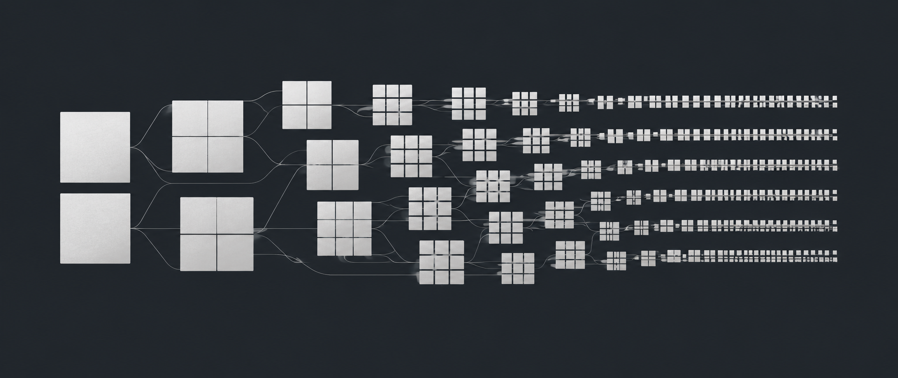

# Running released Next-Concept Modeling checkpoints on Apple Silicon

By [Jan Music](https://orcid.org/0009-0001-5376-7913)



*AI-generated cover illustration. It does not represent experimental data or model reasoning.*

You can run HazyResearch's released Next-Concept Modeling checkpoints on the Apple Silicon GPU without installing PyTorch. [NCM-MLX 0.2.0](https://pypi.org/project/ncm-mlx/0.2.0/) supports unconditional TinyStories generation and the released easy, medium and hard Sudoku models. The project provides converted weights separately on Hugging Face, an independent MLX inference implementation and recorded comparisons with upstream PyTorch. Model weights are not included in the Python package.

The research method and trained checkpoints are by [Kumbong et al.](https://huggingface.co/papers/2610.14162). NCM-MLX independently implements their inference computation; the original training results have not been reproduced here.

## Try a released checkpoint

In a Python 3.12 environment on Apple Silicon:

```bash
python -m pip install "ncm-mlx==0.2.0" huggingface-hub
hf download janmusic/ncm-tinystories-mlx \
  --revision be91c549d5336dd64a476ace9c27589a6f21a7fc \
  --local-dir ncm-tinystories-mlx
python -m ncm_mlx official generate --task tinystories \
  --weights ncm-tinystories-mlx --n 2 --levels
```

The [model card](https://huggingface.co/janmusic/ncm-tinystories-mlx) documents the downloaded files and their provenance. The model stores approximately 500 MB of float32 weights, plus tokenizer and metadata. It uses its own inference path; it is not a Transformers `AutoModelForCausalLM` or an `mlx_lm` checkpoint.

`--levels` decodes the accumulated latent representation after each level. TinyStories uses a 12-level hierarchy: level 0 is drawn from a stored unigram distribution, then 11 generator forwards predict the remaining levels in parallel. Output is bounded to 128 BPE token positions. This checkpoint generates unconditionally from a start prefix; it does not accept instructions or continue a user prompt.

For a preview without installation, the [browser demo](https://huggingface.co/spaces/janmusic/ncm-refinement-demo) replays recorded refinement traces. It is a static replay of actual outputs, not live inference. Intermediate text can be incoherent: it shows partial reconstruction, not the model's reasoning.

## Converting the checkpoints

The upstream release contains PyTorch checkpoints and pickled tokenizer data. The [converter](https://github.com/janmus1c/ncm-mlx/blob/v0.2.0/ncm_mlx/official/convert.py) pins checkpoint revision `d342ce8aaea58830eef3b8ad473664673e41f692` and checks source-file SHA-256 digests before parsing. An alternative to downloading the converted weights is:

```bash
python -m ncm_mlx official fetch --task tinystories
python -m ncm_mlx official convert --task tinystories
python -m ncm_mlx official generate --task tinystories --n 2
```

A small [tensor reader](https://github.com/janmus1c/ncm-mlx/blob/v0.2.0/ncm_mlx/official/torch_reader.py) reads the zip container, tensor-storage buffers and reconstruction metadata without importing PyTorch. Its restricted unpickler permits supported storage types, tensor reconstruction and an ordered dictionary, and rejects unrecognized pickle globals. The separate BPE reader refuses every global. This is a deliberately narrow reader for pinned files, not a general replacement for arbitrary checkpoint loading.

Each source tensor must match exactly one conversion rule. The rule either maps it to an expected MLX parameter, transforms its layout, or explicitly identifies state that inference does not read. Ordinary convolution weights change from `[out, in, kernel]` to `[out, kernel, in]`; learned strided resampling weights use their own transpose-and-reshape rules. A shape-compatible but wrongly ordered tensor could otherwise produce plausible-looking failures.

The converter checks missing and unexpected parameters and rejects shape mismatches. It also checks the stored level IDs and attention mask before dropping those derived buffers; EMA training state is omitted. The output is safetensors plus an architecture specification, tokenizer JSON and, for TinyStories, the level-0 distribution. This is a file-format and layout conversion, not quantization or additional training.

## Checking tokenization

TinyStories uses the released 8,192-token byte-pair tokenizer. Replacing it with another tokenizer of similar vocabulary size would change every subsequent input. The independent [BPE implementation](https://github.com/janmus1c/ncm-mlx/blob/v0.2.0/ncm_mlx/official/bpe.py) reproduces pre-tokenization, byte handling, merges and special tokens.

Thirteen retained parity cases, including Unicode, have identical pre-tokenization, token IDs and round trips. The checks do not exhaust Unicode inputs; rare whitespace classes remain a documented limitation.

## Comparing outputs and logits

The [parity report](https://github.com/janmus1c/ncm-mlx/blob/v0.2.0/docs/research/official-checkpoint-parity.json) compares upstream code revision `c70274273f489abc73832b2b98584a8483b6b203` with the MLX port on CPU, using identical inputs. It separates codec behavior, per-level generator logits and completed greedy outputs.

| Check | TinyStories | Sudoku-easy |
|---|---:|---:|
| Largest compared fp32 logit difference | 0.100 | 0.0000725 |
| Composed exact-fp64 logit difference | approximately 3.22e-10 | approximately 1.18e-13 |
| Greedy fixture outputs identical | 8/8 | 64/64 |

TinyStories logits reach magnitudes around 853. Its tied distance head subtracts large squared-codebook terms, amplifying small upstream rounding differences. Upstream PyTorch's own fp32 result differs from the exact-fp64 reference by about 0.071. An absolute `1e-4` threshold alone would therefore give a misleading diagnosis.

The float64 row is a diagnostic computation. Upstream norms and positional tables that otherwise round internally are recomputed in float64. On the MLX side, composed operations replace primitives that do not preserve full float64 accuracy in this test, with selected functions evaluated on the host. Production inference remains float32. This supports agreement of the tested computations; it does not establish production bitwise identity.

TinyStories codec code agreement is 97.4–100% per level on four input texts. Each first divergence is a near-tie in quantizer distance; changing that code changes later residuals. In the separate generation check, eight greedy fixtures have identical codes and text.

The broader Sudoku evaluation provides another check: MLX solves 1,988, 1,926 and 1,724 of 2,000 published easy, medium and hard boards, respectively. Upstream PyTorch CPU and MLX produce identical outputs on all 2,000 easy boards. The full medium/hard sets were not also rerun in upstream PyTorch. These are results of the released upstream-trained models, not NCM-MLX's smaller independently trained generators.

## Measuring latency

On an Apple M5 Pro with 64 GB memory, the recorded eager TinyStories batch-one median is 39.8 ms on Metal versus 280 ms for upstream PyTorch on CPU. Both complete a 128-position sample, including decoder work and a host copy. MLX uses three warmups and twenty timed iterations; PyTorch uses two warmups and ten iterations. Desktop GPU activity was present. The [methodology](https://janmus1c.github.io/ncm-mlx/official-checkpoints/) records hardware, precision and contention.

This compares a working GPU port with a CPU reference, not two equally optimized accelerator implementations. The tested PyTorch MPS path rejects required non-divisible area interpolation. The timing demonstrates a useful execution option on that Mac; it does not measure an architecture-only speedup or promise another Mac's latency.

Later repository work adds prefix caching and opt-in compilation; these options are not part of the pinned 0.2.0 installation above. Under the released attention contract, prefix tokens attend only to themselves and their positions restart consistently. Their per-layer keys and values can be computed once per generation call. The cache belongs to that call, so different requests cannot reuse stale prefix state.

For Sudoku's 91-token prefix, recorded batch-16 caching improves median latency from 207.8 to 65.4 ms in one busy-desktop comparison. At batch one, caching alone is slower: 23.4 versus 20.5 ms. TinyStories has only a one-token prefix, leaving little reusable work. Compilation is opt-in and incurs first-call tracing costs.

## Using the port

The released port provides a reference for trying NCM, examining refinement and investigating inference changes on Apple Silicon. The conversion rules and parity fixtures make those changes easier to check against the released computation.

Separate, preliminary TinyStories training experiments investigate smaller independently trained models. They do not inherit the released checkpoints' quality, and their ongoing comparisons are not a new capability claim here. Neither track establishes general-purpose chat or instruction following.

The [source and reproduction instructions](https://github.com/janmus1c/ncm-mlx) and [converted-model collection](https://huggingface.co/collections/janmusic/next-concept-modeling-in-mlx-6ae3b295f2ed5265df0906bf) provide the next steps. Cite the original paper for NCM and the [versioned software record](https://doi.org/10.5281/zenodo.23781234) for this implementation. Both codebases use MIT licensing; the converted models retain the upstream license and attribution.

*AI assistance disclosure: OpenAI Codex assisted with implementation, experiment analysis and drafting. It is not an author; this assistance does not constitute independent verification or human review.*
