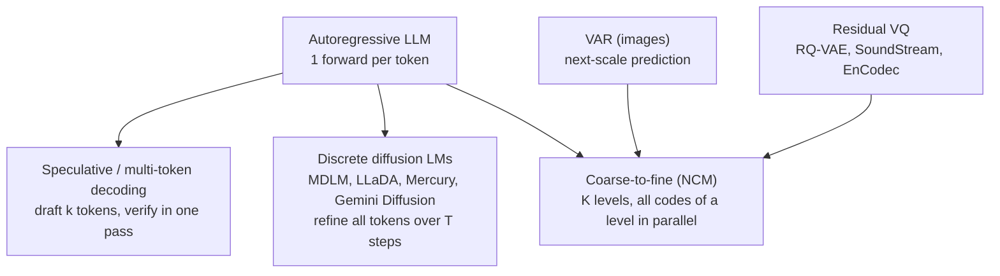

# Landscape and use cases

Where coarse-to-fine generation sits among faster-decoding approaches, and where it could plausibly be useful on a Mac. Every external claim links to its source. Labels: **paper claims** (reported by authors, not reproduced here), **measured here** (see `docs/EXPERIMENTS.md`), **hypothesis** (untested).

## 1. The family of "don't decode one token at a time" methods

| Approach | Forwards per sample | What runs in parallel | Relation to NCM |
|---|---|---|---|
| Autoregressive | one per token | nothing within a sample | the baseline everyone compares against |
| Speculative decoding | one per *accepted chunk* (plus a cheap drafter) | verification of a drafted chunk | orthogonal: NCM could in principle *be* a drafter (hypothesis) |
| Diffusion LMs | T denoising steps, each over the whole sequence | every position at every step | NCM's direct competitor in the paper; NCM's levels are short at the coarse end, diffusion steps are always full length |
| VAR (images) | one per scale | all tokens of a scale | NCM is VAR's next-scale idea moved from 2-D images to 1-D text ([VAR, Tian et al. 2024](https://arxiv.org/pdf/2404.02905)) |
| NCM | one per level (6 here, 12 upstream) | all codes of a level | — |

**VAR.** Images are quantised into multi-scale residual token maps (1×1, 2×2, …) and generated scale by scale, each scale in parallel ([arXiv:2404.02905](https://arxiv.org/pdf/2404.02905)). NCM's multiscale residual VQ is the 1-D analogue, including interpolation between scales and residual quantisation (see `upstream-map.md`).

**Diffusion LMs.** Commercial diffusion LMs report >1,000 tokens/s on H100-class GPUs, for example Mercury Coder Mini at ~1,109 tokens/s ([Inception](https://inceptionlabs.ai/news)) and Seed Diffusion Preview at 2,146 tokens/s on H20 ([Seed Diffusion](https://huggingface.co/papers/2508.02193)). Those are datacenter GPU numbers for multi-billion-parameter models and are not comparable to anything measured here.

## 2. What the NCM paper reports (paper claims)

From the [paper](https://arxiv.org/abs/2610.14162):

- LM1B: better generative perplexity than the strongest diffusion LM at matched size, 21× faster. OpenWebText: competitive, 10× faster. XSum: matching ROUGE-L, 31× faster. All timings on a single H100 SXM, batch 16, 1,024-token sequences; generators of about 88–120M parameters.
- Sudoku (Table 3), share of completely solved boards; difficulty set by the number of givens (40 easy, 35 medium, 30 hard), following S-FLM:

| Method | Size | NFE | Easy | Medium | Hard |
|---|---|---|---|---|---|
| AR, sampling | 25M | 128 | 13.9 | 5.1 | 0.6 |
| AR, greedy | 25M | 128 | 14.6 | 5.1 | 1.0 |
| MDLM | 29M | 128 | 92.0 | 77.1 | 30.2 |
| DUO | 29M | 128 | 96.3 | 84.7 | 58.4 |
| FLM | 29M | 128 | 94.2 | 82.7 | 44.5 |
| S-FLM | 29M | 128 | 94.8 | 85.2 | 45.0 |
| FMLM+ | 29M | 16 | 97.7 | 92.8 | 81.3 |
| **NCM** | 25M | **12** | **99.5** | **96.5** | **86.1** |

The paper does not state the Sudoku training-set size or training steps in the part read so far. Its test boards are public ([hazyresearch/ncm-datasets](https://huggingface.co/datasets/hazyresearch/ncm-datasets), MIT); this repo evaluates on them (`ncm_mlx/text/upstream_sudoku.py`).

**Measured here** on the same boards (E4, E5 in `docs/EXPERIMENTS.md`): a 6.3M same-size AR model gets 13.8 / 3.0 / 0.4%, close to the paper's AR row. This repo's 6.4M NCM gets 0% at every difficulty so far. Qwen3.8 27B (4-bit, local, reasoning off) also gets 0 / 50 at every difficulty, with blank-cell accuracy at chance. With reasoning on (up to 6,000 tokens per board) it had not finished 10 boards after about 95 minutes, while sharing the GPU with training, and the run was stopped. Exact constraint satisfaction is not something a general chat model does well without long reasoning, which is the gap a small specialised model could fill.

The striking number is the AR row: a left-to-right model solves only ~14% of easy boards, because it must commit to early cells before it "knows" the constraints later in the grid. Coarse-to-fine and diffusion models see the whole board at every step.

## 3. The Apple Silicon angle

- Autoregressive decoding of large models on Apple Silicon is **memory-bandwidth bound**: each token re-reads all the weights, so tokens/s ≈ bandwidth ÷ bytes per token ([BaseRT, 2026](https://arxiv.org/pdf/2607.00501); [Starmorph guide](https://blog.starmorph.com/blog/apple-silicon-llm-inference-optimization-guide)). A dense 27B 4-bit model reaches single-digit to ~20 tokens/s on M-series laptops ([example](https://medium.com/@vinoth.lingam333/i-got-18-tok-s-from-a-27b-model-on-a-macbook-mlx-native-mtp-speculative-decoding-on-apple-5e1211a06d0c)). Measured here: Qwen3.8-27B 4-bit via oMLX generated ~7 tokens/s while this repo's training shared the GPU.
- Fewer, wider forwards trade bandwidth for compute: one pass reads the weights once for many positions. That is why parallel decoding helps most at **small batch** sizes on a Mac, and why the advantage shrinks as batches grow and the hardware becomes compute bound. **Measured here** on TinyWorld: 4–5× lower latency than an equal-size AR model at batch ≤16, 1.3× at batch 256.
- Dispatch overhead matters at small model sizes: 32 small forwards cost far more than their FLOPs. `mx.compile` may narrow the gap (untested; `docs/NEXT.md`).
- Metal fp32 matmuls are reduced precision (**measured here**, ~1e-3 relative), which matters for exactness tests but not for sampling quality.

## 4. Use cases

The shape that suits NCM: **short or fixed-length output, global constraints, many outputs, low latency**. Almost every useful case needs conditioning on an input, which the generator supports since the Sudoku task (token prefix).

### Short term: small models (5–50M parameters), trained on this laptop in hours

| Use case | Why NCM fits | What must be true | Success measure | Main risk |
|---|---|---|---|---|
| **Constraint puzzles and grids** (Sudoku, timetables, seat plans, crossword fills) | Global structure decided at coarse levels; the paper's strongest result | The codec can represent valid grids compactly | Exact solve rate vs equal-size AR | Synthetic data does not match real-world constraint distributions |
| **Synthetic test data** (records, addresses, log lines with a fixed schema) | Fixed length, huge batches, cheap to train per schema | Schemas are short and stable | Schema-validator pass rate, duplicate rate, coverage | A template engine or Faker may already be good enough |
| **Log-line synthesis for classifier training** | Short, patterned, high volume; conditioned on a class label | Enough real examples per class to train on | A downstream classifier labels the synthetic lines as intended | Lines look plausible but miss real-world variety |
| **Fixed-format short strings** (slugs, SKU names, headline variants, commit subjects) | Many candidates in one batch at ~5 ms | A checker or ranker exists for the output | Format check plus human or LLM-judge acceptance | Small model quality on open vocabulary |
| **Structured field filling** (fixed-key JSON from a short input) | All fields in one level pass | Inputs and outputs are short | Field-level exact match | An AR model with constrained decoding may be just as fast at this size |

### Long term: larger models or the released checkpoints (hypotheses until measured)

| Use case | Why NCM might fit | Evidence today | Main risk |
|---|---|---|---|
| **One-line summaries** (reports, threads, PRs) | Fixed short output; paper matches diffusion-LM ROUGE-L on XSum | Paper claim vs diffusion LMs only | Quality vs an equal-size AR summariser unknown |
| **Short translation** (UI strings) | Paper reports WMT14 de→en | Paper claim | Same |
| **Bulk offline generation on the Mac** | Throughput at large batch already ≥ AR here | Measured at toy scale only | Gap shrinks with batch size and model size |
| **Drafter for a large LLM** (speculative decoding) | One NCM pass drafts a whole span | None; speculative | Acceptance rate may be too low to pay off |
| **Latency-critical UI text** (type-ahead, suggestions) | 5 ms vs 20–30 ms at batch 1, measured at toy scale | Toy only | Needs real-text quality first |

## 5. Open questions

1. Does the codec hierarchy carry *meaning* at coarse levels on real text, or only spelling-level structure? (Per-level decodes on TinyStories would show it.)
2. How does quality vs an equal-size AR model change with scale? The toy result (AR more accurate, NCM faster) may flip or widen.
3. Is the small-batch speed advantage mostly dispatch overhead that `mx.compile` would remove from the AR baseline?
4. Can one generator serve several difficulty levels or tasks, or does each need its own model, as the released Sudoku checkpoints suggest?
5. Is the released checkpoint format portable to MLX with exact parity (milestone M4)?

## 6. Direction for this project (2026-10-23)

**Where NCM fits and where it does not.** It suits short outputs with a fixed shape and constraints across the whole output, generated fast and in bulk. It does not replace chat or coding models (large local models do that better) or single-label classifiers (a classifier head is simpler, faster and more accurate for one label).

**Hardware roles.** The Apple Silicon laptop is where NCM runs: its latency advantage is largest at batch 1–16. RTX 3080 and A40 GPUs provide additional training capacity.

**Candidate uses, most promising first (hypotheses until measured):**

1. Constraint-satisfying proposals such as booking or scheduling assignments: many complete candidates per batch, filtered by an existing rule checker. Sudoku is the evidence for this.
2. Synthetic data with a fixed schema: form inputs for front-end comparison, backend test fixtures, extra rows for log-classifier training.
3. Multi-field decisions whose fields must agree, as a structured tier next to single-label classifiers, judged by the same benchmark gates.
4. Short text at volume (commit subjects, ticket titles, notification text), once real-text quality is shown.
5. Drafting spans for a large local model (speculative decoding); acceptance rate unknown.

**Phases.** (1) Reproduce Sudoku with scaling curves, publish the paper and the repository: upstream released no training code, so a working cross-platform training recipe is a contribution in itself. (2) Real text on the laptop against an equal-size AR model, then a domain corpus. (3) A small OpenAI-compatible local endpoint for structured short outputs, plus a kit that trains a schema-specific model in about an hour on the 3080. (4) The research bets in uses 1 and 5 if phases 1 and 2 hold up.
