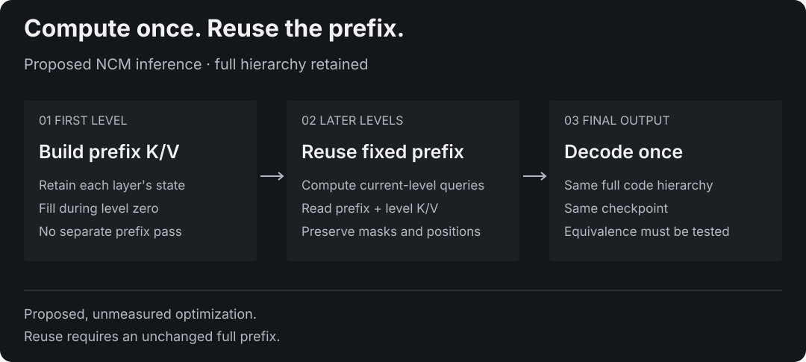
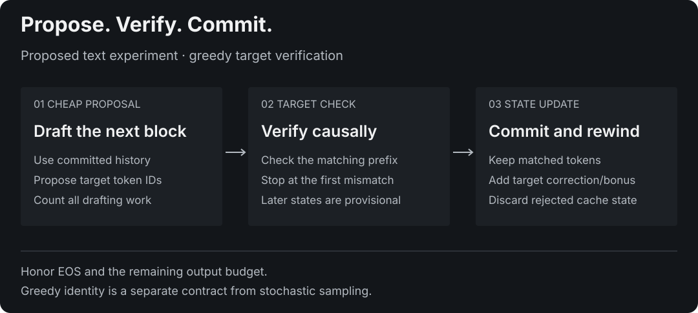

# Prefix caching and speculative drafting

This review examines two ways to reduce inference cost: reusing computation for unchanged conditioning, and verifying inexpensive proposals with an autoregressive target. It connects primary literature to the current MLX implementation and proposes falsifiable experiments. It reports **no new model training, accelerator benchmark or text capability**. The near-term recommendation is generation-local prefix caching; an NCM text drafter is a separate, later research track.

**Reading guide:** start with the decision table, then the cache argument or drafting analysis. The [experiment protocol](inference-experiment-protocol.md) defines implementation gates and the next training decision. The [source ledger](inference-sources.json) records versions, reading scope and claim provenance. The [analytic artifact](inference-analysis.json) contains reproducible operation counts and finite probability checks.

## Scope and evidence

The literature search was checked on 2026-10-27. It covers foundational speculative sampling, cache allocation/reuse, drafter alignment, feature-conditioned and parallel drafting, and selected recent preprints. Core methods and relevant proof/implementation sections were inspected; some related-work entries were screened at abstract level, as recorded in the ledger. This is a targeted technical review, not an exhaustive systematic survey. Reported results from different papers are not a common benchmark, and no external speedup is adopted as a forecast for this repository.

Repository-specific arguments refer to source snapshot [`c2b7319`](https://github.com/janmus1c/ncm-mlx/tree/c2b731963c7a9b10dad4209ec70cfa1ebd21f5d4): [`generator.py`](https://github.com/janmus1c/ncm-mlx/blob/c2b731963c7a9b10dad4209ec70cfa1ebd21f5d4/ncm_mlx/models/generator.py), [`blocks.py`](https://github.com/janmus1c/ncm-mlx/blob/c2b731963c7a9b10dad4209ec70cfa1ebd21f5d4/ncm_mlx/models/blocks.py), [`sampler.py`](https://github.com/janmus1c/ncm-mlx/blob/c2b731963c7a9b10dad4209ec70cfa1ebd21f5d4/ncm_mlx/generation/sampler.py) and the [E20 configuration](../../configs/sudoku-e20-seed1.json). Proposed optimizations remain unimplemented. [STATUS](../STATUS.md) remains the capability authority; the [roadmap](../NEXT.md) remains the priority authority.

| Direction | What changes | Training required? | Recommendation |
|---|---|---|---|
| Prefix K/V reuse across NCM levels | Inference execution of unchanged conditioning | No, if equivalent | First implementation study |
| Shared-prefix cache across requests | Serving state and cache identity | Usually no for supported causal models; NCM has an additional bidirectionality constraint | Defer until generation-local reuse is measured |
| Prompt-lookup speculative proposals | Proposals from existing target-token history | No | First verifier baseline for a future text integration |
| NCM drafts verified by an AR target | A second model, tokenization contract and verification loop | Likely drafter alignment training, after a text baseline | Exploratory, with a cost gate before training |
| Target-feature-conditioned drafting | Drafter architecture and target integration | Yes | Later ablation, not an inference-only switch |
| Fixed concept levels / verified Sudoku exit | Sampling policy and repeated decoding | Potentially no for an initial study | Separate quality/latency study; no AR-distribution guarantee |

## Three different meanings of caching

An autoregressive decoder can retain previous tokens' keys and values because causal attention prevents a later token from changing their hidden states. A serving system can reuse those states across requests sharing the same causal prefix. An NCM generator can potentially reuse the states of its **fixed conditioning prefix across concept levels**. These are related mechanisms with different validity conditions.

Shazeer's multi-query attention work emphasizes the bandwidth cost of reading K/V state. PagedAttention addresses allocation, duplication and sharing; SGLang's RadixAttention organizes reuse across calls. Those results motivate attention to memory, but neither paging nor a radix tree proves that an arbitrary NCM state is reusable. [S02](https://arxiv.org/abs/1911.02150v1), [S03](https://arxiv.org/abs/2309.06180v1), [S04](https://arxiv.org/abs/2312.07104v2)

### Why the current NCM prefix can be invariant

In this implementation, prefix queries can read the prefix only. Queries in concept level `k` can read that prefix and their own level under `block_diagonal` attention. The prefix input contains no level embedding and its rotary positions remain unchanged across levels. The transformer uses per-position LayerNorm and feed-forward layers; there is no normalization across the combined sequence.

In deterministic evaluation mode, let `H_prefix[j]` be the prefix hidden state entering transformer layer `j`. Its update depends only on the same prefix state and model weights. By induction over layers, it is independent of the current concept level and its generated codes. Therefore each layer's normalized, rotary-transformed prefix keys and projected values can be computed once and reused. This is a dependency argument from the inspected code, not a measured caching result.

<picture>
  <source media="(max-width: 600px)" srcset="../assets/prefix-cache-proposal-mobile-dark.svg">
  
</picture>

A proposed execution is:

1. During the first concept-level forward, compute prefix and level-zero states together and retain prefix K/V at every transformer layer.
2. For later levels, compute queries, keys and values for the current level only. Its queries attend to the retained prefix K/V concatenated with current-level K/V.
3. Discard the generation-local cache at completion. Keep code sampling, residual reconstruction and the final decoder unchanged.

This preserves one generator forward per executed level. Building a separate prefix stack pass would be additional computation and must be counted; it must not be hidden behind a claim of fewer forwards. Filling the cache inside the first level avoids that additional pass.

Cache **per-layer K/V**, not just the final prefix embedding. Retain keys at a clearly specified normalization/rotary stage and values at the matching layer input. Per-level rotary positions restart at zero: ordinary monotonically growing AR position offsets would change the computation.

### What cannot be reused automatically

Current-level states depend on the cumulative latent reconstruction, the level embedding and the level's attention neighborhood. They are not a reusable append-only token history. Keeping them when moving to a finer level changes the model.

The experimental `block_causal` path allows earlier concept levels to be visible. Prefix-only independence still holds, but a cache of earlier-level states needs a separate position/mask contract and tests. An initial implementation should support one attention policy explicitly and reject unsupported combinations.

Cross-request partial-prefix reuse is more restrictive. The NCM prefix attends **bidirectionally within the entire prefix**. If two puzzles share their first 80 cells but differ at cell 81, earlier prefix hidden states can change through attention. A causal LLM's radix-prefix rule therefore cannot be transferred directly. Reusing the complete identical prefix is a different case, provided weights, positions, masks and precision settings also match. A future text extension that appends new conditioning tokens must re-examine this dependency.

Training-time caching is outside this proposal: dropout and changing weights invalidate a persistent inference cache, and detaching cached tensors can change gradients. The current teacher-forced path already processes its shared prefix once while predicting all levels. The proposed optimization targets repeated inference work, not a new training objective.

### Analytic opportunity in the existing Sudoku configuration

Let `P` be prefix length, `K` the number of levels, and `l[k]` the number of positions at level `k`. For the default block-diagonal execution:

```text
Repeated-prefix positions per layer = K*P + sum(l[k])
Prefix-once positions per layer      = P + sum(l[k])
Positions removed                   = (K - 1)*P
```

The E20 recipe has `P=81`, `K=12` and `sum(l[k])=314`. The proposed accounting reduces position-wise transformer work from **1,286 to 395 positions per layer**, removing 891 repeated prefix positions. These counts concern operations whose work is proportional to processed positions, such as projections and feed-forward layers. They are not a latency ratio.

Counting only mask-allowed query/key pairs gives:

```text
Repeated: sum(P*P + l[k]*P + l[k]*l[k])
Cached:   P*P + sum(l[k]*P + l[k]*l[k])
```

This changes the logical count from **120,392 to 48,221 pairs per head per layer**. A masked kernel may perform work on disallowed pairs too; actual kernel shapes, launch overhead and fusion determine physical work. Cache reads and concatenation also cost time. Both formulas are recomputed in [inference-analysis.json](inference-analysis.json).

For full multi-head attention, a retained K/V payload is:

```text
bytes = 2 * layers * batch * prefix_length * KV_heads * head_dim * bytes_per_value
```

With eight layers, width 256 and fp32 values, the logical prefix payload is **1,327,104 bytes per sample**, or 1.265625 MiB. At batch 64 it is 81 MiB. This excludes weights, allocation capacity, masks and temporary tensors; it does not estimate total peak memory or its change relative to the existing path. Multi-query/grouped-query attention can reduce K/V dimensions, but changes the architecture and checkpoints rather than supplying a transparent cache patch. [S02](https://arxiv.org/abs/1911.02150v1)

For contrast, the [TinyWorld quickstart](../../configs/toy-grammar-12k.json) has a one-token prefix across six levels: the same position count changes only from 69 to 64 per layer. That small opportunity and the Sudoku count require separate measurements; neither establishes how a future text model will behave. The analytic artifact binds both calculations to config hashes.

### Correctness and numerical boundaries

Cache validity requires identical complete conditioning, model parameters, attention policy, position convention, dtype and execution mode. A generation-local object avoids persistent invalidation complexity. Mutating weights or changing conditioning must not leave old states reachable by another generation.

Algebraic equivalence does not imply bitwise equality after changing matrix shapes or kernel selection. Existing CPU training/per-level exactness tests must remain unchanged; a cached path needs additional exact CPU checks. Accelerator comparisons require a declared tolerance and identical generated token/code checks where deterministic behavior is claimed. Near-tie logits can change an argmax despite small numeric differences.

MLX 0.32.3's official Metal source gates eligible float32 NAX paths on the TF32 setting. Record precision settings in any comparison; changing them is a separate intervention. Disabling reduced precision is neither a proven quality fix nor a free speed improvement. [S18](https://github.com/ml-explore/mlx/blob/v0.32.3/mlx/backend/metal/matmul.cpp)

## Speculative drafting: what the target guarantees

Speculative decoding treats a cheap model or lookup procedure as a proposal generator. An autoregressive target evaluates a proposed continuation in parallel with a causal mask. Accepted history remains sequential: target computations after a rejected draft position cannot be committed as if that draft were real context. The foundational algorithms establish distribution-preserving correction under specified proposal probabilities and arithmetic assumptions. [S05](https://arxiv.org/abs/2211.17192v2), [S06](https://arxiv.org/abs/2302.01318v1)

### Greedy verification

Greedy block proposal and longest-prefix validation predate stochastic speculative sampling. [S20](https://arxiv.org/abs/1811.03115v1)

<picture>
  <source media="(max-width: 600px)" srcset="../assets/greedy-drafting-proposal-mobile-dark.svg">
  
</picture>

For a greedy target, let a drafter offer `m` target-vocabulary tokens. Verify the longest prefix for which each draft token equals the target argmax given the already matched prefix. At the first mismatch, emit the target's correction and discard later proposals. If all match, a target bonus token can be emitted when the remaining output budget permits.

For example, if a draft is `A B X D` and target predictions along that path first disagree at `X`, only `A B` and the target's replacement may become output. A prediction at `D` was conditioned on `X`; it is not verified under the corrected history.

This gives the same greedy sequence as the defined target reference only when tokenization, masks, cache offsets, logits processing, tie-breaking and relevant numerics agree. It guarantees target consistency, not factual correctness. It also does not certify a Sudoku solution.

### Stochastic verification is a separate contract

Write `p` for the target distribution and `q` for the actual proposal distribution at the same history. Standard speculative sampling draws `y` from `q`, then accepts with:

```text
a(y) = min(1, p(y)/q(y))
```

On rejection, sample from the normalized positive residual `max(p-q, 0)`. After accepting the entire proposed block, sample a bonus token from the target. Support, normalization and the definition of the proposal must match the algorithm. Target sampling transforms—temperature, top-k/top-p or repetition rules—belong to the defined target distribution; proposal transforms belong to `q`. [S05](https://arxiv.org/abs/2211.17192v2), [S06](https://arxiv.org/abs/2302.01318v1)

The accepted mass at token `x` is `min(p(x),q(x))`. Residual correction supplies exactly the missing target mass. Thus single-step acceptance is `1 - TV(p,q)`, where `TV` is half the L1 distance. This also explains why token distribution alignment matters. Equality of two independently sampled tokens is a different coupling, generally with different acceptance efficiency. Same-distribution output does not mean the same sampled string for a fixed random seed.

The accompanying analysis script checks four exact rational fixtures, including zero support, deterministic proposals and equal distributions. These are finite mathematical checks; they do not validate an MLX sampler or prove floating-point implementation correctness.

### Cache and tokenizer contracts

A verifier must define which token is already in the cache. Two valid designs are: prefill all but the final input token and process that token with the draft, or prefill everything and retain the final logits for the first decision. Mixing the conventions duplicates or omits context.

After a rejection, retain only cache entries corresponding to real committed history. In a design where the newest correction/bonus token is not cached yet, preserve that convention into the next round. Rewind target and drafter state separately; their processed lengths may differ. Test EOS inside an accepted block, empty proposals, cancellation, output limits and unsupported cache types.

The inspected official MLX-LM source, pinned at [`f39c4aa`](https://github.com/ml-explore/mlx-lm/blob/f39c4aa2af5d61a5e85bd50cc3f4294fedaff116/mlx_lm/generate.py), keeps one input token outside prefill and requires trimmable target caches. Its inspected verification path compares sampled token identities; it should not be described as an implementation of the optimal `p/q` residual algorithm merely because it accepts a sampler argument. This is source inspection, not an integration test. MLX-LM is not a dependency of the current project. [S19](https://github.com/ml-explore/mlx-lm/blob/f39c4aa2af5d61a5e85bd50cc3f4294fedaff116/mlx_lm/models/cache.py)

Drafting directly in target token IDs simplifies verification. Decode/re-encode bridges need boundary stability checks and explicit special-token handling. Matching text fragments do not necessarily have matching token IDs when joined to a prefix. For an initial experiment, a shared tokenizer is preferable to an unverified probability conversion between vocabularies.

### Why acceptance alone is insufficient

Let `A` be the number of consecutively accepted draft tokens in a round, `C` its committed output count, and `T_round` the complete drafting, verification, synchronization and state-management time. Away from EOS/output limits, `C=A+1`. A long-run cost estimate is:

```text
speculative seconds/token ≈ E[T_round] / E[C]
ordinary seconds/token   = measured ordinary decode cost
```

A proposal is useful only when complete cost per committed token falls. A large acceptance fraction can coexist with slow drafts, expensive tree verification or cache copies. A small model that is cheap but unrelated to the target can spend nearly all its time being rejected. Both failure modes matter.

Under the deliberately simplified assumption of an independent identical acceptance probability `alpha` at each position:

```text
E[C] = 1 + alpha + alpha^2 + ... + alpha^m
```

At `alpha=0.5` and `m=4`, this is 1.9375, not `1 + m*alpha = 3`. Only a consecutive prefix counts. Real acceptance is history-dependent and correlated; use empirical survival curves `Pr(A >= j)` and actual round timings instead of fitting this assumption by default. The idealized analysis has antecedents in [S05](https://arxiv.org/abs/2211.17192v2); the numerical example is an arithmetic illustration, not a performance prediction.

## What the literature suggests to test

| Family | Relevant finding | Boundary for this project |
|---|---|---|
| Prompt lookup | Propose continuations from repeated token history without a learned assistant. Official Transformers documentation describes this baseline. [S17](https://huggingface.co/docs/transformers/assisted_decoding) | Test on extractive/repetitive tasks and on non-copying controls; usefulness depends on the workload |
| Independent draft model | Draft cheaply, then verify with the unchanged AR target. [S05](https://arxiv.org/abs/2211.17192v2), [S06](https://arxiv.org/abs/2302.01318v1) | Requires target agreement and complete cost accounting, not just standalone draft quality |
| Alignment distillation | DistillSpec studies on-policy draft data and task-dependent divergence objectives. [S07](https://arxiv.org/abs/2310.08461v2) | Do not assume one-hot teacher outputs or one divergence is universally best |
| Tree proposals / extra heads | SpecInfer explores tree verification; Medusa adds multiple prediction heads and distinguishes frozen-backbone from joint training. [S08](https://arxiv.org/abs/2305.09781v4), [S09](https://arxiv.org/abs/2401.10774v3) | Wider proposal coverage costs verification and cache management; these are not drop-in NCM heads |
| Feature-conditioned drafts | EAGLE predicts features; EAGLE-3 moves to direct token prediction with multi-layer target features and revised training. [S10](https://arxiv.org/abs/2401.15077v3), [S11](https://arxiv.org/abs/2503.01840v3) | Requires target internals and architecture-specific training; more coupling than a text-only drafter |
| Depth-based self-speculation | LayerSkip trains intermediate transformer layers to support early output and verification by deeper computation. [S12](https://arxiv.org/abs/2404.16710v4) | Transformer depth is different from NCM concept depth; its training recipe does not validate concept-level exit |
| Block diffusion | Block Diffusion combines block-level autoregression and within-block parallel refinement with caching. [S13](https://arxiv.org/abs/2503.09573v3) | Shows why attention/dependency structure matters; arbitrary changing non-causal states remain non-cacheable |
| Parallel feature-conditioned drafting | DFlash uses a lightweight block-diffusion drafter with target-context K/V injection and anchor-based training. [S14](https://arxiv.org/abs/2602.06036v2) | Supports studying parallel proposals plus target alignment; a latent hierarchy is not the same architecture |
| Cross-round information reuse | DFlow studies rejected-suffix verifier representations as hints for later proposals. [S15](https://arxiv.org/abs/2609.06498v1) | Recent preprint. Such hints must stay separate from committed target-cache history |
| Relaxed acceptance | A recent speculative-diffusion study varies refinement effort and acceptance leniency jointly. [S16](https://arxiv.org/abs/2610.31819v1) | Recent preprint. Lenient acceptance changes the fidelity claim and belongs to a separately labeled approximate policy |

The strongest actionable theme is **alignment per unit cost**. Parallelism changes draft latency; it does not remove the need to predict a continuation the target will accept. Recent feature-conditioned methods also suggest that an assistant need not solve the whole language task independently. Their reported speedups depend on target, hardware, workload and execution policy and are not reproduced here.

## Can an NCM become a useful drafter?

The original NCM method generates a latent hierarchy and decodes token positions from the resulting reconstruction. Its latent-code probabilities and its text probabilities are different objects. In particular, a selected latent path's code likelihood is not the normalized next-token proposal distribution required by a text verifier. The paper's appendix explicitly distinguishes the latent joint, text marginal and variational bound. [S01](https://arxiv.org/abs/2610.14162v1)

### A staged design rather than a capability claim

Start with an evaluated prefix-conditioned text codec/generator and an explicit target vocabulary. A proposed drafter should receive the accepted text history on every round and propose the **next block**, rather than repeatedly emitting a standalone document summary. Hold the target, tokenizer, output policy and evaluation workload fixed.

A greedy prototype can use any deterministic candidate sequence and rely on exact target verification. It needs neither a claim of tractable NCM text likelihood nor a distribution-conversion approximation. Its success criterion is lower measured cost with identical target output.

For stochastic operation, specify the actual proposal process before implementing acceptance. Possibilities include a normalized target-vocabulary decoder distribution or an explicitly deterministic point-mass proposal. A point mass is mathematically valid but may have poor acceptance: its acceptance probability under the standard rule is simply the target probability of that proposed token. This is not the same as greedy acceptance.

### Latent conditioning: a possible probability contract

A latent marginal can be difficult to compute without making exact speculation impossible in principle. As a conditional application of the standard rejection identity, consider this restricted candidate design:

1. At the start of a round, draw a latent hierarchy `z` using only committed history and recorded drafter randomness.
2. Given `z`, define known normalized token proposals `q_z[j]` in the target vocabulary. Sample them independently within the block, or use another explicitly known sequential proposal.
3. Verify with the corresponding conditional proposal probabilities and standard correction, keeping `z` fixed for that round.

If the conditional verifier yields target distribution `p` for every fixed `z`, averaging over the latent draw still yields `p`. This avoids substituting a latent-code likelihood for a token probability. It does not automatically apply to an existing argmax decoder, tokenization bridge, frequency/adjacency penalty or search procedure; each changes the proposal contract.

The [analysis script](../../scripts/analyze_inference_research.py) enumerates a two-token, two-latent fixture with rational probabilities and confirms this conditional mixture identity. It is not a new general theorem or proof of a working NCM speculative sampler. A full design must specify causal target context, support, latent/proposal randomness, rejection behavior, EOS and any decoder sampling dependencies before making an exactness claim. This is an application of [S05](https://arxiv.org/abs/2211.17192v2) and [S06](https://arxiv.org/abs/2302.01318v1) to a candidate latent interface.

### Training implications

Prefix caching does not require a new training run. A text baseline and a target-aligned drafter do. Keep their objectives and budgets separate:

- **Standalone NCM:** codec reconstruction, latent-code prediction, free-running text quality and local inference cost.
- **Greedy drafter:** consecutive target-token agreement on histories encountered during decoding, with measured proposal cost.
- **Stochastic drafter:** normalized proposal probabilities and target-distribution alignment under the actual sampling settings.

DistillSpec provides motivation to study on-policy histories rather than only teacher-forced answers; it also reports that divergence choice depends on task/decoding. EAGLE-3 and DFlash motivate later feature-conditioning comparisons. These are reasons for controlled ablations, not permission to assume an accuracy or speed gain. [S07](https://arxiv.org/abs/2310.08461v2), [S11](https://arxiv.org/abs/2503.01840v3), [S14](https://arxiv.org/abs/2602.06036v2)

For the next training allocation, first establish a reproducible text data/tokenizer contract and codec reconstruction report. Preserve document-level splits and a held-out acceptance workload. Then compare a token-history-conditioned drafter with a small conventional assistant or lookup baseline before adding target-feature projections. Account for teacher generation, feature storage, codec training and all failed ablations. No result here justifies scaling the drafter before measuring acceptance and its break-even cost.

## What this means for Sudoku and the next decision

Sudoku has an exact structural checker: a candidate must satisfy row, column and box constraints and preserve all input clues. A partial hierarchy can therefore be decoded and checked without consulting a reference solution. That is the basis of a proposed verified-exit policy. It changes which outputs are selected and may change quality relative to full-depth generation; it does **not** preserve an autoregressive language model's distribution.

Repeated decoding, checker transfers and batch compaction can erase any saved generator work. Prefix caching and early exit should first be measured separately. Text has no comparable universal correctness checker; confidence, repeated output or an unchanged partial decode is not an equivalent acceptance rule.

The recommended order is:

1. Implement and validate generation-local prefix caching with the existing checkpoint and full hierarchy; no retraining.
2. Measure its complete quality, latency and memory against the uncached path, independently of compilation and early exit.
3. Establish a controlled-text NCM and AR baseline under the canonical roadmap's data/evaluation gates.
4. Build a greedy verifier with no-draft, oracle, deliberately wrong and prompt-lookup proposals before spending on learned drafting.
5. Train a bounded history-conditioned drafter only if measured cost permits a useful accepted-prefix length. Explore target features or stochastic sampling after that baseline passes.

The [protocol](inference-experiment-protocol.md) makes those gates concrete. A negative cache speed result or unsuccessful drafter is publishable evidence when the contract, timing and failures are retained. No implementation or model quality claim changes until those measurements exist.

## Reproduce the analytic checks

```bash
python scripts/analyze_inference_research.py --check
```

This uses Python's standard library, exact rational arithmetic and the committed E20 config. It checks the saved analytic artifact without importing MLX, downloading data or using an accelerator. It verifies arithmetic and finite examples, not runtime equivalence, distribution preservation of deployed code, training outcomes or performance.

The [source ledger](inference-sources.json) lists all 20 cited primary papers/documentation/source records with explicit reading scope. Recent preprints are labeled above. The review does not claim scientific novelty for caching, speculative verification, distillation or parallel drafting, and does not rank implementations by unmatched published speedups.

## References

Paper links identify the inspected arXiv version. The source ledger records the actual reading scope; a reference is not a claim that its entire implementation or experimental result was reproduced.

- **S01** Kumbong et al. [Next-Concept Modeling: Fast, Parallel Coarse-to-Fine Text Generation](https://arxiv.org/abs/2610.14162v1) (2610.14162v1).
- **S02** Shazeer. [Fast Transformer Decoding: One Write-Head is All You Need](https://arxiv.org/abs/1911.02150v1) (1911.02150v1).
- **S03** Kwon et al. [Efficient Memory Management for Large Language Model Serving with PagedAttention](https://arxiv.org/abs/2309.06180v1) (2309.06180v1).
- **S04** Zheng et al. [SGLang: Efficient Execution of Structured Language Model Programs](https://arxiv.org/abs/2312.07104v2) (2312.07104v2).
- **S05** Leviathan, Kalman and Matias. [Fast Inference from Transformers via Speculative Decoding](https://arxiv.org/abs/2211.17192v2) (2211.17192v2).
- **S06** Chen et al. [Accelerating Large Language Model Decoding with Speculative Sampling](https://arxiv.org/abs/2302.01318v1) (2302.01318v1).
- **S07** Zhou et al. [DistillSpec: Improving Speculative Decoding via Knowledge Distillation](https://arxiv.org/abs/2310.08461v2) (2310.08461v2).
- **S08** Miao et al. [SpecInfer: Accelerating Generative Large Language Model Serving with Tree-based Speculative Inference and Verification](https://arxiv.org/abs/2305.09781v4) (2305.09781v4).
- **S09** Cai et al. [Medusa: Simple LLM Inference Acceleration Framework with Multiple Decoding Heads](https://arxiv.org/abs/2401.10774v3) (2401.10774v3).
- **S10** Li et al. [EAGLE: Speculative Sampling Requires Rethinking Feature Uncertainty](https://arxiv.org/abs/2401.15077v3) (2401.15077v3).
- **S11** Li et al. [EAGLE-3: Scaling up Inference Acceleration of Large Language Models via Training-Time Test](https://arxiv.org/abs/2503.01840v3) (2503.01840v3).
- **S12** Elhoushi et al. [LayerSkip: Enabling Early Exit Inference and Self-Speculative Decoding](https://arxiv.org/abs/2404.16710v4) (2404.16710v4).
- **S13** Arriola et al. [Block Diffusion: Interpolating Between Autoregressive and Diffusion Language Models](https://arxiv.org/abs/2503.09573v3) (2503.09573v3).
- **S14** Chen, Liang and Liu. [DFlash: Block Diffusion for Flash Speculative Decoding](https://arxiv.org/abs/2602.06036v2) (2602.06036v2).
- **S15** Zhang et al. [DFlow: Enabling Verifier Information Flow in Block Diffusion Speculative Decoding](https://arxiv.org/abs/2609.06498v1) (2609.06498v1).
- **S16** Zorel et al. [Speculative Diffusion is a Tale of Two Tradeoffs](https://arxiv.org/abs/2610.31819v1) (2610.31819v1).
- **S17** [Transformers assisted decoding documentation](https://huggingface.co/docs/transformers/assisted_decoding) (checked 2026-10-27).
- **S18** [MLX Metal matmul dispatch](https://github.com/ml-explore/mlx/blob/v0.32.3/mlx/backend/metal/matmul.cpp) (v0.32.3).
- **S19** [MLX-LM speculative generation and cache helpers](https://github.com/ml-explore/mlx-lm/blob/f39c4aa2af5d61a5e85bd50cc3f4294fedaff116/mlx_lm/generate.py) (f39c4aa).
- **S20** Stern, Shazeer and Uszkoreit. [Blockwise Parallel Decoding for Deep Autoregressive Models](https://arxiv.org/abs/1811.03115v1) (1811.03115v1).
