# Upstream NCM map

What the reference implementation does, where, and what `ncm-mlx` takes from it. Sources are upstream file paths at the commit read on 2026-10-22. No upstream code is copied into this repository; every module here is a fresh implementation of the concepts below.

## 1. Pipeline

```mermaid
flowchart LR
    T["text"] --> PT["pre-tokenizer<br/>BPE 8192 / Sudoku 12"]
    PT --> E["Encoder<br/>wte + wpe lookup<br/>(enc_layers=0)"]
    E --> N["GroupNorm, affine=False"]
    N --> Q["Multiscale residual VQ<br/>levels 1 … L, EMA codebooks"]
    Q -->|codes per level| G["Next-concept transformer<br/>block-diagonal attention"]
    G -->|sampled codes| Q2["codes → z_hat"]
    Q2 --> D["Decoder<br/>1 transformer block + linear"]
    D --> O["tokens → text"]
```

Stage 1 trains encoder, quantizer and decoder together as a VQ-VAE. Stage 2 freezes it and trains the generator on its codes.

## 2. Components and source locations

| Component | Upstream location | Behaviour |
|---|---|---|
| Multiscale residual VQ | `models/quant.py` `MultiscaleResidualVectorQuantizer.forward` | For each level `k`: area-downsample the residual to `l_k`, nearest code by squared distance, linear-upsample to `L`, apply `Phi_k`, add to `z_hat`, subtract from residual. |
| Codebook learning | same, `self.training` branch | EMA of assignment counts and summed inputs, Laplace smoothing with `epsilon`; codebooks have `requires_grad=False`. Optional dead-code restart (`restart_threshold`, default 0). |
| `Phi` (quant_resi) | `models/quant.py` `Phi`, `_build_quant_resi` | `(1-r)·h + r·Conv1d_k3(h)`, `r = 0.5`, one per level (`share_mode=0`) selected by `level/(K-1)`. |
| VQ loss | `forward` | per level: `β·mse(sg(z_hat), z) + mse(z_hat, sg(z))`, averaged over levels; final `z_hat = z + sg(z_hat - z)` (straight-through). |
| Fine-level dropout | `forward`, `aux.fine_drop` | With prob 0.5, the decoder receives cumulative `z_hat` truncated at a random level ≥ `min_keep`. |
| Learned level-0 resampling | `_make_cascaded_down_l1/up_l1` | Released configs replace area/linear at level 0 with strided convs initialised to average/repeat, and use a straight-through estimator at level 0 only. |
| Encoder | `models/vae.py` `Encoder` | Released configs: token + position embedding only (`enc_layers=0`), optional compression conv. |
| Decoder | `models/vae.py` `Decoder` | One `Block` (`dec_layers=1`), LayerNorm, linear to vocab; no positional embedding by default. |
| Generator input | `quant.py` `idx_to_ncm_input` | For level `k+1`: cumulative `z_hat` after levels `0..k`, area-pooled to `l_{k+1}`. |
| Generator | `models/next_concept.py` `NextConceptTransformer` | Prefix (`prefix_len` tokens) + all target levels in one sequence; `wte` linear from codec dim; level embedding `wle`; RoPE with positions restarting per level; QK RMSNorm; one head per level, optionally tied to the codebook as a distance head. |
| Attention mask | same, `attn_pattern` | `block_diagonal` (default): prefix sees prefix; level `k` sees prefix and level `k`. `block_causal` lets level `k` also see coarser levels. |
| Level 0 | same, `generate` | Three options: `query_level0` learned queries (Sudoku), `predict_level0` from prefix positions, or a stored level-0 unigram (`generation.level0_unigram`, TinyStories/OWT/LM1B). |
| Generation | same, `generate` | One forward of the stack per level over `prefix + l_k` positions; optional prefix KV cache; temperature, top-k, top-p; optional CFG for conditional tasks. |

Released checkpoint shapes (from `config/eval/*.yaml`): TinyStories uses BPE-8192, `L=128`, 12 levels `1, 8, 16, …, 128` with 4096 codes each, codec `embed_dim=384`, generator 12 × 768. Sudoku uses 12 levels `1, 2, 4, …, 89` with 16 codes each and an 8 × 512 generator.

## 3. What ncm-mlx adopts, modifies or replaces

| Idea | Status here | Notes |
|---|---|---|
| Two-stage codec → generator | **Adopted** | `ncm_mlx/latent`, `ncm_mlx/models`, `ncm_mlx/training`. |
| Multiscale residual VQ with area down / linear up | **Adopted** | Resampling is precomputed as matrices (`latent/resample.py`); tests pin PyTorch's `area` and `linear, align_corners=False` semantics. |
| EMA codebooks, smoothing, commitment + fit loss | **Adopted** | EMA is applied after the optimiser step from statistics returned by the forward, because MLX transforms are functional. Upstream updates codebook `k` before looking up level `k` in the same pass; here all levels use the pre-update codebooks. |
| `Phi` blend conv, ratio 0.5, non-shared | **Adopted** | |
| Fine-level dropout | **Adopted** | prob 0.5, `min_keep=1`. |
| Dead-code restart | **Modified** | Enabled by default (`restart_threshold=0.05`); upstream default is off. The toy corpus is small enough that collapse is a real risk. |
| Learned strided level-0 resampling + STE | **Not implemented** | Uses area/linear at every level. |
| Encoder | **Modified** | 2 bidirectional transformer blocks instead of a lookup-only encoder, so coarse levels can carry sentence-level information. |
| Pre-quant norm | **Modified** | Per-position LayerNorm without affine (upstream's `pre_quant_norm_type: layer` option) instead of GroupNorm(8). |
| Decoder | **Modified** | 2 blocks and a learned positional embedding. |
| Pre-tokenizer | **Replaced** | Fixed-length characters (`text/tokenizer.py`) instead of BPE. |
| Block-diagonal generator, per-level RoPE, level embedding, QK-norm | **Adopted** | Equivalence of per-level inference and full teacher-forced training is tested. |
| Level 0 | **Adopted (`query_level0`)** | |
| Untied per-level heads | **Adopted** | Codebook-tied distance heads not implemented yet. |
| Prefix conditioning, CFG, top-p, KV cache | **Postponed** | Unconditional generation only; there is no prompt in v0. |

## 4. Checkpoint compatibility

None. Released checkpoints are PyTorch `.pt` files built for BPE tokenizers, lookup-only encoders, GroupNorm, learned level-0 resampling and (for text tasks) codebook-tied heads. This codec differs in all of these, so even the tensors with matching roles have different shapes or semantics. An importer is only meaningful for a separate `reference-compatible` variant that reimplements the released configuration exactly; that is milestone M4 and has not started.

## 5. Limitations and open hypotheses

- The paper's speedups (21× on LM1B, 10× OWT, 31× XSum) are against diffusion language models on GPU hardware. They say nothing about autoregressive models on Apple Silicon, and this project makes no such claim until it measures one.
- With a per-character final level, the codec can reconstruct perfectly from the finest level alone; whether the coarse levels carry useful global structure is an empirical question answered by the per-level decode metrics, not assumed.
- Parallel sampling within a level samples positions independently given the level input. Agreement errors in generated text are the expected failure mode and are measured.
- Unproven here: that the hierarchy scales to open-domain text on a laptop budget; that tied codebook heads or learned level-0 resampling help at this size.

## 6. License and citation

Upstream is MIT licensed, © 2025 Hermann Kumbong. This repository contains no upstream source; it cites the work:

> Hermann Kumbong, Ishan S. Khare, Iddah Mlauzi, Andrew Woen, Charles Ding, E. Kelly Buchanan, Simran Arora, Azalia Mirhoseini, Christopher Ré. *Next-Concept Modeling: Fast, Parallel Coarse-to-Fine Text Generation.* arXiv:2610.14162, 2026.

## Training recipe (paper, Appendix C, D.3, F)

From the arXiv HTML of 2610.14162, read 2026-10-23. The released repository has evaluation code and configs only; these numbers exist only in the paper.

| Sudoku | Tokenizer (Table 5) | Generator (Table 6) | This repo, E6 |
|---|---|---|---|
| Parameters | 14.90M | 25.46M | 3.3M codec, 6.4M generator |
| Updates | 10,000 | 50,000 | 3,000 codec, 4,000 generator |
| Global batch | 1,024 | 1,024 | 128 |
| Peak learning rate (floor) | 5e-4 (5e-5) | 3e-4 (3e-5) | 2e-4 codec, 6e-4 generator |
| Warmup | 500 | 1,000 | 100 |
| AdamW β₁, β₂ / weight decay | 0.9, 0.99 / 0.01 | β₂ 0.99 / 0.01 | 0.9, 0.999 / 0.01 |
| Other | EMA decay 0.99, target length 89, 12 levels × 16 codes, width 256, 1 decoder block | 8 × 512, 8 heads, prefix 91 | |

The generator budget is 50,000 × 1,024 ≈ 51M training sequences; this repo's E6 used 0.5M, about 1%.

- **Conditioning corruption** (Section 3.4, Appendix F.3): during generator training, a fraction of the *conditioning* codes (the coarser levels the generator reads) is replaced by other codes from the same level's codebook. Labels stay the ground-truth codes. The replacement probability decreases linearly across levels. Moderate corruption "greatly improved generation quality"; too much hurt. The exact probabilities are not stated in the text read.
- **Minimum Bayes risk decoding** (Section 4.5, Appendix F.4): generate K candidates and keep the one most similar on average to the others. K = 12 for Sudoku in the appendix ablation. Table 3 lists 12 NFE for NCM, which matches one candidate with 12 levels, so the headline Sudoku numbers appear to be single-sample.
- **Number of levels** (F.1): K ∈ {4, 8, 16, 32} tested on text; generative perplexity improves with more levels, with diminishing returns beyond 16.
- Sudoku training data follows S-FLM; its size is not given in the paper.
- **Loss weighting** (Appendix F.2.3): $w_k \propto l_k^{-\alpha}$. $\alpha = 0$ weights every code equally (this repo's choice: CE weighted by level length); $\alpha = 1$ weights every level equally. On TinyStories, raising $\alpha$ from 0 to 1.5 moves the coarse levels' share of the loss from 19% to 63%, with results stable for $\alpha \le 1$.
- **Corruption, more detail** (F.3): codes are replaced uniformly from the same level's codebook at a per-level rate that decreases linearly; the authors note that "corruption based on the model's actual errors may better match inference conditions". That variant is not in the paper.

## Related implementations (GitHub, 2026-10-23)

| Repository | What it is | Useful for this repo |
|---|---|---|
| [HazyResearch/ncm](https://github.com/HazyResearch/ncm) | Official model and evaluation code, released checkpoints; no training loops | Configs, quantiser details |
| [Bakhaow/ncm-forge](https://github.com/Bakhaow/ncm-forge) | PyTorch training loops around the upstream modules, a fill-in-the-middle variant, RTX 4070 benchmarks; no trained model | Corruption as a flat rate (0.1 by default), level weights $l_k^{-\alpha}$ with $\alpha = 0$, measured cost of the full recipe on one consumer GPU (about 180 h) |
| [kavai-no/ncm-forge](https://github.com/kavai-no/ncm-forge) | A small speculative-decoding drafter for Qwen "inspired by" NCM; no codebooks | Shows the drafter idea from `landscape-and-use-cases.md` in practice; not NCM itself |
| [yoonalexander/Concept-Firewall](https://github.com/yoonalexander/Concept-Firewall) | Probes whether NCM's intermediate levels can be used to filter content | Interpretability of coarse levels |

No MLX implementation of NCM other than this one was found.
